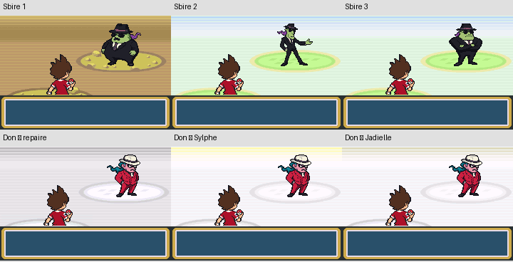

# Mafiamille — bilan final de la transformation graphique

Branche **`feature/mafiamille-kanto`**, base
`6f143452a026a41c08f1db38f9809959809a31b6`. Code livré au jalon
`1fa39994b`, finalisation graphique au jalon `2389580d4`. Références
artistiques conservées : `ddcb53b10` et `cee38fa5f`. Aucun merge. [Autorisation](../../docs/mafiamille/MANDAT.md).

**La transformation graphique demandée est terminée et testée.** Les huit
marches de Don et du sbire sont définitivement validées par le créateur,
sans aucune retouche. Le chapeau approuvé remplace les R du Casino et du
repaire. L’entrepôt ne porte plus aucun emblème : son mur a été reconstitué.
Les quatre ressources identifiées ne contiennent plus leur ancien R.

[Rapport de clôture graphique et captures mGBA avant/après](finalisation/README.md).
Cette clôture ne constitue pas une certification d’une traversée complète
ni de l’équilibrage de l’aventure.

## Ce qui est réellement intégré

- 69 acteurs de l’histoire : 65 sbires, le recruteur du Pont Pépite et les trois
  apparitions de Giovanni. Les identifiants sauvegardés sont conservés, mais
  renvoient aux graphismes Mafiamille/Don. Le groupe postgame est conservé.
- Un seul dessin de sbire sur les cartes, avec neuf images directionnelles ;
  quatre orientations, l’est étant retourné par le moteur. Don possède également
  neuf images. Les trois poses initiales correspondent exactement aux pixels
  de la base ; récupération sélective de `740c257b2`, sans ses scènes.
- 53 fiches Rocket : portraits répartis **18/18/17** entre les trois modèles.
  Le nº22 reste inutilisé, sans nouvelle rencontre inventée. Les trois anciens
  identifiants de portraits sont aussi raccordés aux nouveaux pixels/palettes
  pour les chemins de compatibilité. Aucune variante féminine créée.
- 27 équipes ordinaires, deux administrateurs et deux sbires postgame modifiés
  selon les compositions approuvées : **31 équipes**. Les niveaux, effectifs,
  IV, objets, IA et classes économiques restent conservés. Capacités des membres
  de ces équipes prises dans les apprentissages validés au niveau concerné.
- Les trois équipes principales de Don sont inchangées, comme son équipe bonus.
  Tous les autres tableaux d’équipes restent identiques à la base.
- Affichage « SBIRE MAFIAMILLE », y compris pour les trois caméos : un choix
  de libellé dans l’expansion du texte de combat conserve leur classe économique
  de TOPDRESSEUR. Aucun changement du calcul des récompenses.
- **254 dialogues de cartes réécrits**, plus **22 entrées Memorydex** ; libellés
  de lieux, journal de reprise, Clé Ascenseur et sources de traduction adaptés.
  Les commandes musicales, variables et contrôles intégrés sont préservés.
- Don arrête ses opérations à Kanto ; les sbires de Sevii découvrent son ordre
  de retrait. La famille et le défi postgame subsistent. Aucune filiation avec
  un enfant de Giovanni n’est inventée, aucun nouvel arc majeur ajouté.

Inventaires : [69 acteurs](ACTEURS_69.csv), [60 fiches :53 Rocket +3 Don +4 caméos](ADVERSAIRES_60.csv),
[équipes approuvées appliquées](EQUIPES_APPROUVEES.json), [dialogues avant/après](DIALOGUES.json).

## Corrections techniques localisées

Le champ dresseur conserve ses12octets. Les combats affichent « D. Morléone » ;
les dialogues et notices compatibles utilisent « Don Morléone ». Un nom complet
nécessiterait un traitement spécifique des chaînes de combat et de leurs
consommateurs ; aucune extension risquée de structure n’a été appliquée.
La liste étroite du Memorydex affiche « Morléone » (45pixels pour56 disponibles).

Les deux nouveaux noms de lieux dépassaient les104pixels des bandeaux d’entrée.
Ils utilisent uniquement dans ces deux bandeaux la petite police native, avec
le nom complet. Les autres lieux gardent leur police. Aucun script de carte,
condition de progression, position, déplacement scénaristique ou énigme changé.

## Vérifications mGBA

| Contrôle | Résultat et portée |
|---|---|
| Acteurs | 69/69 dans la ROM publique et69/69 dans la privée : vrais objets des cartes, tables graphiques et palettes relues |
| Équipes | 639 équipes et1649 créatures instanciées par le moteur ; espèces, niveaux, capacités, talents, objets et sacs vérifiés. Ce ne sont pas639 combats joués |
| Marches | Deux modèles, quatre directions chacun ; neuf images liées et cycles réellement observés en VRAM, palettes et transparence vérifiées ; entrées de combat capturées |
| Portraits historiques | Trois anciens identifiants : décompression native des pixels et palettes correspondant aux remplacements |
| Noms de sbires | Expansion native « SBIRE MAFIAMILLE » pour sbires ordinaires, administrateur et les trois caméos ; classes économiques inchangées |
| Dialogues | 276 premières pages rendues par le moteur ; largeur des254 textes de carte contrôlée à208pixels, variables bornées et commandes préservées |
| Memorydex | Vrai menu ouvert et Don sélectionné par contrôleur ; noms et sources contrôlés dans leurs limites natives |
| Principaux événements | 21 cas : victoires au Mont Sélénite, Azuria, Pont Pépite, Casino, repaire, Tour, Jadielle, Mont Braise, Îles5/6 ; administrateurs et Gideon ; deux approches coordonnées de Don à la Sylphe ; scène d’Olga ; Fuji et Pokéflûte ; sac plein et sauvegarde |
| Récompenses complémentaires | Président : Master Ball unique ; affiche du Casino : ouverture des escaliers ; porte de l’entrepôt : second mot de passe nécessaire puis véritable entrée par la porte |
| Postgame | Deux groupes testés : prérequis, refus, victoires, défaites sans fausse récompense, sac plein puis récupération, revanches et sauvegarde/rechargement Flash |
| Musiques |26 formes d’onde privées, en-têtes et boucles comparés octet par octet à la ROM de référence ; gains et73 alias identiques |

Les récompenses effectivement exercées comprennent CT28, Pépite, Clé Ascenseur,
Scope Sylphe, Badge Terre/CT26, Pokéflûte, Saphir, Master Ball et trois Pépites
postgame. Les tests utilisent des parties initialisées par contrôleur, puis
les téléportations et flags de progression nécessaires ; les victoires sont
obtenues par contrôleur avec une équipe renforcée en mémoire. Les adversaires,
programmes d’événement et résultats de combat ne sont pas falsifiés.

**Limites :** pas de traversée continue de toute l’aventure, pas de validation
de difficulté avec une équipe normale, pas de contrôle manuel de toutes les
pages des276 textes. Les captures de dialogues sont des premières pages,
pas des preuves de lecture intégrale. Les fixtures ne prouvent pas le parcours
normal de toutes les salles et énigmes. Aucune écoute humaine revendiquée.
Les premiers essais du pilote ont nécessité de corriger ses hypothèses de
sélection de dresseur et d’arrêt des entrées après dialogue ; aucun programme
d’événement n’a été changé pour faire passer ces tests.

Preuves : [événements](evenements/TEST_MGBA.json), [récompenses](recompenses/TEST_MGBA.json),
[postgame](POSTGAME_MGBA.json), [équipes natives](EQUIPES_MGBA.json),
[acteurs publics](acteurs/TEST_MGBA.json), [acteurs privés](acteurs-prive/TEST_MGBA.json),
[marches](marche/TEST_MGBA.json), [Memorydex](memorydex/TEST_MGBA.json),
[noms](NOMS_MGBA.json), [compatibilité](COMPAT_MGBA.json),
[texte](dialogues/TEST_MGBA.json), [intégrité](PRESERVATION.json),
[audio et compilations](AUDIO_COMPILATION.json).

## Compilation et protection

- ROM publique : **16 777 216 octets**.
- ROM privée de cette branche : **31 589 579 octets**, environ30,13Mio.
- Marge sous32Mio : **1 964 853 octets**.
- Public SHA-256 : `3ca10a74c5bf70f00f33caac8ae43ae7a6f67cc4ab67eb60da67dca3539250ed`.
- Privé SHA-256 : `00004dd1b6f810a6e3f0e014d17dd1dd768da4e9f343ee28a360bef1ed0b73b5`.
- **1776 fichiers protégés identiques**, dont graphismes des151 Yo-kai,
  données d’espèces/évolutions et ressources sonores. Les425 programmes de
  scripts de cartes restent identiques ; seule la ressource graphique du
  recruteur change dans son `map.json`.
- La branche audio reste à `837bd1757a7c2cdc2d476c3a5eacfd6296177c6a`, sans
  modifications. Cette branche conserve les26 OST de sa base, sans fusion des31.
- Aucune ROM, aucun audio privé publié. Les sources, PNG natifs, outils et
  preuves non audio sont sauvegardés sur GitHub.

Construction : environnement/toolchain habituel du dépôt, puis `make -j6`.
Profil privé : `make -j6 YOKAI_AUDIO_DIR=/chemin/vers/les/26/ressources-privees`.
Les feuilles de marche sont directement sauvegardées : la compilation n’a pas
besoin de récupérer un ancien environnement ou de relancer les outils d’auteur.
La réapplication des outils d’auteur sélectifs nécessite l’historique Git cité.
Un nouveau clone propre n’a pas été recompilé pendant cette mission.

## Validations artistiques et clôture

Les huit marches sont **définitivement approuvées** par le créateur. Le chapeau
natif du jalon `cee38fa5f` est approuvé et intégré sur les rouleaux, le tableau
des gains et l’entrée du repaire. La décision ultérieure de ne mettre aucun
emblème à l’entrepôt est appliquée : le R et son fond contrasté sont supprimés,
en restituant les deux teintes existantes du mur et leur séparation verticale.

Les tests finaux ont été rejoués sur les ROM publique et privée : huit marches,
Casino (trois parties contrôlées et un calcul natif de gain isolé), aide et sortie,
deux entrées, deux rencontres remportées et sauvegarde/rechargement Flash.
Les captures des quatre graphismes sont identiques entre les deux profils.
[Preuves et portée exacte](finalisation/VALIDATION.json).

Les anciens rapports ci-dessus décrivent les tests fonctionnels plus larges du
jalon précédent ; ils ne sont pas présentés comme de nouveaux tests du binaire
final. Les sources de ces fonctionnalités restent identiques. La porte de
l’entrepôt ne portait pas de R et reste inchangée. Chaque pixel de tous les
tilesets partagés du jeu n’a pas été audité individuellement.

**Reste hors de cette clôture graphique :** une traversée continue de toute
l’aventure et du postgame, l’équilibrage avec une équipe normale et une recette
manuelle exhaustive des dialogues et des énigmes. Aucune fusion effectuée.
