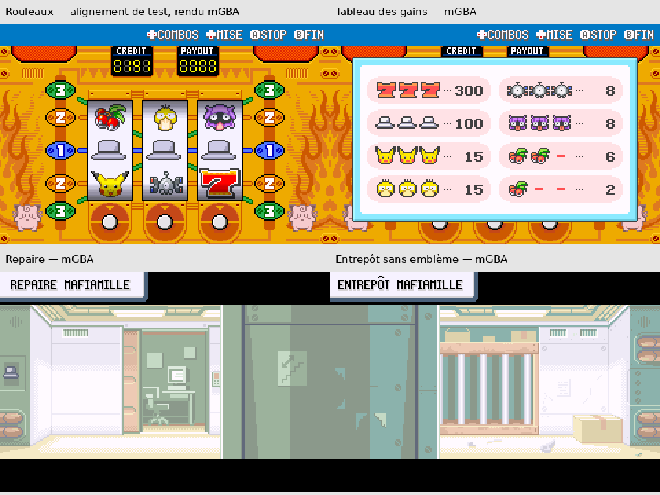

# Clôture graphique Mafiamille — intégration et recette ciblée

Branche : **`feature/mafiamille-kanto`**. Implémentation graphique : **`2389580d4`**.
Références de comparaison conservées : `ddcb53b10` et `cee38fa5f22f95b65d63d995848c5ee94578b12c`.
[Autorisation et décisions finales du créateur](AUTORISATION.md).

**Les huit animations sont définitivement validées par le créateur et conservées
à l’identique. Les quatre anciens symboles R ont été traités conformément aux
décisions finales.** Aucune fusion, aucune modification du scénario ou du gameplay.

## Ressources actives modifiées : liste exacte

| Ressource | Modification |
|---|---|
| `graphics/slot_machine/firered/reel_icons.png` | Chapeau approuvé dans la case R 32 × 32 ; six autres icônes identiques |
| `graphics/slot_machine/firered/combos_window.png` | Chapeau dans la case source R ; ses trois occurrences sont produites par la table inchangée |
| `graphics/map_preview/rocket_hideout/tiles.png` | Chapeau discret à la place du R |
| `graphics/map_preview/rocket_hideout/tilemap.bin` | Placement réorganisé pour éviter les effets de bord des carreaux partagés |
| `graphics/map_preview/rocket_warehouse/tiles.png` | R et fond du logo retirés, sans symbole de remplacement |
| `graphics/map_preview/rocket_warehouse/tilemap.bin` | Placement adapté au mur restauré |

Quatre PNG, deux tables de placement. Dimensions et palettes natives identiques.
Le mur de l’entrepôt retrouve ses teintes d’origine, indices 10 et 2, avec la
limite lumière/ombre à x=29. Les retouches restent dans x=17..37, y=58..82 ;
tous les pixels extérieurs sont identiques. Il ne reste pas de rectangle vide
pour marquer l’emplacement du logo.

Les illustrations utilisent les banques de palette 13/14. Les copies de tables
des aperçus avaient perdu ces attributs ; les premiers tests mGBA ont révélé
le mauvais rendu. Les tables intégrées les préservent désormais **pour chacun
des 640 emplacements**. Les captures finales montrent les palettes correctes.
La compression LZ77 et les conversions 4bpp ont réussi dans les deux compilations.
Repaire : 193 carreaux utilisés dans une feuille de 195 ; entrepôt : 224 sur 240.
Aucun fichier du moteur, calcul de probabilité, gain, équipe ou dialogue modifié.

## Captures réelles après intégration



Ces images proviennent du moteur mGBA, non des simulations. Les PNG natifs sont
conservés dans les sous-dossiers `avant-public`, `apres-public`, `apres-prive`.
Les planches sont agrandies ×2 en nearest-neighbor, avec légendes ajoutées hors
capture. Le trio de chapeaux est **un alignement de test en RAM**, pas un jackpot
gagné au hasard. Le rendu et le calcul du gain sont ceux du moteur inchangé.

| Avant / après réels | Captures |
|---|---|
| Rouleaux | [Comparaison](casino-trois-chapeaux-fixture-avant-apres-mgba.png) |
| Tableau des gains | [Comparaison](casino-gains-avant-apres-mgba.png) |
| Repaire | [Comparaison](RocketHideout_B1F-avant-apres-mgba.png) |
| Entrepôt | [Comparaison](FiveIsland_RocketWarehouse-avant-apres-mgba.png) |

Les quatre captures finales sont identiques pixel par pixel entre les profils
public et privé. Les différences entre les images avant/après sont confinées
aux emplacements attendus. Les autres symboles du Casino sont identiques dans
les sources ; les palettes entières sont conservées. La disparition des quatre
R est contrôlée par comparaison des ressources et inspection des rendus mGBA ;
ceci ne prétend pas à un audit de tous les tilesets partagés du jeu.

## Tests réellement effectués sur les deux ROM finales

| Vérification | Résultat / portée |
|---|---|
| Nouvelle partie | Créée par entrées de contrôleur avant les fixtures |
| Casino | Trois mises maximales, rotation, arrêt des trois rouleaux et retour à l’attente par contrôleur ; aide ouverte/fermée et sortie vers la carte |
| Comparaison Casino | Même graine de test : positions, pertes et crédits identiques avant/après et public/privé : 200 → 197 → 194 → 191 |
| Gain du chapeau | Alignement en RAM des rouleaux d’origine, appel natif `CalcPayout` : classe 5 et gain de 100 pour une mise de 1 ; aucune modification des probabilités, aucun gain aléatoire revendiqué |
| Entrées | 350 images par illustration capturées ; affichage puis retour au terrain |
| Marches | Don et sbire, quatre orientations ; neuf images en VRAM, palettes, transparence et entrées de combat vérifiées, sans retoucher les ressources validées |
| Rencontres | Interaction réelle avec le garde du Casino et Don au repaire ; deux victoires par contrôleur, retour à la carte et état dresseur vaincu vérifiés |
| Sauvegarde | Appels natifs Flash `TrySavingData` puis `LoadGameSave` ; crédits modifiés après sauvegarde puis restaurés à 347, lieu conservé et terrain rechargé |
| Audio | 26 ressources privées, en-têtes/boucles, gains et 73 redirections identiques à la référence ; aucune nouvelle écoute revendiquée |

Le premier pilote de sauvegarde mélangeait rechargements d’instantanés libretro
et tests Flash. Le contrôle final utilise une **instance indépendante sans
restauration d’instantané**, comme les autres tests Flash fiables du projet.
Aucune modification du jeu n’a été nécessaire pour corriger cette fixture.

Les rencontres utilisent une équipe de test renforcée en RAM, des flags de
visibilité et des téléportations. Adversaires, programmes d’événements et résultats
de combat ne sont pas falsifiés. Les marches sont commandées sur place au moteur.

Rapports : [avant](avant-public/TEST_MGBA.json), [public](apres-public/TEST_MGBA.json),
[privé](apres-prive/TEST_MGBA.json), [marches publiques](marche-public/TEST_MGBA.json),
[marches privées](marche-prive/TEST_MGBA.json), [rencontres publiques](rencontres-public/TEST_MGBA.json),
[rencontres privées](rencontres-prive/TEST_MGBA.json), [synthèse vérifiée](VALIDATION.json).

## Compilations et intégrité

| Profil | Taille | SHA-256 |
|---|---:|---|
| Public | 16 777 216 octets, 16 Mio | `3ca10a74c5bf70f00f33caac8ae43ae7a6f67cc4ab67eb60da67dca3539250ed` |
| Privé, 26 OST de cette branche | 31 589 579 octets, 30,13 Mio | `00004dd1b6f810a6e3f0e014d17dd1dd768da4e9f343ee28a360bef1ed0b73b5` |

Compilations réussies avec l’environnement existant :

```sh
source /workspace/.setup/env.sh
make -j6
make -j6 YOKAI_AUDIO_DIR=/workspace/private-audio/audio30-integration
```

Marge sous 32 Mio : **1 964 853 octets**. La taille des deux ROM reste identique
au jalon précédent, mais leurs empreintes changent normalement avec les graphismes.
[Comparaison des ressources audio compilées](AUDIO_COMPILATION.json).
[Contrôle de préservation des sources](PROTECTION.json). [Ressources et empreintes](INTEGRATION.json).
Aucune ROM et aucun audio privé publiés.

## État final et limites

**Transformation graphique Mafiamille terminée dans le périmètre approuvé.**
Les huit marches et l’emblème ont leur validation artistique définitive.
Casino et repaire portent le chapeau ; entrepôt sans emblème. Aucun problème
bloquant observé dans les tests ciblés finaux.

Restent des tâches de recette générale, distinctes de cette mission : traversée
continue de l’aventure et du postgame, équilibrage avec une équipe normale,
lecture exhaustive des dialogues et parcours normal des salles/énigmes. Aucun
nouveau clone propre n’a été compilé pendant cette finalisation. Les tests ciblés
ne sont pas une certification de la totalité du jeu.

Les 151 Yo-kai, types/statistiques/évolutions, équipes, dialogues, événements,
Champions, Ligue, musiques et animations ne changent pas. La branche audio reste
intacte à `837bd1757a7c2cdc2d476c3a5eacfd6296177c6a`. `master` est intact, aucune fusion.
