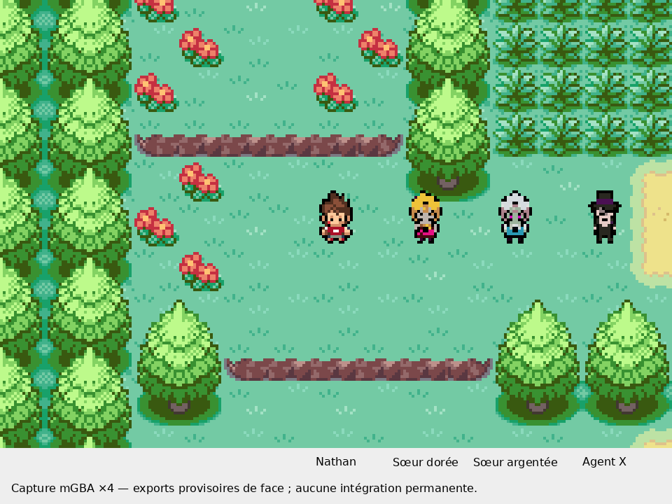

# Comparaison réelle dans mGBA : Nathan et propositions

De gauche à droite : Nathan joueur inchangé, sœur dorée, sœur argentée, Agent X. Le cadrage provient de la Route 1 ; les trois PNJ sont ajoutés seulement à la session de test, pas aux cartes enregistrées.

**Ce sont de vraies images produites par mGBA**, avec des données graphiques et palettes provisoires chargées en RAM. Les personnages ne sont pas collés sur une capture après coup. La version annotée agrandit la capture native par voisin le plus proche et ajoute uniquement les légendes dans une marge extérieure.

Limite importante : faute de dessins natifs définitifs, les trois propositions ont subi une réduction technique provisoire à 12 × 19 pixels visibles, dans une cellule de 16 × 32. Cette opération sert seulement à comparer les proportions, ne satisfait pas à elle seule l’exigence artistique de production, et ne remplace aucun fichier graphique actif. La palette est quantifiée à 15 couleurs visibles plus l’indice transparent. Les visages des sœurs restent moins lisibles à cette résolution et doivent être repris pixel par pixel. La marche, les dos, les profils et les portraits ne sont pas testés ici.

Le PNG natif de 240 × 160 reste disponible sous `capture-mgba-nathan-trois-propositions.png` ; `capture-x4.png` n’a aucune légende ajoutée. `scene-temoin-avant-injection.png` montre la scène avant le remplacement graphique provisoire. Le rapport `CONTROLE.json` vérifie les données VRAM et les palettes chargées. La ROM n’a pas changé : son SHA-256 est enregistré dans le rapport.

Reproduction depuis la racine : activer l’environnement de compilation habituel, puis définir `YOKAI_QA_ROM` et `YOKAI_QA_ELF` avec le couple existant, et exécuter `python3 tools/yokai/comparer_propositions_nathan_mgba.py`. Le script utilise une zone IWRAM libre de cette compilation pour le test ; il ne faut pas le réutiliser sur une autre version sans contrôler cette réserve. Le test remplace les tables d’images en RAM et charge les palettes par la fonction native `LoadPalette`, puis vérifie VRAM et palette matérielle. Aucun fichier ROM ou sauvegarde du joueur n’est écrit.
