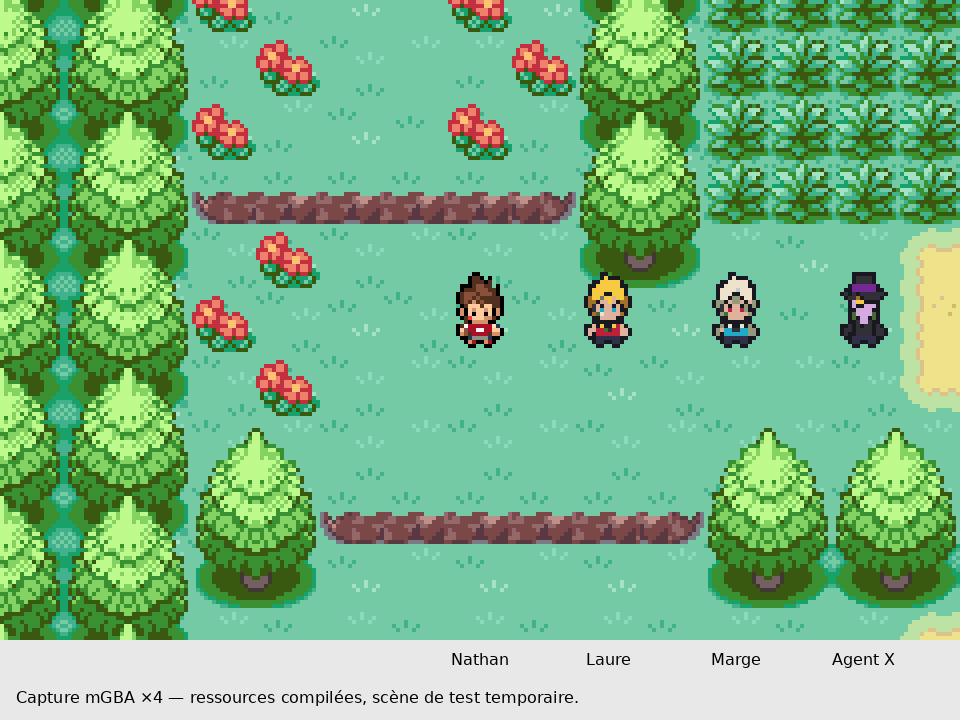

# Décalques natifs sur Nathan : Laure, Marge, Agent X

## Ce qui est réellement créé

Trois planches indexées de 144 × 32, neuf poses de 16 × 32 chacune, dans `graphics/yokai_characters/{laure,marge,agent_x}/overworld.png`. Ordre : face, dos, gauche, pas face A/B, pas dos A/B, pas gauche A/B. Le moteur produit le profil droit par miroir. La source de coloration dessinée avec imagegen et le gabarit de Nathan sont conservés ; `tools/yokai/decalquer_personnages_nathan.py` reproduit la conversion.

À la demande du créateur, **les masques du corps, des mains et des pieds sont copiés des neuf images natives de Nathan** (lignes 24 à 31). Les silhouettes y sont identiques pixel pour pixel. La tête conserve le gabarit natif mais utilise un contour propre à la coiffure ou au chapeau. Les pas avant/arrière reprennent le décalage vertical de la tête de Nathan. Il s’agit d’un décalque technique et d’une projection de la coloration générée, pas d’une prétendue création manuelle dans Aseprite.

Les détails des références ont été simplifiés : bijoux et rides peu lisibles à cette taille, motifs de médaillons et manteau. La lisibilité et la ressemblance restent à apprécier par le créateur ; les tests techniques ne constituent pas une validation artistique définitive. Les identités et leurs couleurs sont associées suivant l’ordre de la référence fournie : dorée/rouge pour Laure, argentée/turquoise pour Marge.

## Déclaration et palettes

Les identifiants 174/175/176 et leurs ressources graphiques sont déclarés dans les tables moteur. Les trois dessins partagent volontairement une banque de 16 couleurs (15 visibles + indice 0 transparent), sous le tag 0x112C. Ils peuvent ainsi être affichés simultanément sans s’écraser leurs palettes dans l’emplacement spécial des PNJ. Les palettes des personnages existants sont préservées.

**Aucun placement scénaristique n’a été ajouté.** Le test fait apparaître les trois acteurs sur la Route 1, uniquement dans la session d’émulateur. Cela ne les ajoute pas à cette route dans une sauvegarde normale. Leurs événements du Temple et les portraits de combat restent à réaliser ; les nouvelles ressources sont disponibles pour ces futurs usages.

## Contrôles effectués

- Compilation publique et compilation avec audio privé : réussies, sous la limite de 32 Mio. Tailles et empreintes dans COMPILATIONS.json.
- mGBA sur les deux compilations : données des neuf images présentes dans la ROM et vérifiées ; quatre directions, miroir est, quatre répétitions de marche par direction et trois acteurs ; tous les indices d’images attendus observés en VRAM.
- Palette matérielle vérifiée pour les trois personnages affichés ensemble dans chacune des quatre directions.
- Les captures et GIF proviennent du moteur, pas d’un collage. La capture annotée ajoute seulement une marge avec les noms et un agrandissement sans lissage. Le second profil est documenté dans `../DECALQUES_NATHAN_AUDIO/CONTROLE.json`.
- Nathan d’origine est inchangé octet pour octet. Aucun script, carte, équipe, statistique, rencontre, évolution, Multi Exp ou ressource musicale n’a été modifié.

## Reproduction et suite

Compiler normalement, définir YOKAI_QA_ROM et YOKAI_QA_ELF, puis exécuter `python3 tools/yokai/tester_decalques_nathan_mgba.py`. YOKAI_TRACE_REPORT permet de changer le dossier de résultats. Cette fois les images et palettes proviennent des ressources réellement compilées : aucune injection de graphismes en RAM comme dans l’ancien aperçu provisoire.

Ces nouveaux dessins restent des versions de travail dont l’aspect est à valider, mais les PNG, les tables natives et les animations décrites existent et ont été testés. Perpétua, McKraken et les portraits ne sont pas terminés par ce lot. Les anciennes propositions non intégrées sont conservées pour historique et ne sont pas utilisées par ce test.

Note de test : le premier essai sur le profil audio a révélé une erreur de scénario de test : les PNJ étaient créés avec le comportement « regarder autour de soi », ce qui pouvait changer leur orientation pendant le contrôle du miroir. Le test utilise maintenant MOVEMENT_TYPE_NONE et impose les orientations ; les assertions de palette, miroir et animation sont conservées. Les deux profils ont passé cette version corrigée du test.
