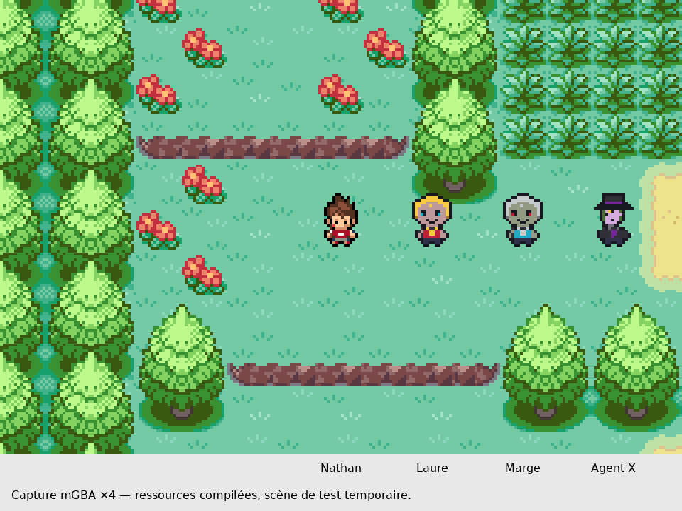
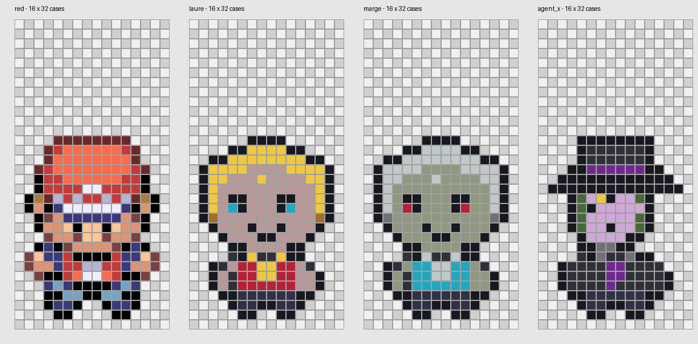

> **ESSAI REFUSÉ PAR LE CRÉATEUR — HORS DES RESSOURCES ACTIVES.** Les PNG et palettes de 78b1ccea4 sont rétablis. Les tests ci-dessous décrivent uniquement cet essai historique, dont le rendu artistique a été refusé. L’exporteur bloque la réactivation de ces grilles. La version rétablie provenait de la méthode antérieure de conversion ; elle ne doit pas être présentée comme un dessin natif manuel.

# Dessin direct dans une grille native

À la demande explicite du créateur, la méthode de dessin a changé. **Aucun dessin généré n’est réduit pour fabriquer ces sprites.** Les trois personnages ont été redessinés à l’aide de matrices de pixels : une case est une couleur ou de la transparence.

## Sources graphiques éditables

Chaque personnage possède `graphics/yokai_characters/{laure,marge,agent_x}/source/overworld-grille.json`. Il contient neuf images de 32 lignes ; chaque ligne contient exactement 16 caractères. Un point est une case vide. Les caractères 1 à f désignent un indice précis de la palette commune `graphics/yokai_characters/nathan_trace/palette-native.json`.

Les cases des coiffures, fronts, yeux, marques frontales, visages, vêtements, médaillons et du chapeau ont été choisies directement dans ces matrices. Les coordonnées du corps, des mains et des pieds reprennent les neuf masques natifs de Nathan pour conserver les proportions validées. La grille et la hauteur de référence sont celles des overworlds de Rouge Feu : 16 × 32, silhouette fixe de 19 pixels. Les fronts des sœurs sont dégarnis avec une chevelure autour, leurs yeux sont cyan/rouges ; Agent X possède son œil jaune sous le bord du chapeau, un col gris et une cravate violette.

`tools/yokai/exporter_grilles_personnages.py` écrit directement les indices dans un PNG natif de 144 × 32. Il n’effectue ni échantillonnage, ni quantification, ni redimensionnement du dessin. L’ancien point d’entrée `decalquer_personnages_nathan.py` appelle désormais cet exporteur pour éviter qu’une ancienne conversion écrase les matrices. Les agrandissements sans lissage sont uniquement des aperçus, créés après export ; ils n’interviennent pas dans la fabrication des ressources natives.

## Vérifications réelles

- Les 13 824 cases des 27 poses correspondent exactement aux indices des PNG exportés : CONTROLE_GRILLES.json.
- Une seconde exécution de l’export produit les mêmes PNG et palettes, octet pour octet : COMPILATIONS_ET_EXPORT.json.
- Compilation publique et compilation avec audio privé réussies ; toutes deux inférieures à 32 Mio. Aucune musique protégée ni ROM n’est jointe au dépôt.
- mGBA sur les deux profils : trois ressources réellement compilées ; quatre directions, miroir est, quatre cycles de marche, images attendues vérifiées en VRAM et palettes matérielles contrôlées. Voir CONTROLE.json et ../GRILLES_NATIVES_DIRECTES_AUDIO/CONTROLE.json.
- Nathan, Katie et Ariane sont conservés tels quels. Ni cartes, ni dialogues, ni équipes, ni gameplay n’ont changé. Les trois PNJ de la capture sont créés uniquement dans la session de test.

Ces sprites sont des propositions natives fonctionnelles, pas une validation artistique définitive. La ressemblance peut encore être retouchée en changeant individuellement les cases des matrices. Les portraits et les événements du Temple restent hors de ce lot. Les anciens dessins et rapports restent consultables dans Git ; ils ne sont plus la source d’export de ces trois personnages.
