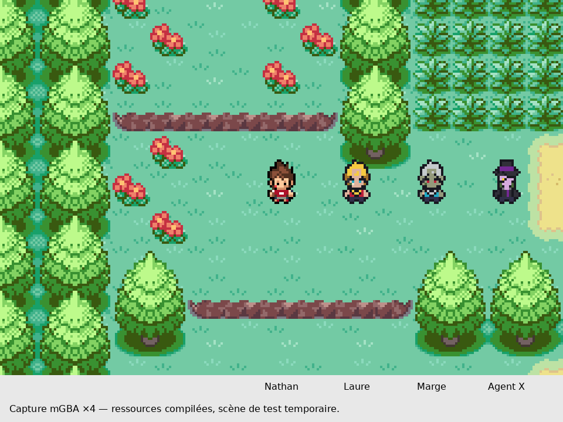

# Retouches légères de la base préférée

Après le refus du dessin natif précédent, les ressources de 78b1ccea4 ont été rétablies et leurs deux ROM ont été recompilées avec des empreintes identiques au jalon déjà testé. Le créateur autorise désormais le choix de la technique, en privilégiant le rendu. Ce lot repart donc de cette base préférée et modifie ponctuellement ses pixels natifs ; il ne réintroduit pas le dessin aux visages trop géométriques.

## Changements limités

- Laure : front un peu dégagé, petite marque dorée, regard plus sombre et médaillon contrasté.
- Marge : visage homogénéisé en gris olive, cheveux plus argentés, front et regard repris, médaillon argenté.
- Agent X : l’œil jaune est déplacé sur le visage sous le chapeau ; le col et la cravate ressortent davantage.
- Les silhouettes, les positions et la palette sont identiques à la base préférée. Les détails ne sont modifiés que dans les cases déjà visibles. Nathan, Katie et Ariane sont inchangés.

Les retouches sont enregistrées sous forme de matrices de 16 × 32 cellules dans `graphics/yokai_characters/{laure,marge,agent_x}/source/overworld-grille.json`. La base historique venait de dessins convertis ; ce travail est une retouche native de ces PNG, pas la prétention de recréer manuellement tous les pixels d’origine. L’export actuel ne réduit ni ne réinterprète d’illustration : il écrit les indices des matrices. La grille refusée reste sous `source/grille-refusee-v1.json`, marquée hors usage. Ne pas la réactiver.

## Vérifications

Les nouveaux PNG correspondent case par case aux matrices. Les masques de transparence des 27 poses sont identiques à 78b1ccea4 ; nombres de pixels modifiés dans MODIFICATIONS.json. Une seconde exportation donne les mêmes PNG et palettes.

Compilations publique et musicale réussies, toutes deux sous 32 Mio ; détails dans COMPILATIONS.json. Contrôles mGBA des deux profils : données réellement compilées, palette matérielle des trois acteurs réunis, quatre directions et miroir, quatre cycles de marche. Les résultats privés sont dans ../RETOUCHES_LEGERES_AUDIO/CONTROLE.json. Aucun changement de gameplay, carte, événement ou musique. Les PNJ sont ajoutés seulement dans la session de test, pas sur la Route 1 du scénario.

[Avant/après : captures du moteur](avant-apres-mgba.png). [Avant/après : pixels agrandis](avant-apres-natifs-x10.png). Les captures sont réelles ; seuls leur agrandissement et les légendes extérieures sont ajoutés.

Ce sont des propositions artistiques, pas une approbation du créateur. Les motifs fins des médaillons et les rides restent simplifiés. La coiffure conserve sa silhouette précédente : ce lot n’affirme pas avoir refait toute sa géométrie. Portraits et placement narratif du Temple restent à faire.
