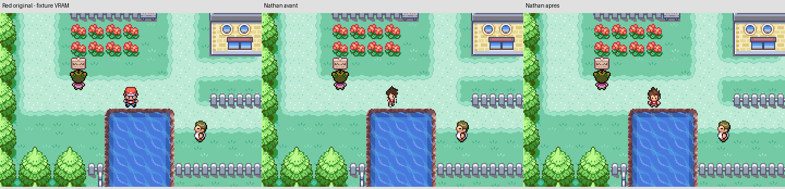

# Nathan — overworld repris sur le gabarit de Red

Demande utilisateur : refaire uniquement Nathan sur la carte en reprenant les formes de base de Red. Point de restauration : `e00c7853bcef495afaaeb82fa433c57722d4c4d8`. Les originaux de Red restent intacts dans leurs dossiers ; les nouvelles ressources de Nathan conservent ses cheveux bruns, son T-shirt rouge à étoile blanche, son pantalon gris et sa montre.

De gauche à droite : référence Red rendue temporairement dans la VRAM du banc de test, ancien Nathan dans la ROM précédente, nouveau Nathan dans la ROM actuelle. Les deux captures Nathan sont des rendus natifs du jeu. La référence Red est une comparaison visuelle temporaire ; elle n’est pas intégrée à la place du nouveau personnage.

## Ressources effectivement remplacées

| Fichier dans `graphics/yokai_characters/nathan/` | Images | Cadre natif |
|---|---:|---|
| `normal.png` |9|16×32|
| `surf_run.png` |14|16×32|
| `bike.png` |9|32×32|
| `vs_seeker_bike.png` |6|32×32|
| `fish.png` |12|32×32|
| `item.png` |9|32×32|

59 images au total. Les silhouettes de marche sont limitées à19 pixels de hauteur visible, avec les appuis et l’ordre des poses de Red. Des images propres à Nathan ont été dessinées par génération d’image à partir de cette base ; le convertisseur ne dessine pas, il découpe, réduit au plus proche voisin et indexe avec la palette existante. Les variantes de face à vélo ont une source complémentaire pour préserver la vue de face pendant le pédalage. Les poses inadéquates ne sont pas raccordées : étoile dessinée par erreur sur un dos, orientation erronée dans le cycle du vélo, vues de dos inutiles dans la séquence Cherch’VS qui tourne vers la face. Les correspondances actives sont explicites dans `CONVERSION.json` et le convertisseur.

Les scripts et durées d’animation du moteur restent identiques. Les vues natives sud/nord/ouest et le miroir vers l’est suivent les conventions de Rouge Feu. Le caméo Nathan réutilise déjà `sPicTable_RedNormal` et reçoit donc le même nouveau graphisme sans changement d’événement.

Les sources de dessin sont conservées dans `graphics/yokai_characters/nathan/source/red-base/`. Reconstruction des PNG : `python3 tools/yokai/convertir_nathan_base_red.py`. Compilation ordinaire : `make -j4`. Pour la musique privée déjà validée : `make -j4 YOKAI_AUDIO_DIR=/chemin/vers/les/ressources_privees`. Les PNG sont suivis par Git et aucune génération d’image n’est nécessaire pour compiler. Le convertisseur historique des protagonistes préserve maintenant cette révision overworld lorsqu’il travaille sur les autres représentations.

## Vérifications réellement effectuées

- Nouvelle partie réelle dans mGBA, quatre orientations du joueur sur la carte et correspondance exacte des six tableaux graphiques liés dans la ROM : `TEST_CARTE_MGBA.json`.
- Trois cycles de marche/course dans quatre directions, vélo, Cherch’VS à pied et à vélo, action de terrain/montre, pêche dans quatre directions avec fin de tâche et retour au graphisme normal : `mgba/TEST_PROTAGONISTES_MGBA.json`. Les images et GIF sont dans `mgba/preuves/`.
- Surf testé sur l’eau réelle de la Route21 Nord, entrée par l’effet natif, quatre directions et retour à terre avec la commande haut : `surf/TEST_MGBA.json`. La progression d’obtention de la CS et des badges n’est pas testée par ce banc.
- Conversion répétée et reconstruction : mêmes octets de ROM. Aucune nouvelle allocation de RAM ni modification des fonctions de jeu.

## Preuve du périmètre strictement overworld

`PRESERVATION.json` compare la ROM précédente et la nouvelle : **6739 octets différents, tous exclusivement dans les six tableaux graphiques overworld de Nathan**. Tous les autres octets de ROM sont identiques, dont les sprites de combat, les portraits, l’introduction, le titre, les données des151 espèces, les musiques et les scripts. Les127 autres images et palettes des personnages vérifiées dans les sources sont inchangées ; Katie et Matt ne sont pas redessinés. La palette partagée et les palettes de reflets sont préservées.

ROM privée : **27718259 octets** ; SHA-256 `cb24569268ca5946f78d04360a39f901e60cff53bded5fd8f06fb5ad629c9501`. Le fichier privé et les ressources DPCM ne sont pas publiés sur GitHub.

Ces vérifications ne constituent ni une nouvelle recette de toute l’aventure ni une validation artistique donnée par l’utilisateur après examen de ces nouvelles captures. Les autres travaux de la session2, notamment les75 shiny restants, ne sont pas annoncés terminés par ce changement.
