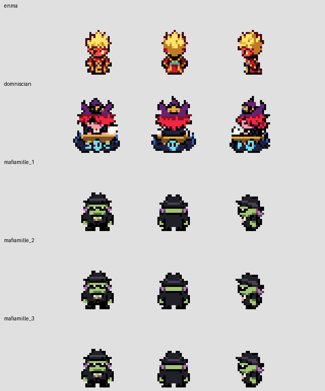
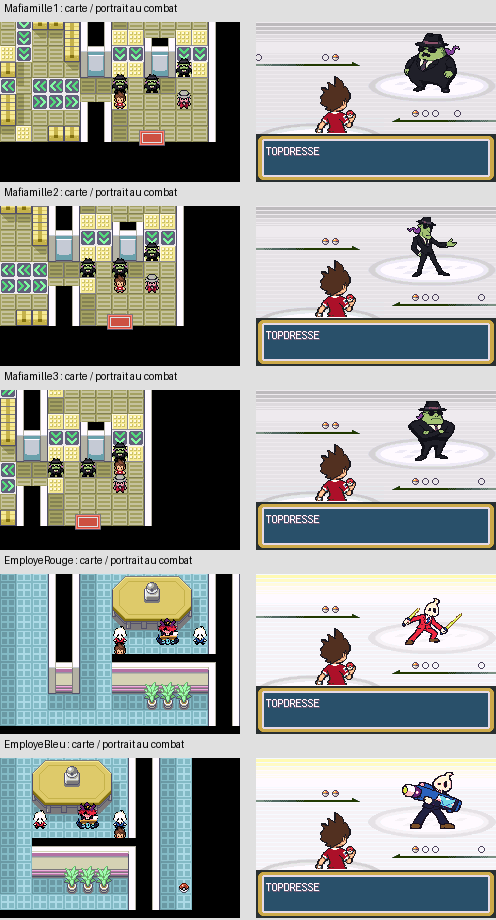

# Sélection finale des personnages de carte et contours noirs

À la demande de l'utilisateur, cette sélection remplace la révision V3 uniquement pour Enma, Domniscian et les trois Mafiamilles. Base avant modification : `e0d3147a0ec6221ffed5a7a656c870833049671e`.

- Enma : ancien dessin overworld restauré.
- Domniscian : ancien dessin avec son bureau restauré.
- Mafiamilles 1, 2 et 3 : même ancien dessin du Mafiamille 3, strictement le même PNG pour les trois.
- Les employés gardent le modèle commun et les costumes rouge/bleu validés précédemment.
- Portraits de combat, palettes de combat, équipes, dialogues, animations et musiques conservés.

Les anciens PNG sont récupérés octet pour octet depuis `daff2e5b824c4e76dc89270820a0574ffc15f3ae` et suivis dans `graphics/yokai_characters/overworld_red_v3/approved_overrides/`. Le manifeste et le convertisseur appliquent cette sélection en dernier, sans dépendre de Git ni du réseau lors d'une reconversion.



## Contours sur la carte

Les contours existants des 15 personnages concernés — Nathan, Katie, Matt, Ariane, Nathaniel, Michael, Wyatt, Enma humain, Domniscian, Don Morleone, trois Mafiamilles et deux employés — passent du presque noir au **noir pur**, à l'indice 1. Aucun agrandissement de silhouette, épaississement automatique ou nouvelle transformation artistique n'est appliqué aux dessins choisis. Les contours colorés secondaires et détails internes sont conservés.

Neuf fichiers `overworld.pal` sont réservés aux palettes de carte et raccordés dans `src/data/object_events/object_event_graphics.h`. Nathan et Katie partagent déjà la palette de carte ; les deux groupes de boss gardent également leurs banques communes. Chaque palette reste à 16 couleurs et garde son indice transparent 0 ; seul l'indice de contour 1 change. Les fichiers `normal.pal` utilisés en combat sont inchangés. Les palettes atténuées de reflets ne sont pas remplacées par un noir opaque.

Les PNG restaurés conservent leurs palettes intégrées historiques : c'est la palette overworld dédiée qui fournit le noir en jeu. La planche ci-dessus utilise cette palette effective. Les feuilles sources V3 restent archivées ; elles ne reprennent pas la priorité sur la sélection explicite.

## Vérifications effectuées

- Compilations privée avec 26 OST et publique avec repli natif : réussies. La ROM privée reste à **31 272 243 octets, 29,8235 Mio** ; aucune ressource audio ou ROM publiée.
- Contrôle binaire : **2 017 octets changés**, uniquement dans les cinq bitmaps demandés et les neuf entrées de contour des palettes de carte. Tous les autres octets de la ROM sont identiques. Voir [PRESERVATION.json](PRESERVATION.json).
- Contrôle des autres PNG/palettes suivis depuis V3 : inchangés, dont les cinq portraits distincts des Mafiamilles/employés.
- Galerie mGBA des 22 objets dans quatre directions ; test supplémentaire du noir natif réellement chargé à l'indice 1 pour les 15 personnages. [Captures et rapport](../overworld/selection-v4/TEST_GALERIE_MGBA.json), [planche](../overworld/selection-v4/planche-22-acteurs.png).
- Groupes Domniscian/employés et Don Morleone/Mafiamilles sur leurs cartes : quatre directions, palettes communes, visibilité avant/après Ligue. Déplacements de Matt aux quatre vitesses conservés. [Rapport](groupes/TEST_MGBA.json).
- Cinq interactions originales suivies jusqu'aux portraits d'entrée en combat : trois portraits distincts pour les Mafiamilles et deux pour les employés ; musique MiniBoss inchangée. [Rapport](carte-combat/TEST_MGBA.json).



Les captures ont été ouvertes et examinées. Ces tests préparent la progression en mémoire après une nouvelle partie ; ils ne constituent pas un nouveau parcours complet ni une nouvelle validation intégrale des cinq combats. Les autres chantiers du jeu ne sont pas déclarés terminés.

Reproduction des tests après compilation privée :

```sh
source /workspace/.setup/env.sh
export YOKAI_QA_ROM="$PWD/pokefirered_audio.gba"
python tools/yokai/tester_galerie_ow_session2_mgba.py --stage selection-v4 --black-contours
YOKAI_CAST_GROUP_REPORT_DIR=QA_RECETTE_FINALE/POST_B13/SESSION_2_GRAPHISMES/RED_SELECTION_V4/groupes python tools/yokai/tester_cast_groupes_frlg_mgba.py
YOKAI_IDENTITIES_REPORT_DIR=QA_RECETTE_FINALE/POST_B13/SESSION_2_GRAPHISMES/RED_SELECTION_V4/carte-combat python tools/yokai/tester_identites_carte_combat_mgba.py
```
