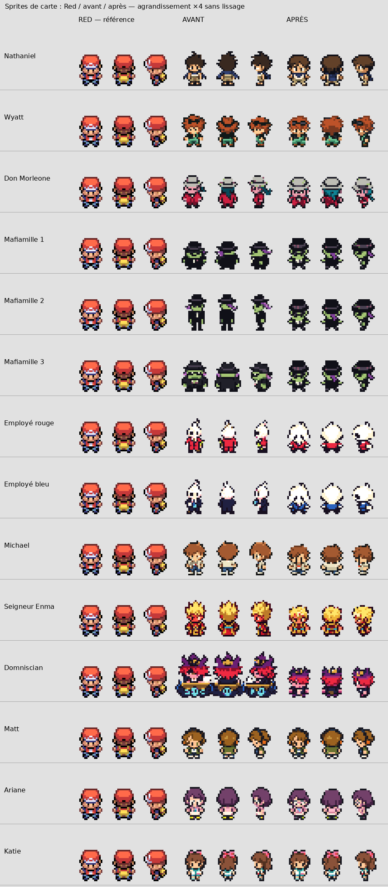
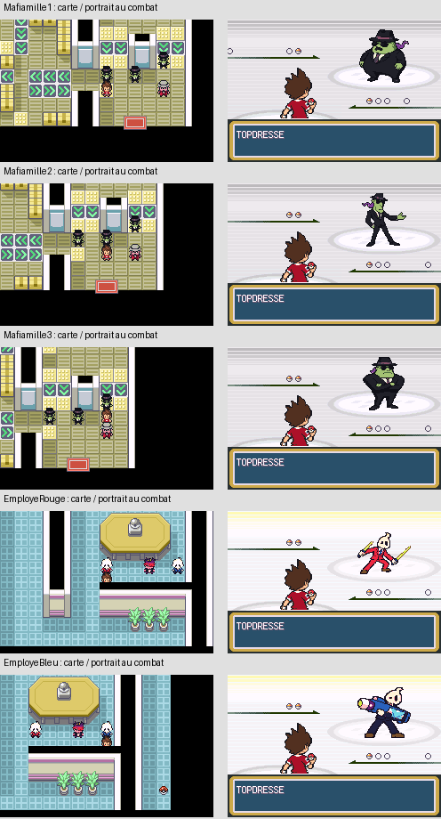

# Personnages de carte — révision individuelle sur Red

Révision demandée après examen du lot précédent. Point de restauration : `daff2e5b824c4e76dc89270820a0574ffc15f3ae`, branche `dev/reconstruction-finalisation`. Overworld uniquement ; aucun nouveau portrait de combat.

## Travail intégré

Chaque personnage a été comparé séparément aux poses de Red. Nathaniel, Wyatt, Don Morleone, Michael, Seigneur Enma humain et Domniscian ont de nouvelles feuilles artistiques individuelles. Un modèle supplémentaire sert aux trois Mafiamilles, un autre aux deux employés : huit nouvelles feuilles au total, dessinées à partir des références officielles et du guide de poses Red.

Nathaniel : cape repliée, tête et jambes compactes. Wyatt : suppression du chapeau erroné, restitution des cheveux roux et des lunettes. Don Morleone : costume, chapeau et cheveux dans un corps plus compact. Michael : cheveux sans casquette, tenue claire et pendentif. Enma : chevelure et vêtement resserrés. Domniscian : personnage compact sans bureau sur la carte ; son bureau reste présent dans son portrait de combat inchangé.

Les **trois Mafiamilles utilisent exactement le même PNG de carte**, octet pour octet, et leur palette commune existante. Les **deux employés partagent exactement les mêmes pixels opaques**, tête et proportions ; seuls les indices de costume donnent les versions rouge et bleue, dans la palette commune existante. Leurs cinq portraits de combat distincts sont conservés.

Matt conserve son dessin et ses neuf poses, recalés sur les bornes et appuis de Red. Ariane conserve son dessin, ramené à la hauteur et à l'ancrage de Red. Katie est conservée après examen : gabarit déjà compact et 59 poses inchangées. Nathan, déjà approuvé, reste également identique.

**13 PNG actifs modifiés, 45 images natives** : douze personnages de trois images, plus les neuf images de Matt. Le [contrôle individuel](CONTROLE_INDIVIDUEL.csv) décrit les 14 personnages examinés, y compris Katie conservée. Les proportions globales sont celles de Red ; les contours propres à chaque identité sont conservés. Le masque alpha n'est pas identique pixel pour pixel à Red.

## Format et reproduction

Cadres natifs 16 × 32, palette indexée 4bpp, transparence indice 0. Domniscian conserve sa cellule technique 32 × 32 existante, avec une figure compacte centrée. Les trois poses immobiles reprennent les bornes visibles de Red : 14 × 19 pixels, même appui. Les neuf poses de Matt suivent leurs références respectives. Katie et Nathan gardent leurs cadres et contours approuvés.

Les feuilles sources sont suivies dans `graphics/yokai_characters/overworld_red_v3/source/`, avec manifeste. `tools/yokai/convertir_overworld_red_strict.py` effectue extraction, conversion aux dimensions natives et attribution des indices de palette existants. Le costume bleu utilise une variante déclarée des indices du costume rouge. L'ancien convertisseur est protégé contre un écrasement de cette révision.

La reconversion a été exécutée : tous les PNG overworld actifs restent strictement identiques. Voir [preuve](REPRODUCTION_CONVERSION.json) et [bornes et sources](CONVERSION.json). La planche est reproductible avec `tools/yokai/comparer_red_strict_v3.py` ; cet outil ne redessine pas les sprites.

## Tests effectués

- Compilation publique réussie : repli musical natif, 16 Mio.
- Compilation privée réussie avec les **26 OST existantes**, sans changement audio : **31 272 243 octets, 29,8235 Mio**. SHA-256 `8172026185b9c640b02275a86781e745a7835d831172337babf6f9bea0a50bca`. ROM et audio privés non publiés. [Métadonnées](COMPILATIONS.json).
- Galeries mGBA : 22 acteurs dans quatre directions, [avant](../overworld/red-strict-avant/planche-22-acteurs.png) et [après](../overworld/red-strict-apres/planche-22-acteurs.png). Les objets statiques à vue fixe conservent leur fonctionnement.
- Groupes sur leurs vraies cartes : Domniscian avec ses deux employés ; Don Morleone avec ses trois Mafiamilles. Quatre directions, palette OBJ commune vérifiée, absence avant Ligue et présence postgame. [Résultats](groupes/TEST_MGBA.json).
- Matt : huit cas de déplacement, ouest/est aux quatre vitesses, **576 images d'émulation** ; orientations et hFlip contrôlés. Images et GIF dans `groupes/`.
- Cinq interactions originales suivies jusqu'à l'entrée native en combat : trois Mafiamilles et deux employés. Portraits identifiés dans les tables et le sprite chargé ; thème MiniBoss conservé ; captures examinées. [Résultats](carte-combat/TEST_MGBA.json).

Les tests initialisent une nouvelle partie par le moteur, puis préparent la progression en mémoire et les déplacements vers les cartes. Ils ne constituent pas un parcours complet de l'aventure. Les cinq combats sont contrôlés jusqu'au portrait d'entrée, sans être rejoués intégralement. Les captures, la planche comparative et les groupes ont été ouverts et examinés.

## Préservation

Comparaison octet par octet des ROM avant/après : **4 278 octets modifiés, tous dans les 13 tableaux bitmap overworld visés**. Aucun autre octet ne change. Adresses et tailles des symboles identiques. Palettes, commandes d'animation, portraits de combat, ressources des 151 espèces, audio et gameplay préservés. Nathan et Katie inchangés. Contrôle complémentaire : 5 657 autres fichiers graphiques/palettes identiques au point de restauration Git. [Preuve détaillée](PRESERVATION.json), outil `tools/yokai/verifier_red_strict_v3.py`.

Cette révision concerne les personnages sur la carte ; les autres chantiers de graphismes, shiny et recette générale ne sont pas déclarés terminés. La validation artistique finale appartient à l'utilisateur à partir des comparaisons fournies.
