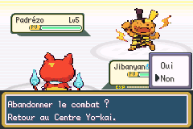
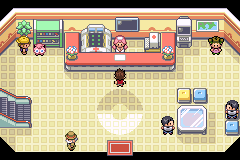

# Abandon d’un combat de Dresseur

## Comportement

Dans un combat de Dresseur local, **Fuite** ouvre :

> Abandonner le combat ?
> Retour au Centre Yo-kai.

**Non** est sélectionné par défaut. Non ou B retourne au menu d’actions,
sans consommer de tour, de PV ni de PP. Oui enregistre `B_OUTCOME_LOST`,
exécute les messages et la fin normale d’une défaite, puis le trajet natif
`CB2_WhiteOut` : pénalité d’argent habituelle, soins et retour au dernier
point de soins. Avant d’avoir visité un Centre, le point de départ peut être
la maison, comme pour une défaite native.

Le Dresseur n’est pas marqué vaincu et aucune récompense de victoire n’est
accordée. Les combats doubles permettent l’abandon depuis les commandes du
premier ou du second Yo-kai humain. Le partenaire temporaire d’Ariane est
retiré proprement et sa quête reste en attente. Une scène autorisant normalement
la poursuite après une défaite n’exécute pas sa suite lors d’un abandon : la
destination demandée est le point de soins. Le premier tutoriel de Matt utilise
la même question, tout en conservant son propre contrôleur après annulation.

La fuite sauvage et les liaisons gardent leurs chemins natifs. La condition
locale Dresseur est vérifiée avant d’ouvrir le menu ; l’abandon n’est jamais
transmis sous forme d’une fuite sauvage réussie. Les bonus d’objets et talents
permettant la fuite ne changent pas ce comportement.

## Implémentation

Le menu de confirmation est partagé entre les contrôleurs joueur et du premier
rival, avec leurs fonctions propres de retour et de fin de commande. Le rendu
attend la fin du texte animé avant d’ouvrir Oui/Non, pour conserver les couleurs
des caractères. Le curseur préserve l’octet de communication employé également
par la sélection d’un autre combattant.

Le marqueur d’abandon est limité à la RAM du combat et réinitialisé à chaque
rencontre. Les ressources sont libérées par le chemin natif de défaite avant
le retour au point de soins. La reprise du script de victoire est évitée, le
partenaire temporaire est nettoyé, et la restauration d’objets tenue propre aux
rencontres e-Reader est conservée. Aucun champ de sauvegarde n’est ajouté.

## Vérifications mGBA

9 scénarios par profil : version privée garçon, privée fille et publique garçon,
soit 27 contrôles ciblés réussis :

- Non par défaut : retour aux commandes sans changement de l’équipe ni tour.
- B : annulation sans tour.
- Oui contre Wyatt : défaite native puis Centre, retrait exact de la pénalité
  calculée par le moteur ; Badge, CT, drapeau de victoire et Dresseur vaincu
  restent non attribués.
- Duo Ariane : Centre, index temporaire 6 vidé, deux membres originaux conservés,
  quête toujours à l’état 1.
- Double ordinaire : abandon depuis le second combattant humain, défaite globale.
- Premier Matt : Non conserve son contrôleur de tutoriel et son équipe.
- Premier Matt : B conserve également le contrôleur du tutoriel.
- Premier Matt : Oui renvoie au Centre sans reprendre la cinématique.
- Combat sauvage suivant : fuite ordinaire, sans question d’abandon ni défaite.

Les équipes, cartes, point de soins initial et branches d’instantanés sont des
fixtures. Les choix passent par les boutons ; aucun résultat de combat n’est
injecté. Ces essais sont distincts du parcours joueur complet, toujours arrêté
à Argenta. Les contrôles ne prétendent pas rejouer chaque combat scénarisé du jeu.

Les deux compilations passent. Dix sauvegardes natives existantes se rechargent
avec Continuer, avec carte, position, effectif, niveaux et PV identiques ; les
fichiers `.sav` ne changent pas.

## Lot de corrections en attente

Branche : `feature/abandon-combats-dresseurs-20261024`.
Elle inclut les correctifs précédents de Matt, des sprites du duo Ariane et des
taux de capture par rang. Aucune fusion sur master et aucune nouvelle ROM
publiée ; la livraison groupée attend les autres retours de l’utilisateur.

ROM de test privée : SHA-256 `14addbd73bb730d935a382decc6dac026809ce91fe74db0c36400f7404b8a855`, 33449979 octets.
