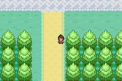
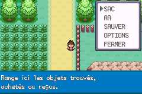

# Argenta : blocage au retour vers la Route 2

Le verrouillage signalé est reproduit dans la ROM livrée `Pokemon_Yokai_Watch_Beta_0.1_Corrigee.gba`, SHA-256 `5ac3df63ea192cd4392613108d7ccd8fdc4c7c0c60eba3403d1427f7453f2068` : le joueur reste en (23,36), les quatre directions et START sont inopérants, tandis que l’aide L peut s’ouvrir. Ce n’est pas un problème de collision avec les arbres. Le premier essai de retour direct n’avait pas reproduit le changement d’état provoqué par une visite dans un bâtiment.

## Cause et correction

Le discours utilise quatre déclencheurs au sol (x20 à x23, y36), conditionnés par `VAR_TEMP_F == 0`. La scène place cette variable temporaire à 1, mais entrer dans un bâtiment la réinitialise. Au retour, le drapeau permanent indique que le discours a déjà eu lieu. Le déclencheur se réactive alors et quitte immédiatement son script, avant `lockall`, sans modifier sa condition.

Dans cette situation, le moteur conserve le pas en attente : le script vide recommence à chaque image avant le traitement des autres commandes. `lockall` évite normalement cela en attendant l’arrêt du joueur et en appelant `StopPlayerAvatar`. L’aide L utilise un autre circuit de traitement, ce qui explique qu’elle reste accessible.

La correction est limitée à `data/maps/PewterCity/morleone.inc` :

- Désactiver le déclencheur à chaque chargement d’Argenta quand le discours est terminé, y compris sur une ancienne sauvegarde.
- Consommer aussi un déclencheur obsolète dès l’entrée du script, avant ses sorties anticipées.

Aucun déplacement artificiel, aucun changement du moteur global, aucune nouvelle variable sauvegardée. Wyatt, déjà validé dans le public du discours, reste présent. Les OST et les autres fonctionnalités ne sont pas modifiées. La traduction complète en cours sur `fix/beta-retours-20261024` est conservée séparément ; cette livraison urgente n’en annonce pas la finalisation.

## Vérifications mGBA

| Vérification | Résultat |
|---|---|
| Ancienne ROM : drapeau terminé + rechargement de carte, descente jusqu’à y36 | Blocage reproduit, directions et START bloqués ; aide L accessible |
| Discours complet, soins à l’infirmière, paiement/visite du Musée, sortie des bâtiments, Route 2 et retour au-delà de y36 | 4 colonnes × garçon/fille : 8 parcours réussis |
| États obsolètes : variable temporaire remise à 0, discours terminé ou événement non actif | Traversée et START fonctionnels |
| Autres scènes : états terminés chargés sur carte, déplacement et START | 16 cas × garçon/fille : 32 cas réussis |
| Version publique compilée : chargement après discours et sortie sud | Traversée et START fonctionnels |
| Deux sauvegardes V2 existantes, garçon/fille | Continuer et déplacement réussis ; contenu des 151 Yo-kai du PC inchangé |

Les 32 cas couvrent les quatre colonnes d’Argenta et leur retour, Lavanville (introduction terminée, variable persistante incohérente puis nouveau chargement), l’entrepôt de Carmin aux états 2 et 3, la rencontre déjà vue de Cramois, le retour sur l’île, Carmin après l’Océane, Yopple après sa libération et les quatre salles du Conseil 4. Le rappel normal d’Ariane après cinq secondes est fermé au bouton A lorsqu’il apparaît pendant l’attente du test : il rend bien les commandes.

Les positions, certains drapeaux de progression et les états terminés sont des préparations de test explicites. Les huit parcours d’Argenta jouent réellement le discours et les interactions infirmière/Musée. Les 32 autres cas testent les états après scène, sans rejouer tous les combats et toute l’aventure. Une équipe de niveau 100 et un Repousse sont préparés dans cette dernière suite afin de ne pas confondre une rencontre sauvage avec un blocage de commandes. Aucun résultat de combat n’est forcé.

Les fichiers JSON, captures et scripts sont joints dans ce dossier et `tools/yokai/`. Les anciennes sauvegardes de test sont lues en copie et ne sont pas réécrites.

## Revue des autres déclencheurs

L’inventaire couvre les **243 déclencheurs de coordonnées** (135 scripts distincts) et les **203 entrées des tables automatiques par image** (44 scripts distincts, tables communes des Centres incluses). Les branches sont suivies avec leurs appels et sorties ; les conditions sont volontairement conservatrices. Ce contrôle source ne remplace pas un parcours intégral du jeu.

Le même défaut a été identifié et corrigé à Argenta. Aucun autre cas confirmé n’a été trouvé dans les cinématiques ajoutées. Points nécessitant une lecture contextuelle de l’inventaire :

- Les macros de la Tour des Dresseurs désactivent leurs déclencheurs (`DISABLE_SINGLES_TRIGGER` / `DISABLE_DOUBLES_TRIGGER`, alias de variables temporaires) ; les refus repoussent le joueur.
- Les routines natives des salles d’échange/combat multijoueur passent la main aux tâches de liaison : elles ne constituent pas un retour vide comme Argenta. Leur fonctionnement en liaison réelle n’est pas certifié par ces tests solo.
- Les quatre scripts vides de `RecordCorner` appartiennent au Coin Archives désactivé dans Rouge Feu (`CableClub_EventScript_RecordCorner` est lui-même neutralisé). Ils ne sont pas des cinématiques du parcours solo ; aucune nouvelle fonction ne leur est ajoutée.
- La branche très courte de Ho-Oh à Roc Nombri est réservée à la relecture du Journal ; la branche normale désactive `VAR_TEMP_1`. Elle ne correspond pas à une nouvelle cinématique des 151 Yo-kai.
- Le chemin théorique sans réponse de Léo à Cramois est un faux positif conservateur : la question Oui/Non ne renvoie que les réponses traitées, lesquelles font progresser la scène.
- La finale Don Morléone / Don Spiraton consomme `VAR_TEMP_1` dès son entrée et continue vers le Panthéon. Lavanville réconcilie son drapeau terminé et sa variable avant de rendre les commandes. L’entrepôt utilise son état de quête persistant ; la rencontre de Nathaniel/Michael est déclenchée par interaction et protégée par son drapeau permanent.

Il n’y a pas de garantie que toutes les combinaisons de progression du jeu sont exemptes de bugs. Le défaut précis des commandes bloquées après une cinématique a été recherché dans l’ensemble des déclencheurs et les retours ciblés ci-dessus ont été vérifiés dans mGBA.

## Compilation et sauvegardes

Branche dédiée : `fix/argenta-retour-route2-20261024`. Aucune fusion sur `master`.

- ROM avec OST privées : 33 449 971 octets ; SHA-256 `9f39dbfdd694cc0fde1c4cd6e699096f408102b310bc1abe4c075d12ecb148b5`.
- Version publique également compilée et démarrée dans mGBA.
- Format `.sav`, espèces et identifiants de progression inchangés.

