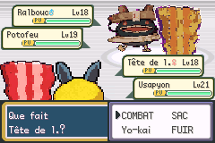
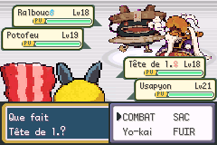
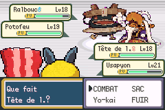
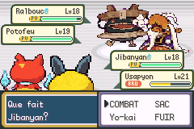

# Combat duo d’Ariane — sprite adverse remplacé par le dos du joueur

Défaut reproduit dans mGBA sur la bêta française initiale
(SHA-256 `5e350381135282f916616c221ef59db974fec501b73579a406c533e5104469e5`).
La capture reproduit le second adversaire affichant des pixels du sprite de dos
du joueur, recolorés avec sa propre palette.

## Cause et correction

L’introduction crée un deuxième portrait de sbire avec `CreateSprite`, puis
remplace son OAM par celui du premier portrait. Le nouveau sprite conserve
cependant la propriété de ses tuiles : sa destruction libère alors les tuiles
du portrait partagé, au lieu de son allocation d’origine. La libération
ultérieure du portrait principal peut ainsi rendre disponibles des tuiles
déjà réutilisées par les Yo-kai. Dans la reproduction, deux sprites de
combattants finissent tous deux à la tuile VRAM 358.

Le deuxième portrait est désormais une copie sans allocation propre, utilisant
la feuille graphique partagée. Il ne libère ni les tuiles ni la matrice du
portrait principal. La feuille possède toujours un seul propriétaire et est
libérée par le chemin natif existant. Les deux sbires sont toujours montrés.
La correction reste sous la condition du combat avec partenaire scénarisé.

## Vérifications

- Compilations publique et privée avec les OST existantes réussies.
- Reproduction avec Tête de l. 18, Usapion 21, Ralbouc 18 et Potofeu 19.
- En privé : garçon et fille, introduction, tour d’attaque et remplacement
  volontaire du Yo-kai du joueur, soit six contrôles de rendu.
- En public : les trois mêmes contrôles de rendu avec le garçon.
- Pour chaque combattant vivant : les 2 048 octets de pixels en VRAM
  correspondent à son propre tampon natif ; les plages de 64 tuiles sont
  disjointes. Les sprites ne partagent plus de zone mémoire.
- Le partenaire reste à l’index temporaire 6 ; les deux membres propres au
  joueur restent dans son équipe. Aucun résultat de combat n’est forcé.
- Dix sauvegardes natives déjà existantes rechargées avec Continuer,
  sans modification des fichiers : carte, position, équipe, niveaux et PV
  identiques. La sauvegarde personnelle de l’utilisateur n’a pas été fournie.

Fixtures : nouvelle partie, carte et équipe préparées, lancement de la fonction
native du duo. Les tests d’attaque et de remplacement repartent du même
instantané isolé. Ce sont des régressions graphiques, pas une reprise du parcours
normal à 100 %, qui demeure arrêté à Argenta.

[Introduction avec les deux sbires](apres/garcon/introduction.gif).

## Livraison

Branche : `fix/ariane-duo-sprites-20261024`. Aucune fusion sur master.
La base inclut aussi la correction de palette de Matt déjà préparée dans
`17022d05b`. Aucun changement du scénario, des statistiques, des musiques,
des ressources de Yo-kai ou du format des sauvegardes.

ROM avec OST : `33449979` octets, taille inchangée.
SHA-256 : `0b58f6555c007e49d3b530b03737d95fcc6725a3fb3e56dec4cfe29ff2f70ae8`.

Quitter mGBA puis remplacer la ROM en conservant le nom de base de la `.sav`.
Reprendre avec **Continuer** : un état rapide pris pendant le combat contient
encore les anciennes allocations graphiques en mémoire.
