# Galerie de travail des personnages

Planches des fichiers existants, sans retouche ni activation dans le jeu. Chaque planche conserve toutes les cases des fichiers. Ce ne sont pas des captures mGBA et leur présence ne vaut pas validation artistique.

## Nathan

Protagoniste et champion alternatif. État : `existant_a_revoir`.

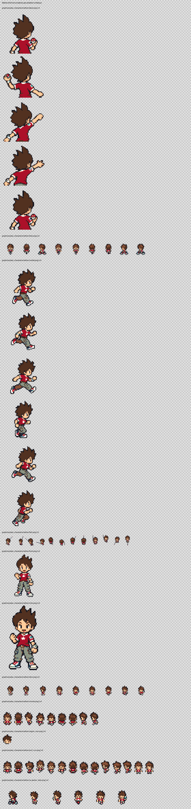

## Katie

Protagoniste et championne alternative. État : `existant_a_revoir`.

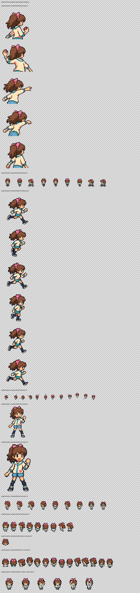

## Matt

Rival, trois apparitions de combat. État : `existant_a_revoir`.

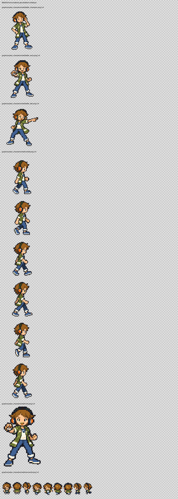

## Ariane

Championne. État : `existant_a_revoir`.

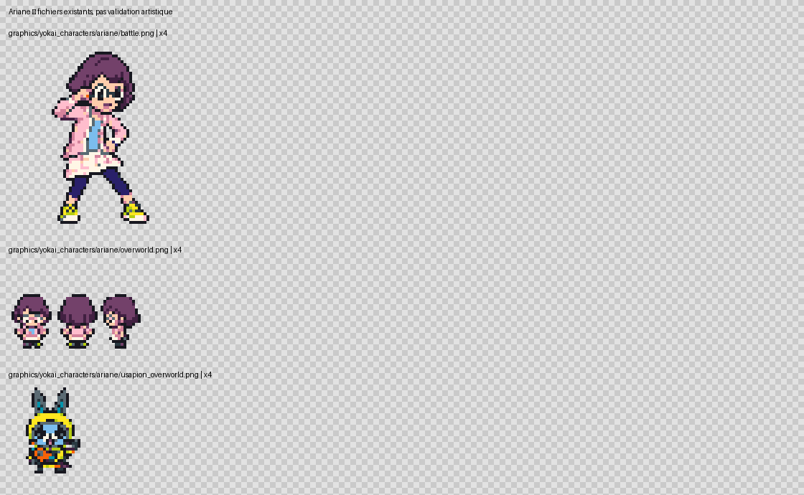

## Wyatt

Champion. État : `existant_a_revoir`.

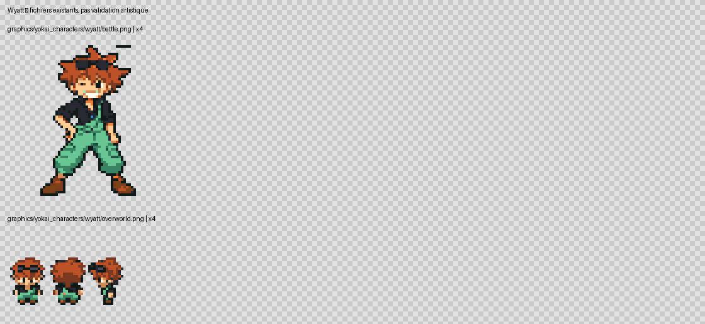

## Nathaniel

Ancêtre, version jeune du chapitre du passé. État : `existant_a_revoir`.

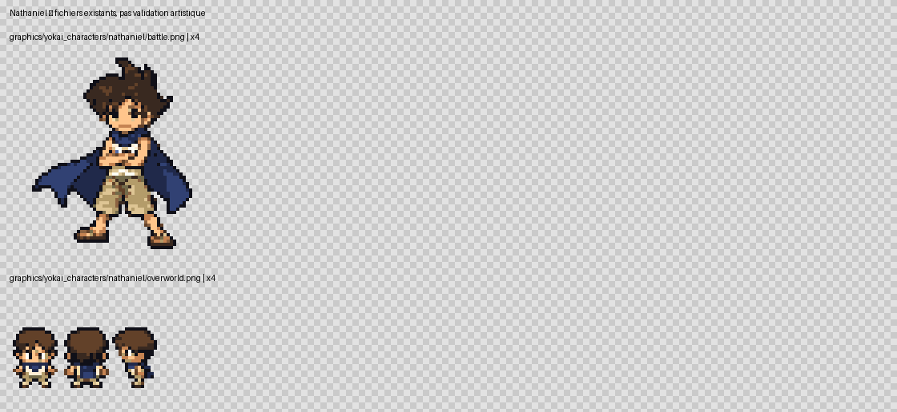

## Michael

Ancêtre, version jeune du chapitre du passé. État : `existant_a_revoir`.

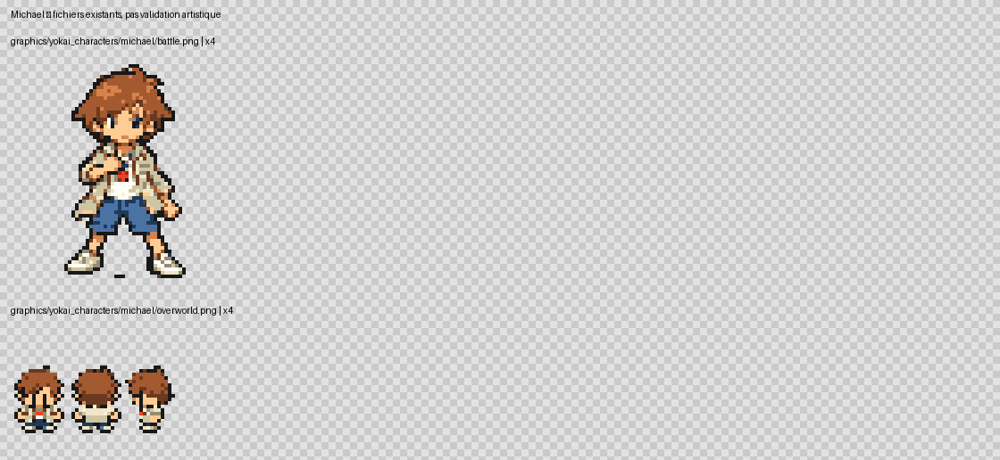

## Seigneur Enma

Personnage narratif, distinct de la créature capturable. État : `existant_a_revoir`.

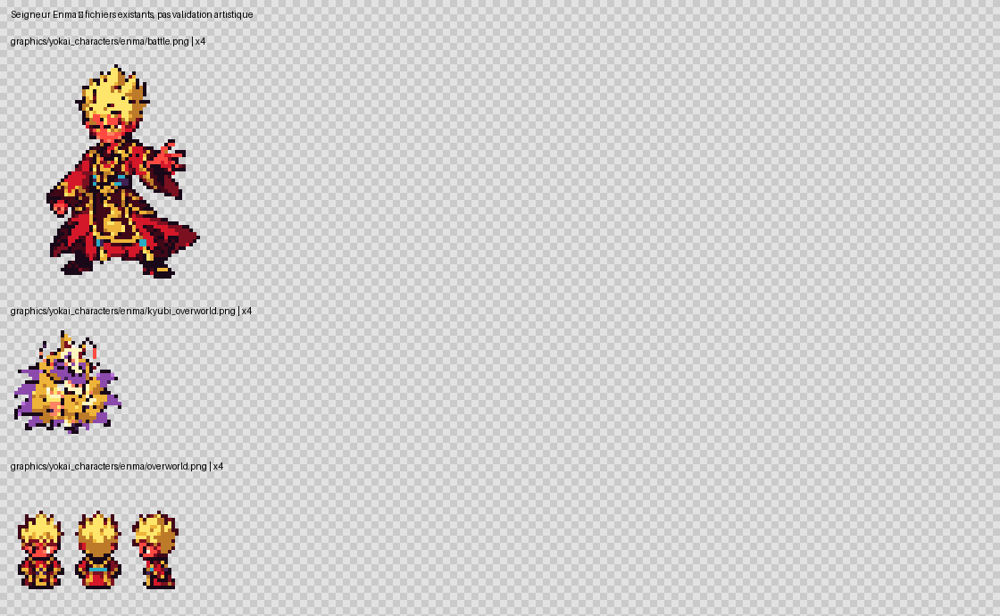

## Enma — tenue civile

Apparition déguisée à Argenta. État : `a_preparer_ou_reutiliser`.

Pas de dossier graphique dédié retrouvé sous cet identifiant. Vérifier les alias, références et possibilités de réutilisation avant de conclure à une ressource manquante.

## Domniscian

Boss et caméo existant. État : `existant_a_revoir`.

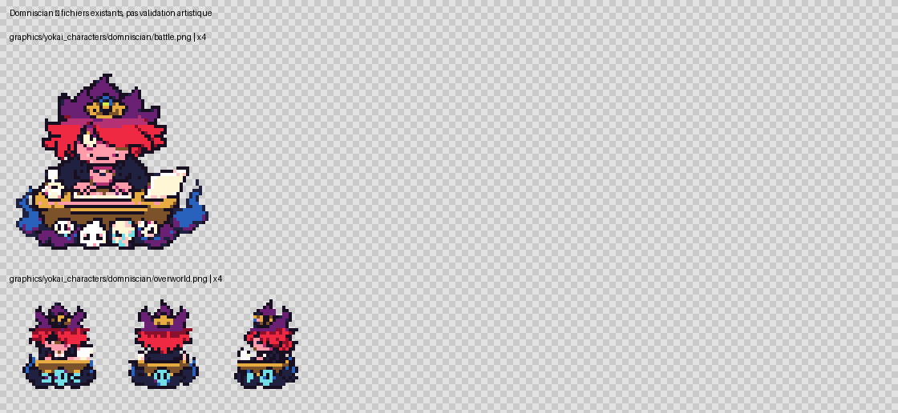

## Don Morleone

Antagoniste et champion. État : `existant_a_revoir`.

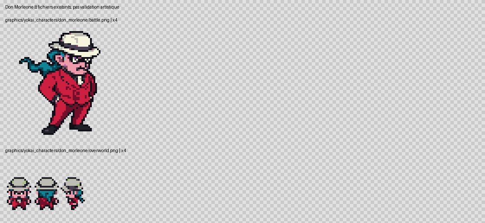

## Mafiamille 1

Carte commune, combat distinct. État : `existant_a_revoir`.

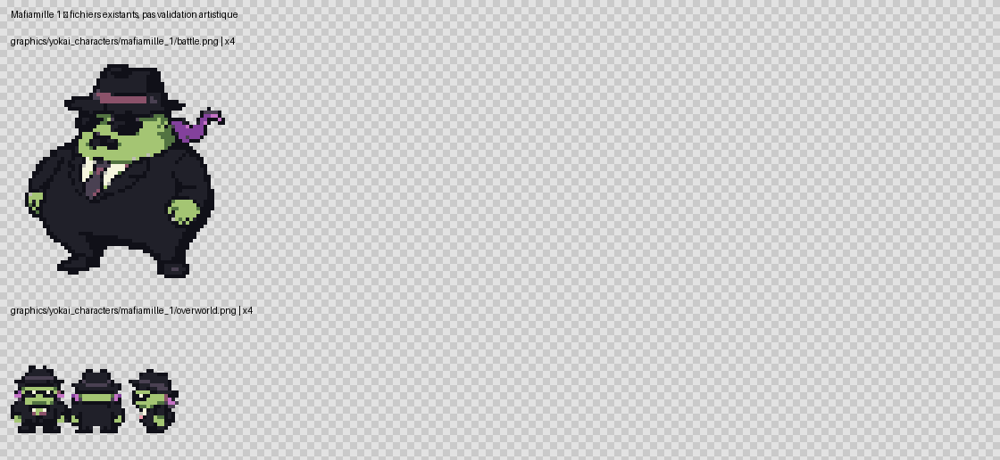

## Mafiamille 2

Carte commune, combat distinct. État : `existant_a_revoir`.

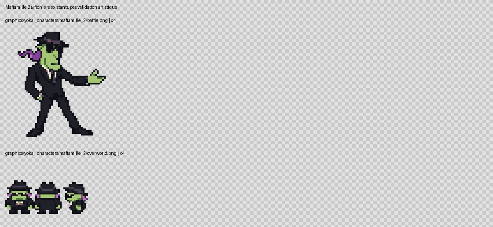

## Mafiamille 3

Carte commune, combat distinct. État : `existant_a_revoir`.

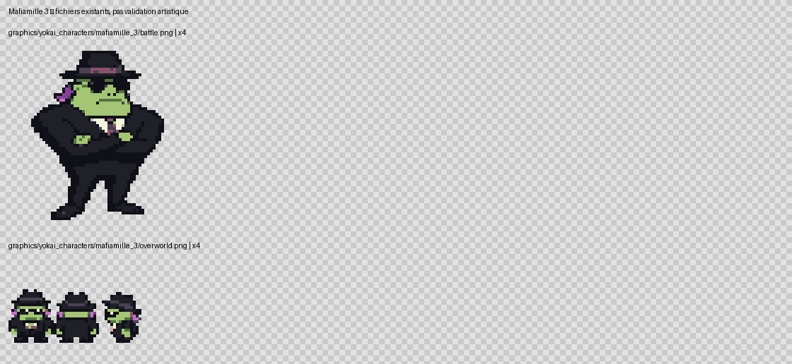

## Employé rouge

Même silhouette de carte que le bleu, palette distincte. État : `existant_a_revoir`.

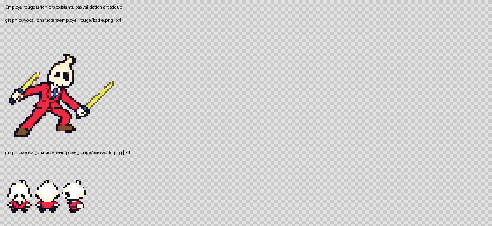

## Employé bleu

Même silhouette de carte que le rouge, palette distincte. État : `existant_a_revoir`.

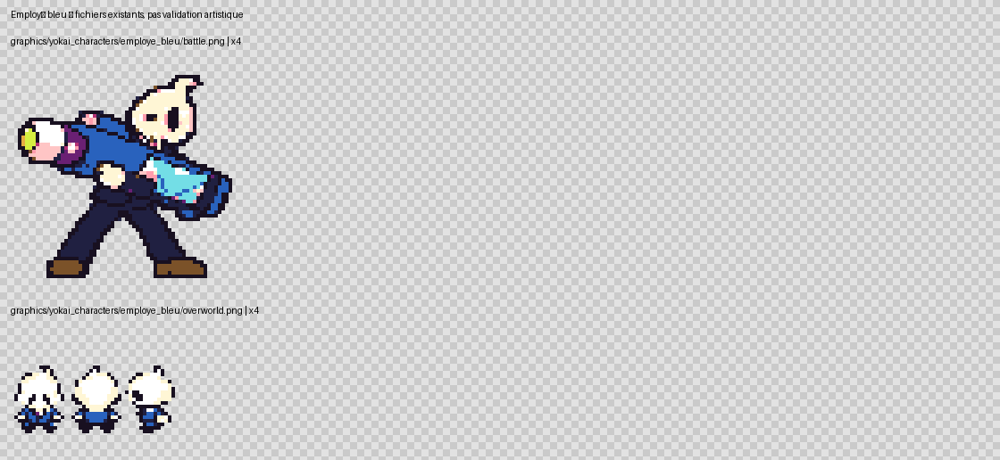

## Dr Jobard

En pause : ne pas poursuivre son redesign maintenant. État : `en_pause`.

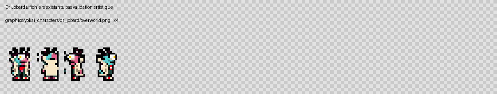

## Bérénice

Scientifique, Bourg Palette et Portes Mystères. État : `a_preparer_ou_reutiliser`.

Pas de dossier graphique dédié retrouvé sous cet identifiant. Vérifier les alias, références et possibilités de réutilisation avant de conclure à une ressource manquante.

## Steve Jaws

Introduction, champion et Yopple. État : `a_preparer_ou_reutiliser`.

Pas de dossier graphique dédié retrouvé sous cet identifiant. Vérifier les alias, références et possibilités de réutilisation avant de conclure à une ressource manquante.

## Mark Orckerberg

Allié de Yopple. État : `a_preparer_ou_reutiliser`.

Pas de dossier graphique dédié retrouvé sous cet identifiant. Vérifier les alias, références et possibilités de réutilisation avant de conclure à une ressource manquante.

## Whisper — majordome

Champion de Parmanie. État : `a_preparer_ou_reutiliser`.

Pas de dossier graphique dédié retrouvé sous cet identifiant. Vérifier les alias, références et possibilités de réutilisation avant de conclure à une ressource manquante.

## Alyzon

Championne, Zombie Night. État : `a_preparer_ou_reutiliser`.

Pas de dossier graphique dédié retrouvé sous cet identifiant. Vérifier les alias, références et possibilités de réutilisation avant de conclure à une ressource manquante.

## Zazel

Gardien du Temple ; combat supplémentaire non présumé. État : `a_preparer_ou_reutiliser`.

Pas de dossier graphique dédié retrouvé sous cet identifiant. Vérifier les alias, références et possibilités de réutilisation avant de conclure à une ressource manquante.

## Laure

Temple ; composition du combat duo à préciser dans les sources. État : `a_preparer_ou_reutiliser`.

Pas de dossier graphique dédié retrouvé sous cet identifiant. Vérifier les alias, références et possibilités de réutilisation avant de conclure à une ressource manquante.

## Marge

Temple ; composition du combat duo à préciser dans les sources. État : `a_preparer_ou_reutiliser`.

Pas de dossier graphique dédié retrouvé sous cet identifiant. Vérifier les alias, références et possibilités de réutilisation avant de conclure à une ressource manquante.

## Lady Perpetua

Adversaire du Temple. État : `a_preparer_ou_reutiliser`.

Pas de dossier graphique dédié retrouvé sous cet identifiant. Vérifier les alias, références et possibilités de réutilisation avant de conclure à une ressource manquante.

## McKraken

Adversaire du Temple, morphologie particulière. État : `a_preparer_ou_reutiliser`.

Pas de dossier graphique dédié retrouvé sous cet identifiant. Vérifier les alias, références et possibilités de réutilisation avant de conclure à une ressource manquante.

## Agent X

Dernier adversaire du Temple. État : `a_preparer_ou_reutiliser`.

Pas de dossier graphique dédié retrouvé sous cet identifiant. Vérifier les alias, références et possibilités de réutilisation avant de conclure à une ressource manquante.

## Soranaki

Climax ; formes et boss spécial à définir sans inventer. État : `a_preparer_ou_reutiliser`.

Pas de dossier graphique dédié retrouvé sous cet identifiant. Vérifier les alias, références et possibilités de réutilisation avant de conclure à une ressource manquante.

## Yopple Bot

Mini-boss ; format de combat à confirmer. État : `a_preparer_ou_reutiliser`.

Pas de dossier graphique dédié retrouvé sous cet identifiant. Vérifier les alias, références et possibilités de réutilisation avant de conclure à une ressource manquante.

## Juste Yoann

Quête créateur ; retrouver la référence déjà envoyée avant dessin. État : `a_preparer_ou_reutiliser`.

Pas de dossier graphique dédié retrouvé sous cet identifiant. Vérifier les alias, références et possibilités de réutilisation avant de conclure à une ressource manquante.

## Coach Antonic

Quête entraînement et trois accompagnateurs. État : `a_preparer_ou_reutiliser`.

Pas de dossier graphique dédié retrouvé sous cet identifiant. Vérifier les alias, références et possibilités de réutilisation avant de conclure à une ressource manquante.

## Scientifique récurrent

Même identité aux quatre apparitions ; ne pas confondre avec Jobard. État : `a_preparer_ou_reutiliser`.

Pas de dossier graphique dédié retrouvé sous cet identifiant. Vérifier les alias, références et possibilités de réutilisation avant de conclure à une ressource manquante.

## Fan de Jibanyan

PNJ de quête ; ressource générique possible. État : `a_preparer_ou_reutiliser`.

Pas de dossier graphique dédié retrouvé sous cet identifiant. Vérifier les alias, références et possibilités de réutilisation avant de conclure à une ressource manquante.

## Grand-père disparu

PNJ de quête ; ressource générique possible. État : `a_preparer_ou_reutiliser`.

Pas de dossier graphique dédié retrouvé sous cet identifiant. Vérifier les alias, références et possibilités de réutilisation avant de conclure à une ressource manquante.

## Spécialiste des chromatiques

PNJ de quête ; ressource générique possible. État : `a_preparer_ou_reutiliser`.

Pas de dossier graphique dédié retrouvé sous cet identifiant. Vérifier les alias, références et possibilités de réutilisation avant de conclure à une ressource manquante.

## Red

Personnage distinct de Nathan ; conserver ressources originales. État : `original_a_preserver`.

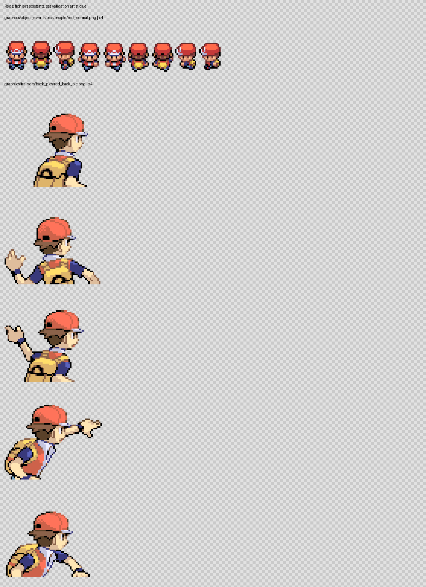

## Jibanyan — acteur de scène

Accompagnateur du Coach ; réutilisation possible du Jibanyan de Léo. État : `existant_a_revoir`.

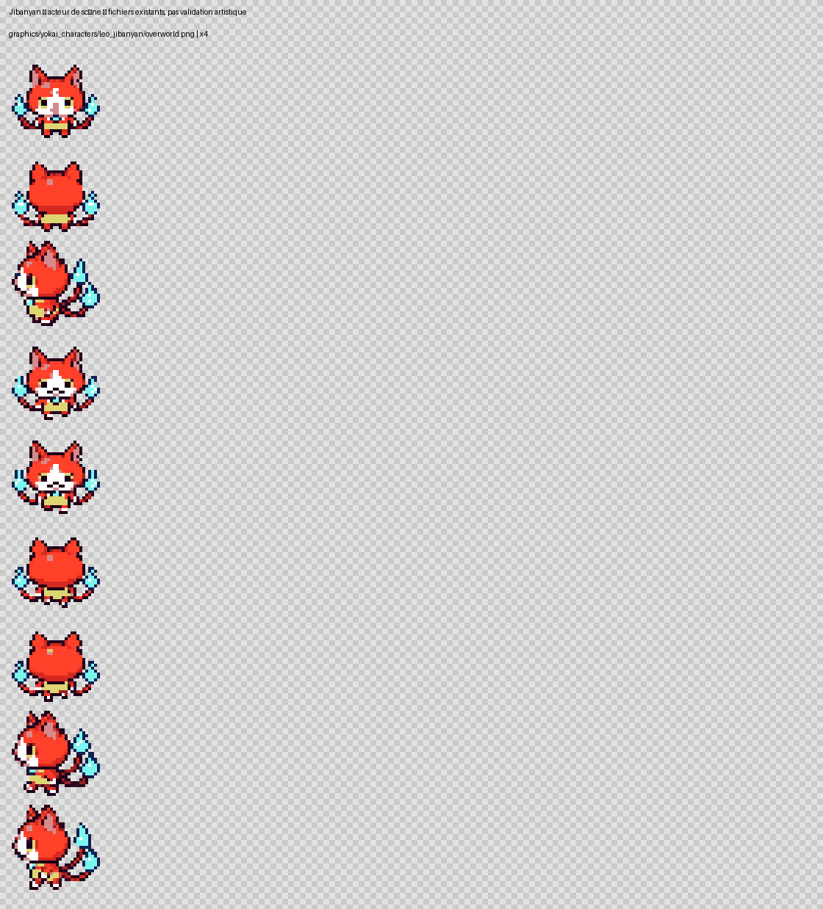

## Komasan — acteur de scène

Accompagnateur du Coach. État : `a_preparer_ou_reutiliser`.

Pas de dossier graphique dédié retrouvé sous cet identifiant. Vérifier les alias, références et possibilités de réutilisation avant de conclure à une ressource manquante.

## Whisper — acteur de scène

Accompagnateur du Coach, distinct de la tenue majordome. État : `a_preparer_ou_reutiliser`.

Pas de dossier graphique dédié retrouvé sous cet identifiant. Vérifier les alias, références et possibilités de réutilisation avant de conclure à une ressource manquante.

## Triptic-tac — acteur de scène

Voyage dans le passé. État : `a_preparer_ou_reutiliser`.

Pas de dossier graphique dédié retrouvé sous cet identifiant. Vérifier les alias, références et possibilités de réutilisation avant de conclure à une ressource manquante.

## Oni — acteurs de Terr’heure

Espèces, variantes et animations de poursuite à relever avant production. État : `a_preparer_ou_reutiliser`.

Pas de dossier graphique dédié retrouvé sous cet identifiant. Vérifier les alias, références et possibilités de réutilisation avant de conclure à une ressource manquante.

## Misterre — rencontre statique

Morphologie de créature, hors gabarit humain. État : `existant_a_revoir`.

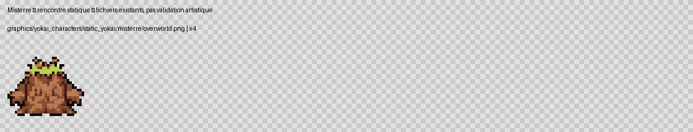

## Mademoaiselle — rencontre statique

Îles Écume ; morphologie de créature. État : `existant_a_revoir`.

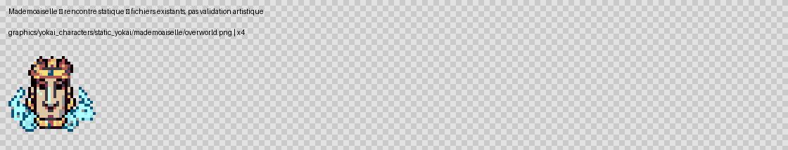

## Octorgone — rencontre statique

Centrale ; morphologie de créature. État : `existant_a_revoir`.

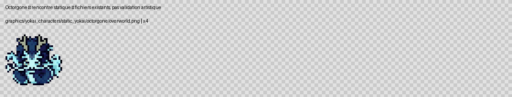

## Kyubi — rencontre statique

Mont Braise ; morphologie de créature. État : `existant_a_revoir`.

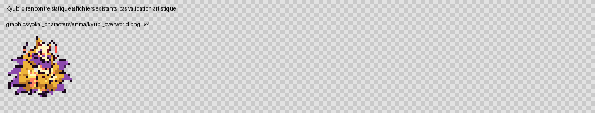

## Enma — créature capturable

Distinct du Seigneur Enma narratif. État : `existant_a_revoir`.

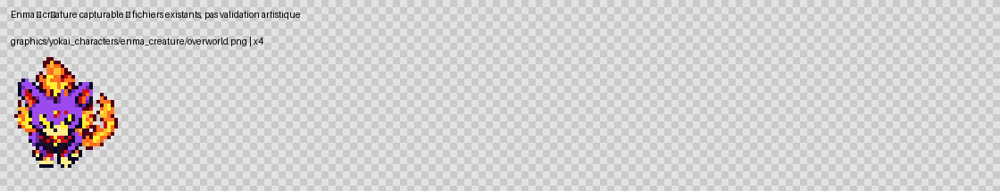

## Enma l’Ancien

Sanctuaire Divin ; ne pas inventer une forme non spécifiée. État : `a_preparer_ou_reutiliser`.

Pas de dossier graphique dédié retrouvé sous cet identifiant. Vérifier les alias, références et possibilités de réutilisation avant de conclure à une ressource manquante.
