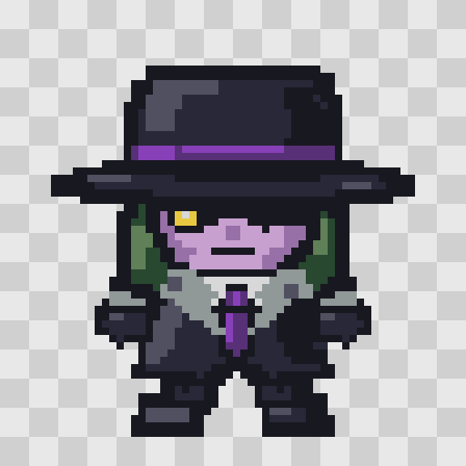

# Agent X — proposition native 64 × 64

- [PNG natif transparent : 64 × 64](agent-x-64.png).
- [Vue sur la grille de 64 × 64 cases, agrandie ×8](agent-x-64-grille-x8.png).
- [Source éditable : chaque case et les commandes à coordonnées entières](agent-x-64-source.json).
- [Palette JASC, 16 entrées dont 12 couleurs visibles utilisées](agent-x-64.pal).

## Dessin et proportions

Une vue de face inspirée des proportions compactes du Red fourni par le créateur : tête dominante abaissée sur les épaules, torse court, petites mains et pieds séparés. Chapeau noir et bande violette, cheveux verts, peau mauve, œil jaune sous le bord du chapeau, col gris, cravate violette. Contour sombre et ombres en aplats, sans anticrénelage. Le dessin occupe 50 × 51 cases dans le canevas de 64 × 64 ; la marge transparente fait partie du canevas.

Le PNG final est écrit directement à sa résolution native à partir des 4 096 cases de la source JSON. Aucun dessin de grande taille n’est réduit pour le fabriquer. Les agrandissements sont des aperçus uniquement. Une recherche de design a été réalisée avec Image Generation ; la tentative suivante de reconstruction sur grille a échoué sur un paramètre interne de cet outil. La reconstruction finale a donc suivi la voie d’édition native du skill du plugin. Les outils MCP propres au plugin ne sont pas exposés dans cette session : aucun appel de peinture ou d’analyse de ce plugin n’est revendiqué. Détail dans source/prompts-et-methode.md.

## Contrôles

Dimensions exactes 64 × 64, PNG indexé 4 bits, 12 couleurs visibles et indice 0 transparent, alpha strictement binaire, composantes visibles compatibles RGB555. Les 4 096 cases de la matrice et le replay des commandes de dessin donnent les mêmes pixels. Un nouvel export donne la même empreinte SHA-256. Résultats dans CONTROLE.json. Le stockage brut théorique en tiles GBA 4bpp serait de 2 048 octets ; aucune ROM n’a été compilée pour ce prototype.

## Périmètre

C’est une proposition graphique statique, **pas un sprite overworld déjà intégré ni une capture du jeu**. Les ressources actives du jeu, dont le petit Agent X précédent, ne changent pas. Le format actuel des personnages de carte est 16 × 32 ; ce prototype 64 × 64 ne doit pas y être substitué sans adaptation explicite du moteur. Les animations et autres orientations ne sont pas créées par ce lot. La validation technique ne vaut pas approbation artistique du créateur.

Reproduction : `python3 tools/yokai/exporter_agent_x_64.py` depuis le dépôt avec Pillow disponible. Ce script ne lit aucune ressource privée.
