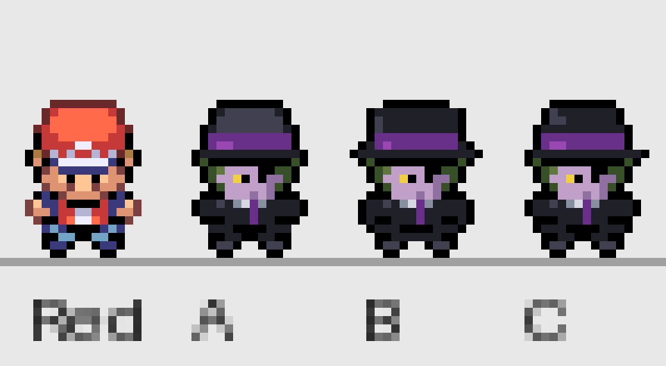

# Agent X au gabarit de Rouge Feu — trois propositions de face

[Comparaison à taille native](comparaison-native.png) · [Mesures sur Red](mesures-red-x12.png)

## Référence et mesures

Le sprite analysé est la première image de face de `graphics/object_events/pics/people/red_normal.png`, l’original de Rouge Feu présent au dépôt et correspondant à la pose fournie. Les mesures portent sur ces pixels natifs ; elles ne sont pas déduites à l’œil de l’aperçu de conversation agrandi. Le PNG de référence est conservé sous red-reference.png. MESURES_RED.json contient les coordonnées, conventions et couleurs exactes, ainsi que l’empreinte du fichier source.

| Élément | Mesure native |
| --- | --- |
| Case du moteur | 16 × 32 |
| Silhouette hors transparence | 14 × 19, x=1..14 et y=12..30 |
| Tête avec casquette | 14 × 12, y=12..23 |
| Calotte | 12 × 6, y=12..17 |
| Région visière/bande | 10 × 2, y=18..19, sélection des couleurs de casquette |
| Torse central annoté | 6 × 5, x=5..10, y=23..27 |
| Bras avec épaule et main | 4 × 4 par côté, y=23..26 |
| Jambes et chaussures | 3 lignes, y=28..30 |
| Chaque chaussure | 4 × 2, y=29..30 |
| Derniers pixels des semelles | y=30 ; x=4,5 et x=10,11 |
| Couleurs visibles | 12, plus transparence |
| Contours | 1 pixel ; rouge sombre sur la casquette et noir sur les autres zones |

Les regroupements anatomiques sont annotés explicitement : la largeur de torse est celle du noyau central, pas la largeur avec les bras. Les bornes de silhouette et des régions colorées sont calculées à partir des pixels non transparents. L’ombrage de Red emploie de petits aplats et quelques teintes par matériau ; aucune interpolation ni dégradé continu.

## Les trois essais

| Version | Silhouette exacte | Intention |
| --- | --- | --- |
| [A](agent-x-a.png) | 14 × 19 | Fidélité au gabarit : masque de transparence identique à Red, proportions les plus compactes. |
| [B](agent-x-b.png) | 16 × 19 | Identité renforcée : chapeau légèrement plus large et bas de manteau plus présent. |
| [C](agent-x-c.png) | 15 × 19 | Compromis : couronne de chapeau plus sombre et visière intermédiaire. |

Toutes les cases font 16 × 32 ; chaque proposition utilise 12 couleurs visibles, plus l’indice transparent 0. Les semelles sont aux mêmes coordonnées que celles de Red. Le chapeau noir à bande violette, les cheveux verts, le visage mauve, l’unique œil jaune et la cravate violette sont dessinés dans ces cellules, avec un manteau volontairement court visuellement. La silhouette compacte est prioritaire sur la longueur réaliste du manteau de l’artwork.

Les sources sont `agent-x-a-source.json`, `agent-x-b-source.json` et `agent-x-c-source.json` : chaque caractère correspond à une case native, « . » pour transparent, 1..c pour une couleur précise. Aucun dessin de grande taille ni recherche générée n’est utilisé pour fabriquer ces trois sprites. L’export écrit directement les indices en 16 × 32. Seules les vues de comparaison sont agrandies au plus proche voisin.

## Contrôles et limites

CONTROLE.json vérifie dimensions, alpha binaire, indices de palette, correspondance entre chaque case et le PNG, alignement des pieds et identité du masque A/Red. Chaque silhouette est d’un seul tenant, sans pixel opaque détaché. Une seconde exportation produit les mêmes PNG.

Ce sont trois propositions statiques pour choix artistique : **aucune animation créée, aucune intégration, aucun remplacement du sprite actif**. Elles ne sont pas présentées comme des captures mGBA et aucune nouvelle compilation n’est revendiquée pour ce lot hors moteur. Les autres directions et animations ne seront pas déduites automatiquement de cette planche ; elles attendent le choix du créateur. Les dimensions exactes et les contrôles ne constituent pas une approbation artistique.

Reproduction : `python3 tools/yokai/exporter_agent_x_frlg_abc.py`, avec Pillow, depuis le dépôt. Les PNG sont indexés 4bpp avec transparence, compatibles avec une future conversion graphique GBA ; aucune ressource privée n’est nécessaire pour reproduire les propositions.

## Retouches de l’œil de A

Deux propositions conservent tous les pixels de A sauf un ou deux pixels mauves remplacés par du jaune : A+1 en (5,21), A+2 en (5,21) et (6,20), coordonnées depuis zéro. L’œil reste unique. Palette, transparence et silhouette de 14 × 19 sont inchangées.

[Comparaison native](comparaison-yeux-native.png) et [agrandissement ×12](comparaison-yeux-x12.png) : Red, A original, A+1, A+2. Aucun remplacement dans le jeu. Sources complètes dans les JSON correspondants ; contrôle dans CONTROLE_YEUX.json. Reproduction : `python3 tools/yokai/retoucher_yeux_agent_x_a.py`.

## Regard sous le chapeau

Nouvel essai A-regard : cinq cellules modifiées depuis A+1 pour une petite iris jaune en L, une pupille sombre et une ombre asymétrique du bord du chapeau. Même silhouette 14 × 19 et palette. Comparaison Red / A+1 avant / nouveau regard dans `comparaison-regard-native.png` et `comparaison-regard-x12.png`. Proposition non intégrée, sans animations. Reproduction : `python3 tools/yokai/retoucher_regard_agent_x.py`.
