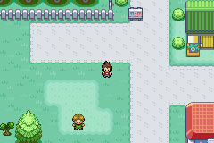
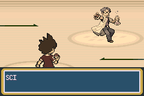

# Bêta 0.1 — diagnostic audio et version de test

La compression des OST introduit des erreurs mesurables dans le son rendu par mGBA. Cette version réduit ces erreurs, mais **la disparition complète du grésillement signalé par Yoann n'est pas certifiée à l'écoute**. Les contrôles sont des captures et analyses numériques ; aucune écoute humaine ni comparaison sur console physique n'est revendiquée. Il faut écouter les extraits et essayer la ROM avant de déclarer le problème résolu.

Base : `integration/beta-0.1-20261024`, commit `08ee1aa042b3d5aee1caa5afb988a52814ee6966`. Correction isolée sur `fix/audio-gresillement-beta-0.1`. Aucune fusion sur `master`.

Le pipeline existant décodait les MP3 en mono PCM16 à 13 379 Hz (12 000 Hz pour les crédits), arrondissait en PCM8, puis utilisait le DPCM du SDK : 16 deltas fixes, 33 octets pour 64 échantillons. Une OST complète est ainsi une seule voix contenant tous ses instruments. Ce n'est pas une séquence MIDI avec des instruments GBA séparés : augmenter le nombre de canaux ne restaure pas la précision perdue par sa compression.

Le moteur de la bêta utilise 5 canaux Direct Sound, un volume maître de 12/15, un mélangeur à 13 379 Hz et une sortie PWM 8 bits. Les extraits musicaux seuls utilisent un canal. Ces réglages et le décodeur ARM d'origine étaient déjà identiques à ceux de `origin/master` avant cette correction ; les adaptations Yo-kai ajoutent notamment le routage, les gains et la reprise après les effets. Comparaison effectuée avec les **sources du moteur du dépôt**, pas avec une ROM commerciale de Rouge Feu : aucun enregistrement de cette dernière n'est présenté.

Avec les lecteurs musicaux et les effets arrêtés, la sortie brute de mGBA est exactement nulle sur 600 images, avant et après. Les six effets/cri testés restent audibles sans musique, sans échantillon de sortie saturé. Aucune saturation de sortie n'est observée dans les extraits des 32 pistes. Cela ne prouve pas l'absence de saturation à tout instant de tout le jeu ; les captures de début de piste ne couvrent pas chaque passage complet.

L'erreur de compression est confirmée en comparant les données décodées aux PCM16 originaux et en jouant un contrôle PCM8 dans le même moteur. Sur le titre, la comparaison native avec ce contrôle passe d'environ 21,0 à 22,5 dB pour les captures livrées (alignement à l'échantillon entier). Cette mesure ne comprend pas un jugement d'écoute et dépend de l'alignement du rendu. Les mesures de conversion sur les pistes complètes sont plus directement reproductibles : titre 26,09 → 30,93 dB ; crédits 21,13 → 23,95 dB. Un SNR plus haut signifie moins d'erreur par rapport au PCM de référence.

Le passage expérimental du PWM de 8 à 9 bits a été **écarté** : il améliore la mesure large bande d'un sinus de contrôle, mais dégrade celle de la bande 0–6 kHz (35,33 → 32,88 dB). Le doublement expérimental de la fréquence du mélangeur et une hausse de volume ont également été écartés. Aucun de ces réglages n'est dans la ROM livrée. Aucun filtre de débruitage n'est appliqué au jeu ou aux extraits livrés.

La correction retenue ajoute un format adaptatif IMA dans le type privé `WaveData` 2 : prédicteur signé 16 bits, index adaptatif, blocs indépendants de 256 échantillons / 131 octets. La restitution reste PCM8 dans le mélangeur natif. Le type SDK 1 et les échantillons des bruitages d'origine sont conservés. Le cache du nouveau décodeur distingue l'adresse de la piste et son bloc pour permettre l'alternance des canaux.

Les 32 sources sont évaluées contre leur encodage précédent. La reconversion est retenue uniquement si elle gagne au moins 1 dB sur la piste entière : **31 pistes reconverties, une piste inchangée (slot 18, Robon Arrives)**. Les gains vont de 1,03 à 5,60 dB, médiane 3,30 dB. Ce seuil n'est pas une garantie que chaque passage sera subjectivement meilleur. Le nouvel encodeur repart des PCM16 originaux vérifiés par SHA-256, jamais de l'ancien DPCM déjà dégradé. Les mélodies, arrangements, volumes, fréquences, nombres d'échantillons, positions des boucles et durées sont conservés. Les valeurs décodées de quelques jonctions varient avec la quantification ; leurs écarts sont consignés dans `CONVERSION.json` et demandent aussi une écoute.

Les limites demeurent celles de cette restitution : sources mono rééchantillonnées, compression avec perte, mélange et sortie en 8 bits. Le décodeur adaptatif ne rend pas le son identique aux MP3 originaux. Il peut rester du souffle, notamment dans les passages faibles. Les captures du cœur mGBA évitent la compression AAC des anciennes vidéos ; elles ne testent pas les réglages de périphérique audio, les tampons ou les interruptions propres à l'installation mGBA de Yoann. Aucun défaut spécifique à cette installation n'est donc exclu avec certitude.

Les vérifications réalisées dans le cœur mGBA sont consignées dans les JSON voisins :

- `DECODER.json` : correspondance échantillon par échantillon avec le décodeur hôte, extrêmes signés, silences, rampes, sinus, franchissements de blocs, changements d'adresse du cache ; compatibilité du DPCM SDK contrôlée.
- `NATIVE_PLAYBACK.json` : lecture des 32 en-têtes avant/après, fin réelle des deux pistes sans boucle, boucles accélérées des autres par positionnement de test, silence numérique après arrêt. Ce contrôle ne constitue pas l'écoute de toutes les pistes complètes.
- `COMBATS.json` : trois interactions et combats natifs gagnés au contrôleur — scientifique du Manoir, Dojo, employé de Yopple — puis retour correct à la musique de terrain. Progression, équipe et accès préparés uniquement dans les instances de test.
- `BRUITAGES_ATTAQUES.json` : Surf, Ultralaser, Fatal-Foudre, Déflagration, Explosion et Psycho Boost des deux côtés ; musique toujours présente après les douze animations, aucun échec de reprise observé. Appels d'animation de test dans une scène de combat native.
- `SFX.json` : sélection, porte, ouverture de Ball, expérience, coup super efficace et cri nº149, avant/après sans musique ; tous audibles et aucune sortie saturée dans ces captures.
- `FIELD_SAVE.json` : capture sonore dans Bourg Palette, Route 1, Jadielle et Lavanville ; sauvegarde interne créée par la bêta précédente puis chargée par le vrai menu Continuer de la nouvelle ROM.
- Les compilations privée et publique réussissent. Aucun scénario, tableau de sauvegarde, portrait, sprite ou fonctionnalité hors audio n'est modifié. Aucun fichier de sauvegarde personnel n'a été utilisé ni écrasé. Aucun profilage sur GBA physique n'est réalisé.





La ROM privée mesure **33 319 168 octets**, soit **126 287 octets de moins** que la bêta précédente ; il reste 235 264 octets sous la limite de 32 Mio. SHA-256 : `f95ffce4462f1797843703c360d00a2509a39d846f9863abde1ef734694f1a6c`.

Les WAV avant/après sont enregistrés avec le même cœur, les mêmes appels et volumes, sans normalisation. La capture native est stéréo PCM16 / 65 536 Hz ; l'export de livraison est WAV PCM16 / 48 000 Hz sans compression avec perte. Les fichiers « comparaison » contiennent AVANT, une demi-seconde de silence, puis APRES. L'archive contient aussi les extraits séparés du titre, de ville, de route, de combat sauvage, de boss et des crédits.

Pour reprendre une partie personnelle, conserver le fichier `.sav` original et utiliser une copie portant le même nom de base que la nouvelle ROM. La compatibilité vérifiée concerne les sauvegardes internes du jeu, pas les états instantanés d'émulateur.

Reproduction de la préparation privée, avec une carte de sources privée contenant les chemins et empreintes des PCM16 (voir l'aide du script) :

```sh
source /workspace/.setup/env.sh
OPENBLAS_NUM_THREADS=1 python tools/yokai/preparer_audio_adaptatif.py \
  --source-pack /workspace/private-audio/title-credits-integration \
  --source-map /workspace/artifacts/audio-diagnostic-beta-0.1/source-map-complete.json \
  --output /workspace/private-audio/audio-adaptive-integration --jobs 3
make -j6 YOKAI_AUDIO_DIR=/workspace/private-audio/audio-adaptive-integration
YOKAI_QA_ROM=$PWD/pokefirered_audio.gba YOKAI_QA_ELF=$PWD/pokefirered_audio.elf \
  YOKAI_ADPCM_QA_DIR=/tmp/adpcm-verification python tools/yokai/tester_adpcm_mgba.py
python tools/yokai/tester_comparaison_audio_mgba.py \
  --before-rom /workspace/artifacts/beta-0.1/Pokemon_Yokai_Watch_Beta_0.1.gba \
  --before-elf /workspace/artifacts/audio-diagnostic-beta-0.1/baseline.elf \
  --after-rom pokefirered_audio.gba --after-elf pokefirered_audio.elf \
  --output /tmp/audio-comparaison-mgba
```

Les fichiers audio privés ne sont pas ajoutés au dépôt source. Les scènes de test existantes ont été exécutées avec leurs sorties redirigées, sans écraser leurs rapports historiques. La ROM et les comparaisons restent une livraison de test : **aucune affirmation « grésillement totalement résolu » à ce stade**.
