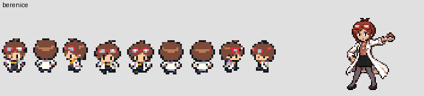

# Champions de Kanto × Yo-kai Watch — audit et préparation

**Étape 1 uniquement. Équipes proposées et choix artistique de Bérénice en attente de ton accord.** Aucun Champion, événement, sprite actif ou combat n’est modifié dans cette livraison.

Branche dédiée : `feature/champions-yokai-watch`, créée sur `d32774305cc02651ea976f04c6a1174aabf42a05`, dernière validation publiée de `feature/lavanville-zombie-night`. Aucun merge sur `master`.

## Décisions à valider

| Combat | Proposition, dans l’ordre d’envoi |
|---|---|
| Katie / Nathan, badge 2 | Noko **14**, Crocho **16**, **Jibanyan 21** |
| Ariane Célestin, badge 3 | Antonnerre **18**, Padrézo **19**, Parantonn **21**, **Usapion 23** |
| Alyzon Bie, badge 4 | Potofeu **27**, Whisper **28**, Triptic-tac **29**, **Zombie Colosse 31** |
| Nathaniel / Michael, badge 7 | Métaurolog **40**, Sirénité **41**, Sal de bain **41**, Brumella **42**, Faux Kappa **43**, **Hovernyan 45** |

Les noms du document correspondent respectivement à « Métaureaulog » nº34, « Sirènité » nº67 et « Usapyon » nº100 dans le registre actuel. Ce sont bien les espèces demandées ; aucun changement global de nom ou d’évolution n’est proposé.

Pour Bérénice, je recommande le **lot complet retrouvé sur `codex/reprise-scenario-2026-10-22`** : neuf poses overworld et portrait assorti. Il n’est pas encore installé dans cette branche. Sa conversion porte explicitement le statut `converted_not_yet_engine_tested` ; aucune validation artistique finale n’est déduite de sa simple présence dans Git.



Un autre portrait existe dans `art/personnages-production`, sans overworld assorti identifié sous ce nom. Le PNG y est identique entre la branche locale et distante :


Choix proposé : **le lot complet ci-dessus**, plutôt qu’un mélange de ces deux directions graphiques. Aucun nouveau dessin ni personnage de substitution n’est nécessaire. Les noms complets d’Ariane et Bérénice seront employés dans les dialogues ; les champs courts afficheront **ARIANE** et **BÉRÉNICE**.

## Branches et ressources retrouvées

L’inventaire [AUDIT.json](AUDIT.json) enregistre les références locales et distantes présentes après actualisation de **toutes les branches distantes**, leurs commits et leurs chemins candidats. Recherche des noms, variantes non accentuées et préfixes : `wyat`, `cardamom`, `kati`, `nathan`, `arian`, `celestin`, `beren`, `belier`, `michael`, `hailey`, `inaho`, `fumi`, `keita`. Les branches archivées et artistiques ont aussi été examinées.

La base Lavanville descend des branches Argenta, Mafiamille et Don Spiraton. La branche audio et la branche artistique ont des historiques séparés : leurs contenus utiles sont déjà partiellement repris dans cette base, sans qu’une relation d’ancêtre commune suffise à en prouver l’équivalence. Aucune de ces branches n’est fusionnée ici.

L’ancienne branche scénario a déjà changé plusieurs Champions, avec **une distribution différente de la demande actuelle** : Bérénice à Carmin, Ariane à Safrania et remplacement de Koga. Elle ne doit donc pas être fusionnée. Seuls les fichiers graphiques retenus seront extraits individuellement, sans ses équipes, scripts ou identifiants.

| Personnage | Ressources présentes dans la base | État et réutilisation prévue |
|---|---|---|
| Wyatt | `graphics/yokai_characters/wyatt/{overworld,battle}.png` | OW 48×32 : trois orientations 16×32 ; portrait 64×64. Déjà enregistré dans le moteur : OW160, portrait152. |
| Katie | `graphics/yokai_characters/katie/{normal,front}.png` | OW 144×32 : neuf poses 16×32 ; portrait 64×64. Ressources actives du protagoniste et du cameo, OW157 ; portrait LEAF. |
| Nathan | `graphics/yokai_characters/nathan/{normal,front}.png` | OW 144×32, neuf poses ; portrait 64×64. Ressources actives du protagoniste et du cameo, OW156 ; portrait RED. Le dos du joueur n’est pas modifié. |
| Ariane | `graphics/yokai_characters/ariane/{overworld,battle}.png` | OW 48×32, trois orientations ; portrait 64×64. Déjà enregistré : OW152, portrait148. |
| Bérénice | Lot `graphics/yokai_characters/berenice/` dans le commit `2647bc1627050f193cc9606f8c0f5f1151986047` | OW144×32, neuf poses ; portrait64×64 et palettes retrouvés. À valider visuellement puis enregistrer dans le moteur actuel. Copies exactes consultables dans `ressources/berenice/`. |
| Nathaniel | `graphics/yokai_characters/nathaniel/{overworld,battle}.png` | OW48×32, trois orientations ; portrait64×64. Déjà enregistré : OW158, portrait150. |
| Michael | `graphics/yokai_characters/michael/{overworld,battle}.png` | OW48×32, trois orientations ; portrait64×64. Déjà enregistré : OW159, portrait151. |

Les PNG actifs recensés sont indexés, avec au maximum 16 couleurs et transparence d’indice0. Le JSON fournit dimensions, couleurs, SHA256 et branches contenant des octets identiques. **Aucun personnage n’est totalement dépourvu de ressources retrouvées.** Bérénice nécessite une sélection artistique, pas une génération automatique.

Les quatre personnages à trois orientations disposent de la face, du dos et du profil, avec miroir natif pour l’autre profil. **Ce ne sont pas neuf poses de marche.** Cela suffit pour un Champion immobile qui se tourne vers le joueur ; aucune marche de ces personnages ne sera ajoutée sur la base de ces trois images. Une future scène les faisant marcher demanderait des poses supplémentaires à valider.

## Équipes réellement actives

| Badge | Champion actuel | Équipe réelle, dans l’ordre du tableau |
|---|---|---|
| 1 | Pierre | Felipaix8, Bouh10, Passpa12 |
| 2 | Ondine | Murhaine14, Faux Kappa16, Sirènité19 |
| 3 | Major Bob | Antonnerre18, Usapyon19, Tontonnerre21, Parantonn23 |
| 4 | Alyzon Bie | Potofeu27, Whisper28, Triptic-tac29, Mémogre31 |
| 5 | Koga | Toumou34, Lulugubre35, Émousstik36, Épinyan38, Slurpent40 |
| 6 | Morgane | Baku36, Ed Mémoire37, Fourchelangue38, Mognyan39, Savantard42 |
| 7 | Auguste | Tête de lard40, Sabrille41, Poulpater42, Feulion43, Kyubi45 |
| 8 | Don Morléone | Pachycoul41, M. Felipaix42, Crocho44, Pachypipi45, Tryptik49 |

Source : `src/data/trainers.h`, tableaux effectivement référencés de `src/data/trainer_parties.h`, talents forcés de `src/data/yokai_trainer_abilities.h`, données globales et pointeurs actifs d’apprentissage. Le fichier historique `equipes_boss_validees.json` est insuffisant : sa fiche Érika décrit encore l’ancienne équipe Plante.

[EQUIPES.md](EQUIPES.md) présente **toutes les attaques, niveaux, objets, talents et statistiques réelles**, ainsi que les propositions détaillées. Les anciennes attaques imposées hors apprentissage de niveau y sont signalées ; elles ne sont pas corrigées automatiquement.

### Wyatt et Bérénice

Pour Wyatt : conserver octet pour octet les trois membres, niveaux, attaques, objets, IV, talents et paramètres d’IA de Pierre. Son équipe contient actuellement **deux Sol et un Roche**. Cela reste inchangé conformément à la priorité explicite de conserver l’équipe exacte. L’ordre natif sera vérifié ; aucun rééquilibrage n’est autorisé.

Pour Bérénice : les cinq membres de Morgane sont tous **Psy purs**. Aucun problème de type n’a été trouvé ; conservation de l’intégralité de cette équipe et de ses objets.

### Katie / Nathan : raisonnement de la proposition

Deux Normal purs, puis Jibanyan **Feu**, sans modifier ses données. Trois adversaires comme Ondine, aucun objet de soin de Dresseur, aucun objet tenu ; IV24 comme auparavant. Noko reste une ouverture modeste. Crocho apporte de l’endurance et une attaque physique ; Morsure évite une équipe dépendant entièrement des dégâts Normal. Jibanyan termine avec Flammèche, Vive-Attaque, Combo-Griffe et Brouillard.

**Le niveau final passe de19 à21**, proposé pour compenser le remplacement de Sirènité (470 de statistiques de base) par Jibanyan (320). Crocho16 remplace Faux Kappa16 et augmente la résistance du milieu de combat. Cela conserve trois adversaires et une plage proche de l’existant ; une équivalence de difficulté n’est pas démontrée par les seules statistiques. Il faudra la vérifier en équipe de joueur normale après validation. Aucun Bandinyan ni autre évolution n’est substitué à Jibanyan.

### Ariane : raisonnement de la proposition

Quatre adversaires aux mêmes niveaux18/19/21/23, dont **trois Électrik** ; Usapion reste **Acier**. Padrézo remplace le Tontonnerre Vol pour rendre la spécialité majoritaire. Usapion passe du deuxième emplacement au dernier. Parantonn descend de23 à21 et conserve une présence défensive forte, mais ses attaques sont limitées à son apprentissage réel à ce niveau : pas d’Onde de Choc anticipée pour lui. Usapion23 peut légalement utiliser Griffe Acier, Vive-Attaque, Météores et Onde de Choc.

Conserver les objets de soin actuels de Major Bob : Super Potion et Total Soin. L’énigme des poubelles, les interrupteurs, le Badge Foudre et la CT34 restent en place. La difficulté reste à éprouver : conserver le nombre et les niveaux ne suffit pas à la certifier.

### Nathaniel / Michael : raisonnement des niveaux

Six adversaires au lieu de cinq, **plafond maintenu à45** comme Kyubi actuellement. Les trois premiers sont40/41/41, puis42/43/45, pour limiter la hausse d’endurance totale du combat. Aucun membre imposé n’évolue : Métaurolog reste nº34 et Faux Kappa nº20.

Types conservés : Normal, Eau, Ténèbres, Spectre, Eau, Vol. Hovernyan possède **144 en Attaque et142 en Vitesse de base**, contre57/42 pour Métaurolog et65/80 pour Faux Kappa. Au niveau45, Bec Vrille et Vive-Attaque lui donnent une vraie fonction de dernier adversaire ; le set proposé évite d’ajouter Hâte à cette vitesse déjà élevée. Les six membres et leurs quatre attaques légales figurent dans le détail. Les Hyper Potion et Total Soin actuels sont conservés.

## Zombie Colosse dans l’équipe d’Alyzon

### Architecture actuelle constatée

`LavanvilleStartZombieBattle()` crée un monstre temporaire à partir de `SPECIES_NIDORAN_M` (Potofeu), puis remplace son surnom, ses statistiques et ses attaques. Il déclenche un **combat sauvage scénarisé**, avec `BATTLE_TYPE_LAVENDER_ZOMBIE` et deux bits de variante. `LavanvilleLoadZombieGfx()` et `GetYokaiBattleGeometry()` choisissent alors le graphisme de l’adversaire selon ces bits.

Cette signalisation s’applique à **tout le combat**. L’utiliser sur Alyzon transformerait aussi visuellement Potofeu, Whisper et Triptic-tac, et changerait plusieurs règles d’introduction et de combat. Elle ne convient donc pas à un seul membre d’équipe.

### Solution proposée, isolée par Dresseur et emplacement

1. Garder `TRAINER_LEADER_ERIKA` et sa classe native Champion, ses quatre emplacements, ses récompenses et son retour de victoire. Installer le Colosse uniquement dans l’emplacement3, niveau31, lors de `CreateNPCTrainerParty()` ; un descripteur séparé identifie cet adversaire par **ID du Dresseur + index de partie**, jamais par le seul numéro d’espèce ou le surnom.
2. Utiliser un gabarit interne existant dans cette instance temporaire, comme les zombies actuels, puis remplacer ses statistiques, attaques et surnom. Aucun nouveau numéro du Médallium, aucune modification de `gSpeciesInfo`, de l’évolution, des 151 noms ou des apprentissages globaux. Le Potofeu du premier emplacement conserve son comportement normal.
3. Garder les règles `BATTLE_TYPE_TRAINER`. La capture est donc interdite par le combat de Dresseur natif, sans appliquer le drapeau des zombies errants. Aucun état spécial n’est écrit dans les Pokémon du joueur ou dans la sauvegarde.
4. Réutiliser les octets du sprite, de la palette et les paramètres de cadrage validés du Colosse. Le prédicat par emplacement doit être partagé par le chargement graphique, la géométrie OAM, les noms affichés et les effets qui rechargent le sprite. Respecter le clone de Clonage : l’habillage du Colosse ne doit pas remplacer le leurre. Vérifier aussi les animations, les retours au combat, la transformation/Copie et les données de type/talent.
5. Proposition de valeurs **finales en combat**, distinctes de statistiques de base : **PV140 / Atq80 / Déf80 / Vit25 / AtqSp36 / DéfSp54**, niveau31, type Spectre ; conserver Lévitation du gabarit actuel des zombies. Attaques : Écras’Face, Jet-Pierres, Groz’Yeux, Étonnement. Ce descripteur ne touche pas au Colosse errant de niveau24, qui reste à110/62/62/19/28/42 et conserve ses attaques.
6. Définir aussi le rendement d’EXP de cette instance : proposition **156**, comme l’ancien Mémogre, plutôt que d’hériter silencieusement du rendement60 du gabarit. L’EXP partagée et les multiplicateurs restent natifs. Auditer les accès au nom d’espèce, au cri, à l’icône de capture et aux données d’espèce pour éviter une présentation accidentelle de Potofeu.
7. Conserver l’ordre forcé déjà présent pour Alyzon dans `ShouldSwitch`, `GetMostSuitableMonToSwitchInto` et le choix d’une cible de remplacement forcé. Généraliser cette règle uniquement aux signatures des nouveaux Champions concernés, pour que Jibanyan, Usapion et Hovernyan arrivent eux aussi en dernier, y compris contre Hurlement/Cyclone. Aucune modification de l’IA de Koga ou Don Morléone.
8. Ajouter une intervention de texte après l’animation d’envoi du Colosse, avant le tour suivant, dans la séquence native de remplacement. Un booléen **temporaire au combat**, remis à zéro au démarrage et libéré en sortie, empêche de répéter le texte après un retour du Colosse. Le retour du script doit reprendre exactement le moteur de combat et ses effets d’arrivée ; aucune scène overworld ni nouvelle musique.

Découpage de dialogue proposé, à mesurer avec la police native avant validation moteur :

```text
ALYZON : Et maintenant,
je vais te présenter

mon petit préféré !
Hihi !
```

Le nom de la barre de PV restera `Z. COLOSSE` pour respecter ses dix caractères. Le dialogue facultatif et les statistiques ci-dessus font partie de la proposition à valider. Aucune nouvelle ressource graphique n’est nécessaire.

## Variantes garçon / fille et sauvegardes

| Arène | Joueur garçon | Joueuse fille | Identifiant de victoire conservé |
|---|---|---|---|
| Azuria | Katie | Nathan | `TRAINER_LEADER_MISTY` |
| Cramois’Île | Nathaniel | Michael | `TRAINER_LEADER_BLAINE` |

Résoudre l’identité depuis `gSaveBlock2Ptr->playerGender`. Garder les ID historiques des Champions pour les drapeaux de défaite, statistiques de combat, récompenses et sauvegardes. **Ne pas recycler les ID des combats optionnels de ces mêmes personnages** : ils ont leurs propres victoires et récompenses.

Prévoir une résolution commune du nom, portrait et genre du Champion pour l’entrée, les textes de combat, le résultat, une éventuelle réapparition du portrait et les fiches du Fame Checker concernées. La classe reste Champion/Championne, même lorsqu’on emploie le portrait RED ou LEAF ; aucun traitement de rival ou tutoriel n’est activé. Aucun nouveau rematch de Champion au Cherche VS n’est ajouté.

Sur la carte, un seul objet de Champion conserve son `localId` et ses coordonnées. Les identifiants graphiques variables natifs `OBJ_EVENT_GFX_VAR_*` permettent de choisir son apparence avant sa création ; réserver une variable libre à l’échelle de la carte après recherche des usages. Sur `ON_LOAD`, `ON_TRANSITION` et `ON_RESUME`, rétablir la bonne variante, y compris pour les objets déjà actifs restaurés d’une ancienne sauvegarde. Réutiliser l’approche de rafraîchissement ciblé de Lavanville, sans recréer le joueur ni les services et sans toucher aux autres cartes.

**Aucun agrandissement des SaveBlock, aucun déplacement de drapeau ou changement des huit bits de badges.** Une Arène déjà terminée reste terminée et ne redonne pas sa CT. Les nouvelles équipes concernent les futurs combats ; aucune équipe ennemie n’est persistée par cette fonctionnalité. Le sexe du joueur est déjà sauvegardé ; aucune nouvelle sélection n’est demandée au chargement.

## Scripts et raccordements à prévoir après accord

| Zone ou système | Changements ciblés | Fonctionnement à conserver |
|---|---|---|
| `PewterCity_Gym` + références d’Argenta | Nom, objet Wyatt, portrait et dialogues | Équipe exacte, Badge1, CT39, Argenta/Mafiamille et événements existants |
| `CeruleanCity_Gym` + références d’Azuria | Identité selon sexe, équipe Normal, conseils du guide et textes | Badge2, CT03, conditions de victoire et récompense |
| `VermilionCity_Gym` + références de Carmin | Ariane, équipe et textes | Badge3, CT34, interrupteurs et apparition de l’assistant de Chen |
| `PokemonTower_7F` / Lavanville | Quatrième membre et intervention du Colosse uniquement | Tout le chapitre validé, cinématique, portrait Alyzon, quatre combats errants, treize Dresseurs de la Tour et trois gardes du sommet |
| `SaffronCity_Gym` + références de Safrania | Bérénice, ressources retenues et textes | Équipe actuelle Psy, Badge6, CT04, téléporteurs, portes et événements |
| `CinnabarIsland_Gym` + références de Cramois’Île | Variante, équipe du passé, dialogues et conseils | Badge7, CT38, quiz/portes, clé de l’Arène, raccordement à Léo et aux Îles Sévii |
| Fame Checker, statues, panneaux, habitants | Noms, portraits et références des cinq Champions remplacés | Emplacements de sauvegarde et états déjà débloqués |
| Cameos existants | Relecture des références pour reconnaître leur rôle de Champion | Combats optionnels, drapeaux, musiques, objets et positionnements actuels |

**Point de continuité :** Wyatt apparaît déjà à Cramois’Île, Ariane sur Route25 avec Usapion, Katie/Nathan à Céladopole, Nathaniel/Michael à Parmanie. Ces apparitions ne seront pas supprimées ni leurs victoires confondues avec celles des Arènes. Les dialogues pourront mentionner une visite hors Arène. Tout déplacement d’un cameo ou retrait d’un combat existant sortirait du périmètre actuel.

**Limite de noms :** `struct Trainer.trainerName[12]` laisse onze caractères plus terminateur. « Ariane Célestin » et « Bérénice Bélier » dépassent cette taille. Proposition : `ARIANE` et `BÉRÉNICE` dans les champs courts, noms complets dans les dialogues ; aucun agrandissement de structure. « NATHANIEL » tient dans le champ existant. Les longueurs seront mesurées en pixels et avec les variables développées, pas seulement en caractères.

Koga, son Arène et ses références restent intacts. Don Morléone garde l’Arène de Jadielle, sa partie Sol, ses apparitions Mafiamille et sa finale Don Spiraton. Les récompenses sont les CT actuelles, même quand la spécialité change ; aucune nouvelle CT n’est substituée sans instruction.

## Préservation et contraintes mémoire

L’audit vérifie l’absence de modification de **11074 fichiers de jeu et de ressources suivis**, par rapport à la base, et en archive les SHA256 dans [PRESERVATION.json](PRESERVATION.json). Cela inclut les 151 espèces, les attaques, évolutions, scripts, sprites actifs, musiques et tables de sons. Les copies graphiques de cette livraison sont uniquement des pièces de consultation sous `docs/`.

Les dernières mesures de la base validée sont :

| Mesure | Publique | Privée |
|---|---:|---:|
| ROM | 16777216 octets | 31671895 octets |
| Marge sous32Mio | 16777216 octets | 1882537 octets |
| EWRAM utilisée | 261128 octets | 261128 octets |
| Marge EWRAM brute | 1016 octets | 1016 octets |
| IWRAM utilisée | 29824 octets | 29888 octets |
| Marge IWRAM brute | 2944 octets | 2880 octets |

Source : [validation Lavanville héritée](../../lavanville-zombie-night/finalisation/VALIDATION.json). **Ces valeurs ne sont pas de nouvelles compilations.** La marge brute ne garantit pas qu’une adresse particulière de mémoire de travail soit libre : les réserves, piles et allocations devront être contrôlées au build et à l’exécution. Éviter une grande nouvelle structure globale ou de dupliquer les graphismes du Colosse en RAM.

Les portraits existants64×64 sont réutilisables. Le Colosse peut utiliser le tampon64×64 et la banque de palette du monstre adverse déjà alloués ; il n’a pas besoin d’un second monstre à l’écran. Vérifier les matrices OAM et les palettes pendant les animations et l’éventuel portrait d’intervention. Les slots NPC sont partagés : Katie/Nathan et les autres Champions doivent charger leur palette de carte sans écraser les palettes du joueur ou des figurants. Aucun nouvel échantillon musical n’est requis.

## Validation à exécuter à l’étape 2

1. Compiler les versions publique et privée, vérifier les deux cartes mémoire, tailles ROM, erreurs de build et marges RAM ; comparer les données des151 Yo-kai, les OST et les ressources protégées à l’empreinte de départ.
2. Effectuer les huit parcours de Champion demandés : Wyatt ; Katie garçon ; Nathan fille ; Ariane ; Alyzon ; Bérénice ; Nathaniel garçon ; Michael fille. Vérifier toutes les entrées, noms, portraits, palettes, attaques et derniers adversaires observés réellement dans le moteur.
3. Pour Alyzon : observer les trois premiers Yo-kai sans habillage zombie, le Colosse31 seul dans le dernier emplacement, un seul dialogue, capture interdite, perte/reprise, victoire normale, EXP, badge, CT et retour au terrain. Comparer les quatre zombies errants avant/après ; leurs paramètres doivent rester identiques.
4. Tester chaque remise de badge et de CT, sac plein, sauvegarde Flash puis Continuer après victoire et Arène déjà terminée. Conserver les huit drapeaux de badge, leurs effets de statistiques, obéissance et CS. Inclure une sauvegarde antérieure à la refonte dans chacune des cartes modifiées, pour vérifier les objets restaurés et les variantes.
5. Vérifier les textes GBA avec la police native, y compris les noms complets, guide, statues, panneaux, habitants et Fame Checker. Vérifier les signatures malgré les remplacements choisis par l’IA ou forcés par une capacité.
6. Rejouer les scénarios Lavanville publics/privés : nuit, brume, arrivée d’Alyzon, Tour, ordre d’envoi révisé, badge4, Céladopole, Flûte Yo-kai, repaire et Misterre. Les tests d’Alyzon devront être adaptés explicitement de Mémogre vers Colosse ; les rapports historiques resteront identifiables comme preuves de l’ancienne version.
7. Contrôler Koga et Don Morléone par comparaison des équipes, sprites, dialogues et événements, puis exécuter la finale native Don Morléone → soin de Matt → Don Spiraton huit formes → Chen → Panthéon → sauvegarde → Continuer.
8. Fournir captures mGBA et rapports sur les deux nouvelles ROM. Distinguer les tests fonctionnels en équipe QA renforcée de l’équilibrage avec une équipe de joueur normale ; aucun test automatisé ne remplacera silencieusement une validation de difficulté.

Les compilations et captures nouvelles attendent l’accord prévu par la demande. Les tests de la version Lavanville restent des résultats de référence, pas des validations anticipées de cette refonte.

## Reproduire cet audit

```sh
python tools/yokai/auditer_champions_preparation.py
```

Le script lit les sources et les références Git, vérifie les attaques proposées par niveau, archive les candidats Bérénice sous `docs/`, produit les tableaux et les empreintes. Il ne modifie aucun fichier de jeu. [AUDIT.json](AUDIT.json) contient les données structurées ; [EQUIPES.md](EQUIPES.md) est la version lisible de l’examen des équipes.
