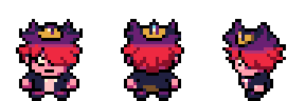

# Corrections des cinématiques, crédits et Domniscian — 25 octobre 2026

Branche : `fix/cinematiques-collisions-20261025`, issue de `a7ba02b95`. **Aucune fusion sur master.**

- [ROM corrigée](Pokemon_Yokai_Watch_Beta_0.1_Cinematiques.gba)
- [Court extrait sonore : les deux lancements](lancements-deux-combats-effet-oni-mgba.mp4) — environ **24 secondes**, 12 par combat.
- [Nouvelle photo finale](groupe/garcon/32.png) ; [version Katie](groupe/fille/32.png).

## Scène finale

- Le joueur s’arrête désormais en **(6,10)**, à **deux cases** de Don Morléone en (6,8), avant son dialogue.
- Matt passe immédiatement par le côté gauche et rejoint le joueur en **(5,10)**. Il ne traverse plus sa case.
- Chen emprunte le bord gauche du pont, puis l’allée extérieure ; il contourne Matt et le joueur avant de se placer en **(6,9)**. Sa trajectoire a aussi été contrôlée sur la grille de collision du décor.
- Les trois sbires commencent chacun une case plus près de Don Morléone : **(4,7), (8,7), (6,6)**. Leur rassemblement avant la fusion garde les positions attendues.
- La fusion les fait disparaître. Après la victoire contre Don Spiraton, **ils ne reviennent pas** : seul Don Morléone réapparaît pour son dernier dialogue et son départ.
- Don Morléone sort par le passage de droite, colonne **7**, puis rejoint le centre du pont, colonne **6**. Il ne passe plus dans le décor de la colonne 8.
- Les deux combats ont le même cri d’introduction que les scripts d’apparition/alerte des Oni : `playmoncry SPECIES_ARCANINE, CRY_MODE_ENCOUNTER`. Les OST de Don Morléone et Don Spiraton restent conservées.

L’extrait sonore montre les deux vrais blocs de lancement de cette scène dans mGBA, préparés séparément puis assemblés. Pendant chaque capture, seules les touches sont envoyées. Aucun résultat de combat n’est injecté dans les clips. Le déclenchement du cri est observé dès les premières images ; [provenance](EXTRAITS_AUDIO.json), [format vidéo/audio](VIDEO_FORMAT.json). Aucun nouveau film intégral de la fin n’a été produit : l’ancienne vidéo longue montre l’état précédent du jeu.

## Vérification des autres cinématiques

L’[inventaire statique](INVENTAIRE_DEPLACEMENTS.json) recense **805 appels de déplacement, 415 mouvements, 93 fichiers de scripts**, y compris les fichiers `.inc` ignorés par les recherches Git habituelles. Toutes les références de mouvement sont résolues. Cela recense l’ensemble des déplacements scriptés ; ce n’est pas, à lui seul, une preuve d’absence de collision dans toutes les branches et sauvegardes possibles.

Un observateur mGBA suit ensuite, image par image, la position des pieds des sprites visibles pendant les scènes et repère les superpositions. Pour la finale, il contrôle également les cases bloquées du décor. Il ne modifie ni les coordonnées, ni les collisions du jeu.

Autres corrections trouvées :

- **Argenta** : deux habitants qui empruntaient la même case de sortie hors écran sont retirés chacun à la fin de leur trajet avant d’être replacés à leur position normale.
- **Plateau Indigo, avant les crédits** : le joueur finit de s’écarter avant que Matt franchisse la porte. Matt et Chen sont retirés individuellement dès leur sortie, sans rester superposés hors écran.
- **Grotte de Glace, Île 4** : les trois sbires partent toujours simultanément, mais chacun est retiré dès qu’il atteint la sortie commune, sans attendre les deux autres sur cette même case.

Parcours natifs observés :

| Parcours | Résultat |
| --- | --- |
| Finale normale, deux combats réellement gagnés, fusion, conclusion, Panthéon puis arrivée aux crédits | [PASS](FINALE_MGBA.json), aucune superposition ni entrée dans une case bloquée |
| Discours d’Argenta, quatre entrées depuis la Route 2 | [PASS](argenta/TEST_MGBA.json), [positions](argenta0-collisions.json) |
| Lavanville : quatre arrivées, scènes et retours, Tour et réveils | [PASS](lavanville/TEST_MGBA.json), [positions](lavanville0-collisions.json) |
| Mafiamille : 16 événements, dont Yopple par les deux approches et la scène de l’Île 4 | [PASS](mafiamille/TEST_MGBA.json), [positions](mafiamille0-collisions.json) |
| Enquête d’Ariane : scène, vrai combat duo, fuite des sbires | [PASS](ENQUETE_MGBA.json) |
| Nouvelles scènes Enma/Nyada/Démophage et leurs conditions | [PASS](postgame/TESTS_SCENES.json), [positions](postgame0-collisions.json) |

Aucune autre superposition dans ces parcours observés. Les états de départ et certaines équipes sont préparés pour le test ; la finale utilise une équipe de QA renforcée pour vérifier la scène, pas l’équilibrage. Il ne s’agit pas d’une partie complète, ni d’un test exhaustif de chaque variante de chaque événement multijoueur/annexe. Les anciens tests ont été adaptés aux quêtes actuelles : pas de répétition des anciens combats Fuji qui ont été remplacés par Alizon, ni de revendication sur leurs anciennes récompenses.

## Crédits

Cinq photos sont corrigées, pour les deux protagonistes :

1. **Terr’heure** : Nathan/Katie, Gargaros et la patrouille sont cadrés dans une zone assez dégagée. Les empreintes du joueur et de Gargaros, y compris les cases au-dessus et de côté nécessaires au grand sprite, ont été vérifiées sur le sol praticable.
2. **Yopple** : le joueur se trouve sur le sol du couloir, en (24,11), plutôt que dans le mur.
3. **Zazel** : joueur en (6,7), Zazel en (6,5), même colonne et orientations opposées.
4. **Maître Nyada** : joueur en (6,10), Maître Nyada en (6,8), même colonne et orientations opposées.
5. **Photo finale** : Usapion est remplacé par **Alizon Bie**. Domniscian utilise aussi son nouveau sprite debout.

Les captures sont natives de mGBA ; les cadrages sont préparés, sans montage de personnages sur l’image. [Sources des quatre souvenirs](credits/PROVENANCE.json), [composition finale](groupe/garcon/GROUPE.json). Les cinq photos sont déclarées dans `data/yokai/credits_replacements.json` pour conserver ces choix lors d’une future régénération.

Les **32 scènes, textes et durées des crédits sont conservés**. Le chargement réel des nouvelles tuiles et palettes est vérifié dans le jeu, pour les deux genres : [contrôle des crédits compilés](TESTS_CREDITS_CORRIGES.json).

## Domniscian

La planche debout fournie dans le chat était déjà disponible à l’identique dans `graphics/yokai_characters/overworld_red_v3/source/domniscian.png`. Ses trois poses remplacent le sprite de carte avec le bureau, via la ressource commune **OBJ_EVENT_GFX_YOKAI_DOMNISCIAN / 161**. Ce remplacement couvre l’Arène, Yopple, les apparitions issues d’anciennes sauvegardes par le remappage existant, et la photo finale.

La palette partagée avec les employés est conservée pour éviter de modifier leurs couleurs. Aucun redessin n’a été ajouté à la planche. Le portrait de combat reste conservé ; la référence fournie concerne les poses overworld. Le choix est également conservé dans les sources du convertisseur pour éviter un retour à l’ancien sprite lors d’une reconversion. [Provenance et dimensions](DOMNISCIAN_SOURCE.json).

Les combats d’arène de Domniscian, **premier combat et revanche**, utilisent maintenant **Vs. Hinozall**, identifiant **348**, ressource privée `mus_yokai_02`. Le contrôle mGBA vérifie le choix de BGM et l’en-tête musical réellement joué ; il vérifie aussi les tuiles de son nouveau sprite dans la VRAM. Son autre rencontre chez Yopple conservait déjà Hinozall. [Vérification](DOMNISCIAN_MGBA.json). Les pistes n’ont pas été reconverties et les réglages du mixeur ne changent pas.

## Livraison

- ROM : **33521847 octets** ; SHA-256 : `90b247b24c0383b9e0c260f084fbe737698abb58171ddbc34405ef97ac1b6df7`.
- EWRAM : **261 624 / 262 144 octets** ; IWRAM : **30 912 / 32 768 octets**, inchangées.
- Format des sauvegardes conservé ; aucun fichier de sauvegarde utilisateur n’a été ouvert ou remplacé.
- La campagne complète filmée jusqu’aux 151 Yo-kai et Juste Yoann est une étape distincte, à mener ensuite. Les essais ci-dessus ne sont pas présentés comme cette aventure complète.
