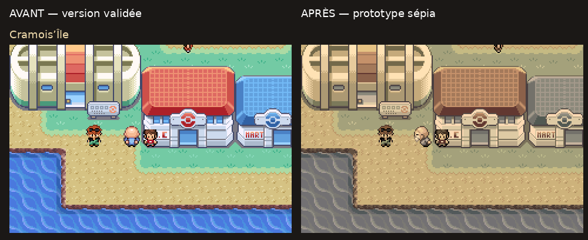

> Dernier ajustement : [taille d’Hovernyan alignée sur Nathaniel](phase-c/taille-hovernyan/README.md).

> **Phase C intégrée, en attente de revue visuelle et scénaristique : [rapport, GIF et tests](phase-c/README.md).** La phase B est validée. Aucun merge sur master.

# Cramois'Île — soixante ans dans le passé

**Phases A et B validées. [Phase C intégrée : rencontre, quiz et Hovernyan, en attente de revue](phase-c/README.md).**

Les captures, chiffres et descriptions ci-dessous documentent la phase A au commit `1f335d268`. Les résultats et mesures actuels figurent dans le rapport de phase C.

Branche : `feature/cramois-ile-passe`. Base validée : `2e81a799f`. Audit préalable : `0c79002b9`. Implémentation : `3e5fded7c`. Aucun merge sur master.

[Comparaison extérieure avant/après](phase-a/public/comparaison-exterieur.png) · [Intérieurs](phase-a/public/comparaison-interieurs.png) · [Portraits et combats](phase-a/public/comparaison-combats.png).

## Prototype réalisé

Le sépia brun doré couvre les treize cartes : extérieur, Arène, Boutique, deux étages du Centre, quatre salles du laboratoire et quatre étages du Manoir. Le joueur et les PNJ sont traités avec le décor. Les deux variantes du Champion, les Yo-kai de face et de dos et les décors de combat de base sont également traités.

Les couleurs sont converties en RGB555 à partir des palettes existantes, avec conservation d'un quart de leur teinte initiale pour garder des verts olive et différencier les matériaux. Ce n'est pas un voile opaque. La conversion s'effectue sur la palette matérielle, sans modifier les deux buffers source ni les graphismes validés : pas d'accumulation au fil des images, ni de couleur enregistrée dans une sauvegarde.

Les palettes des dialogues, menus, informations de combat, barres de PV et indicateurs de statut sont exclues. Le Sac plein écran conserve ses couleurs natives. Le retour sur la carte rétablit le sépia ; le retour dans une autre ville conserve ses couleurs d'origine. La nuit propre à Lavanville reste indépendante.

L'audit mGBA a confirmé que les portraits de face utilisent une banque dynamique, ici OBJ6, distincte des banques réservées aux Yo-kai. Le prototype reconnaît leur table d'animation et traite uniquement cette banque tant que le portrait existe. Il évite ainsi de teinter les palettes de PV lorsqu'un emplacement de sprite est réutilisé.

## Captures et démonstrations mGBA

- [Extérieur après](phase-a/public/apres/exterieur-x4.png), [avant](phase-a/public/avant/exterieur-x4.png).
- [Centre](phase-a/public/apres/centre-x4.png), [Boutique](phase-a/public/apres/boutique-x4.png), [laboratoire des fossiles](phase-a/public/apres/laboratoire-fossiles-x4.png).
- [Manoir RDC](phase-a/public/apres/manoir-rdc-x4.png), [premier étage](phase-a/public/apres/manoir-etage-1-x4.png), [deuxième étage](phase-a/public/apres/manoir-etage-2-x4.png), [sous-sol](phase-a/public/apres/manoir-sous-sol-x4.png).
- [Arène](phase-a/public/apres/arene-x4.png), [portrait Nathaniel](phase-a/public/apres/nathaniel-portrait-x4.png), [portrait Michael](phase-a/public/apres/michael-portrait-x4.png).
- [Combat sauvage](phase-a/public/apres/sauvage-combat-x4.png), [combat du Champion et jauges](phase-a/public/apres/nathaniel-combat-x4.png).
- [Menu sur carte](phase-a/public/apres/menu-carte-x4.png), [Sac](phase-a/public/apres/sac-x4.png), [dialogue](phase-a/public/apres/dialogue-x4.png).
- GIF natifs : [entrée du combat sauvage](phase-a/public/apres/sauvage-entree.gif), [Nathaniel](phase-a/public/apres/nathaniel-entree.gif), [Michael](phase-a/public/apres/michael-entree.gif).

Les PNG natifs mesurent 240 × 160. Les agrandissements utilisent le plus proche voisin ; les planches avant/après assemblent uniquement ces captures. Les GIF enregistrent des images des vrais combats mGBA, avec avancement des dialogues au contrôleur. Ils ne montrent pas une frontière temporelle : la brume relève de la phase B, encore non implémentée. Les captures de la version privée figurent dans [phase-a/prive](phase-a/prive).

## Tests et mémoire

[Rapport global et empreintes ROM](phase-a/VALIDATION.json) · [Préservation](phase-a/PRESERVATION.json) · [Compilation publique](phase-a/COMPILATION-public.txt) · [Compilation privée](phase-a/COMPILATION-prive.txt).

Pour chaque version :

- 40 contrôles/rendus du prototype et 40 de la ROM de référence, avec lecture des 512 couleurs de palette matérielle et comparaison aux banques attendues.
- Treize cartes, menu sur carte, Sac et retour, dialogue, Save/Continue sur l'île, véritable sortie du Centre par sa porte, combat sauvage gagné et retour au Manoir.
- Combat réel contre Nathaniel, six niveaux conservés 40/41/41/42/43/45 et Badge Volcan obtenu ; variante Michael observée sur la carte, en portrait et au début du combat.
- Retour à Bourg Palette et Carmin sans sépia résiduel ; même paire de Yo-kai observée en combat hors de l’île dans ses couleurs natives ; effet nocturne de Lavanville vérifié selon sa conversion d'origine.
- 14 régressions Ariane : suivi, rappel, Save/Continue, porte de l'entrepôt, dialogue, victoire en duo avec Usapion, fuite des deux sbires, Coupe et fin du suivi.

| Mémoire statique | Avant | Après | Variation |
|---|---:|---:|---:|
| EWRAM publique et privée |261348 octets|261348 octets|0|
| Marge EWRAM |796 octets|796 octets|0|
| IWRAM publique |29824 octets|29824 octets|0|
| IWRAM privée |29888 octets|29888 octets|0|

La table occupe 65536 octets en ROM. La ROM publique reste à 16777216 octets grâce au remplissage existant ; la privée passe de 31677019 à 31742955 octets, sous 32 Mio. Aucun format de sauvegarde n'est agrandi. Les mesures concernent les allocations statiques, pas une mesure de la profondeur maximale de pile sur matériel réel.

Les 5821 PNG/palettes approuvés, 1880 fichiers de cartes/layouts, les 151 Yo-kai, toutes les équipes et tous les scripts préexistants restent identiques à la base. Les 31 flux audio privés sont vérifiés à leur emplacement réel dans la ROM, sans republier de musique ni de ROM. Les seuls fichiers existants du moteur modifiés sont `src/palette.c` et `src/overworld.c` ; les fonctions de Cramois sont isolées dans un nouveau module. Les sources du suivi d'Ariane, de Lavanville, des autres Champions et de la finale restent inchangées.

## Fixtures, limites et suite

Les tests partent de véritables nouvelles parties. Ils placent le joueur sur les cartes et renforcent son équipe pour les combats ; le sauvage utilise une espèce/niveau explicitement fournis comme fixture. Les ennemis du Champion, leurs PV et les issues ne sont pas modifiés. Les salles de l'Arène sont atteintes par une fixture de position : cela ne valide pas le parcours jusqu'à la Clé Secrète ni les portes du quiz. Le contrôle de persistance postgame utilise le drapeau de fin comme fixture, sans prétendre avoir rejoué la Ligue. Le parcours de régression Ariane reste au contrôleur ; son trajet évite le rayon du marin qui marche aléatoirement sur le quai, sans supprimer de PNJ du jeu.

Restent à réaliser ou vérifier :

- **Validation visuelle** de cette proposition sépia avant de la considérer comme définitive.
- Phase B : brume blanche/grise sur Route 20 et Route 21 Sud, dans les deux sens, déplacements spéciaux et transitions complètes, sans brume dans l'île.
- Phase C : scène temporelle, dialogues où le grand-père ne croit jamais le joueur, année cohérente et six questions exactes. Les textes et quiz actuels sont encore ceux de la base validée.
- Phase D : parcours intégral du Manoir jusqu'à la Clé, résurrection des fossiles, toutes les portes et réponses du quiz, victoire complète de Michael, retour après une Ligue réellement terminée, Fly/Téléport/Tunnel/Corde Sortie et tous les accès.
- Les palettes temporaires de certains effets d'attaque, les salles de liaison partagées et les captures/sorties particulières ne sont pas certifiées intégralement sépia. Le prototype couvre les décors de base et les combattants ; les banques temporaires doivent être auditées séparément avant d'étendre le traitement, pour préserver l'interface.
- Pas de validation exhaustive sur GBA physique, ni de nouvelle certification d'écoute ou de boucle des musiques privées, ni de traversée équilibrée complète de Kanto.

[Audit préalable](phase-a/AUDIT.md) · [Plan des quatre phases](PLAN.md) · [Demande complète](CAHIER_DES_CHARGES.md).
