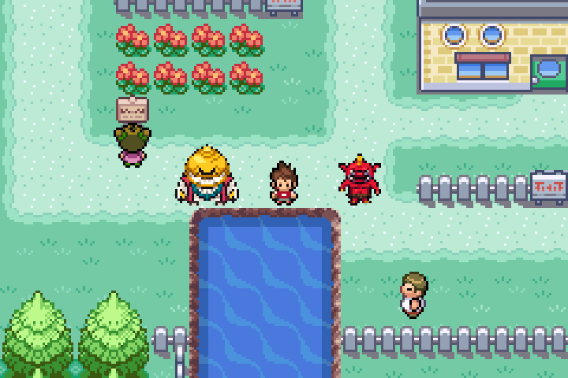

# Démophage — sprite statique de face

Démophage est à gauche, Nathan au centre et Gargaros à droite. La capture provient de mGBA, avec les trois sprites rendus par le jeu. Les acteurs de comparaison sont placés temporairement au Bourg Palette pour cette capture ; aucune nouvelle scène d’aventure n’est ajoutée.

Le sprite reprend la silhouette dorée arrondie de la référence, le grand sourire, le plastron turquoise, les côtés bordeaux et les longues griffes claires. Une seule pose de face est intégrée, sans animation de déplacement.

- Démophage : **27 × 26 pixels visibles**, dans une cellule transparente de 32 × 32.
- Oni de référence : environ **18 × 22 pixels visibles**, à la même échelle.
- Palette GBA de 15 couleurs opaques et un index transparent, distincte de Gargaros.
- Identifiant graphique ajouté : `OBJ_EVENT_GFX_DEMOPHAGE_STATIQUE` (188), sans réaffecter les identifiants précédents.

[PNG transparent](demophage-face.png) · [Agrandissement du sprite](demophage-face-x8.png) · [Capture native](demophage-en-jeu.png) · [Contrôles mGBA](TESTS.json)

La génération graphique est conservée dans `graphics/yokai_characters/demophage_statique/source/face-generee.png`. La conversion technique vers le format GBA est reproductible avec `tools/yokai/convertir_demophage_statique.py`.

Quatre contrôles ciblés passent dans mGBA : cellule liée à la ROM et chargée en VRAM, palette propre chargée, présence visible du sprite entier, et immobilité de la pose pendant 120 frames natives. La compilation avec les ressources audio existantes réussit. Aucune vidéo enregistrée.

Branche dédiée : `feat/demophage-statique-20261025`. Aucune fusion sur `master`.
