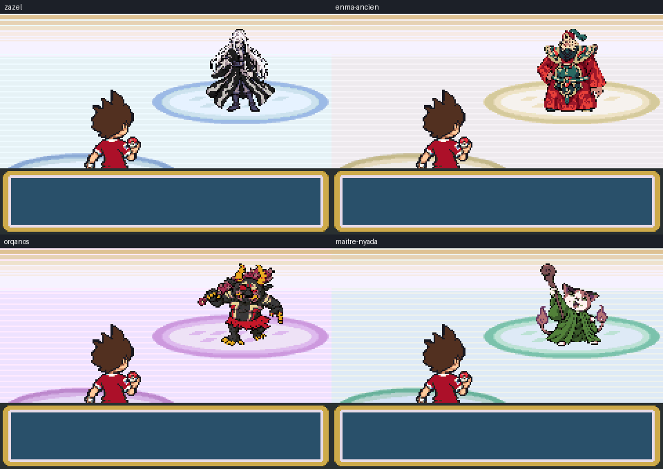

# Ligue, Yopple et rencontres — résultat du dossier du 23 octobre 2026

Implémentation sur **`feature/dossier-ligue-yopple-20261023`**, depuis **`0fa1808fe`** (Cramois terminé). **Aucune fusion sur master.**

## Voir le résultat dans mGBA

Les images ci-dessous sont des captures du moteur, pas des montages de sprites. Les tests utilisent des placements, drapeaux et équipes joueur de contrôle ; les victoires sont obtenues avec les boutons, sans modifier les PV adverses ni les résultats.



| Personnage | Extrait public | Extrait privé |
|---|---|---|
| Zazel | [Introduction](tests/public/zazel-extrait-intro.gif) | [Introduction](tests/prive/zazel-extrait-intro.gif) |
| Enma l’Ancien | [Introduction](tests/public/enma-ancien-extrait-intro.gif) | [Introduction](tests/prive/enma-ancien-extrait-intro.gif) |
| Orqanos | [Introduction](tests/public/orqanos-extrait-intro.gif) | [Introduction](tests/prive/orqanos-extrait-intro.gif) |
| Maître Nyada | [Introduction](tests/public/maitre-nyada-extrait-intro.gif) | [Introduction](tests/prive/maitre-nyada-extrait-intro.gif) |
| Domniscian | [Arène de Safrania](tests/public/domniscian-extrait-intro.gif) | [Arène de Safrania](tests/prive/domniscian-extrait-intro.gif) |
| Bérénice | [Arène de Parmanie](tests/public/berenice-extrait-intro.gif) | [Arène de Parmanie](tests/prive/berenice-extrait-intro.gif) |

Autres captures : [Seigneur Enma face/dos](tests/public/seigneur-enma-combat-face-dos-x3.png), [employés de Yopple](tests/public/yopple-employes-postgame-x3.png), [Kyubi](tests/public/overworld-kyubi-x3.png), [Octorgone](tests/public/overworld-octorgone-x3.png), [Enma l’Ancien sur la carte](tests/public/overworld-enma_ancien-x3.png), [Multi Exp conservé](tests/public/multi-exp-recompense-conservee-x3.png), [sauvegarde et départ du PDG](tests/public/yopple-apres-don-continue-x3.png).

## Décisions appliquées

- **Domniscian remplace Bérénice à Safrania. Bérénice remplace Koga à Parmanie et reste Psy.** Son équipe, ses statistiques générées, ses talents et ses attaques sont conservés exactement, pour les deux variantes de protagoniste.
- L’équipe de Domniscian est Navétéran36, Robonyan37, **Rhinolimit38** (remplace Shogunyan), Emperor39, Robonyan F42. Talents principaux. Après la Ligue, revanches dans **son Arène**, avec cette même équipe et ces niveaux validés ; aucun palier supplémentaire inventé.
- **Le caméo optionnel de Domniscian dans Yopple est supprimé.** Le PDG donne la Master Ball après le sauvetage, puis rejoint son Arène. Sa présence de scénario disparaît seulement après réception effective du cadeau. Les employés sont visibles pendant l’aventure, puis affrontables après la Ligue. **Aucune scène de réveil n’a été ajoutée.**
- Steve Jaws est le fondateur/inventeur historique ; Domniscian est l’acquéreur et le PDG actuel. Noms, enseignes, dialogues, objets, journal et fiches correspondantes utilisent Yopple.
- **Le Multi Exp automatique est supprimé ; l’objet tenu reste disponible et fonctionnel**, toujours offert une seule fois par l’assistant de Chen après 50 captures. Les conseils et tutoriels ont été corrigés.
- Les variantes garçon/fille, les autres Champions et leurs apparitions secondaires restent en place. Les anciens drapeaux de badges et cadeaux restent compatibles : les victoires des sauvegardes existantes ne sont pas réinitialisées.

Les récompenses de type sont désormais **Psyko/CT29** chez Bérénice et **Queue de Fer/CT23** chez Domniscian, avec les drapeaux natifs de cadeau et les reprises en cas de Sac plein. Badges Âme et Marais inchangés. La Master Ball ne dépend pas de la victoire à l’Arène.

## Ligue et rencontres

Ordre d’envoi contrôlé dans les quatre combats : **0 →1 →2 →3 →4 →5**. Les huit identifiants natifs, première visite et revanche, utilisent les compositions validées ; pas de progression de niveaux supplémentaire supposée.

| Adversaire | Composition dans l’ordre |
|---|---|
| Zazel | Bonneto52, Baku53, Fourchelang54, Emperor55, Savantard56, Octorgone58 |
| Enma l’Ancien | Faux Kappa54, Potofeu55, Tauracle56, Hovernyan57, Shogunyan58, Kyubi60 |
| Orqanos | Passpa56, Coach Antonic57, Rocky Badboya58, Turboss59, Gorgouille60, Mademoaiselle62 |
| Maître Nyada | Blizzaria58, Émettor59, Sir Dragon60, Robonyan F61, **Démophage63, Maître Nyada65** |

Les quatre personnages sont des Dresseurs. Leurs espèces homonymes restent distinctes. La finale Don Morléone/Don Spiraton reste séparée et conservée.

| Lieu | Résultat |
|---|---|
| Mont Braise | Maître Nyada148 à la place de l’ancien statique ; **verrouillé** par `FLAG_NYADA_QUEST_UNLOCKED` (`0x32F`) et la Ligue. Aucun script actuel n’active cette future quête. |
| Îles Écume B4F | Kyubi50, nouvel overworld fourni. Les emplacements réels de départ étaient inversés par rapport au résumé du ZIP ; ils sont maintenant réalignés. |
| Centrale | Octorgone50 conservé, nouvel overworld fourni. |
| Grotte Azurée B1F | Seigneur Enma150, niveau70 : plus de préalable `FLAG_YOKAI_ENMA_WON`. Accès généraux et unicité/capture conservés. |
| Route Victoire3F | Mademoaiselle147, **5%**, niveaux45–48. Emplacements8 et10, poids4%+1%, dans les deux tables de version. Total100%, toutes les espèces précédemment présentes restent représentées. |

Seigneur Enma : Psy, PV100/Atq130/Déf90/Vit120/AtqSpé150/DéfSpé90, total680. Nouveaux face/dos au design avec épée, icône assortie et overworld royal existant ; affichage sans étirement hérité du chat violet. Attaques existantes orientées lame/Psy ; nom abrégé `Sgr Enma` dans la limite native. Identifiant `SPECIES_MEWTWO`, numéro150 inchangés.

## Références graphiques et tailles

- Zazel : overworld de la planche fournie ; portrait selon **la dernière illustration aux cheveux blancs et manteau noir**.
- Enma l’Ancien : overworld selon **la dernière planche pixel transmise**, et portrait selon **la dernière illustration au chapeau à pompon turquoise et grandes épaulières**. L’ancienne illustration et les essais archivés ne sont pas utilisés pour son portrait final.
- Maître Nyada : overworld de la planche fournie ; portrait selon **la dernière référence souriante au bâton levé**.
- Orqanos, Kyubi et Octorgone : références du ZIP.
- La planche `personnage_safrania_3_vues.png` est attribuée à **Domniscian**, conformément à la correction de Yoann. Ses ressources existantes correspondantes sont réutilisées ; elle n’est pas attribuée à Seigneur Enma.
- Nathan sert de gabarit : **19 px** de haut ; Enma l’Ancien et Orqanos font **22 px**. Domniscian et Seigneur Enma sur la carte font 19 px, sans déformation des proportions. Hovernyan de Cramois reste inchangé.
- Index transparent0, palettes RGB555, contours sombres, conversion par voisin le plus proche. Sources/adaptations conservées dans `graphics/dossier-20261023/source/`. [Inventaire](graphismes.json) et [planche technique ×8](planche-overworld-x8.png).

Les références utilisateur restent dans [demande/](demande/). Les images générées sont des adaptations au format GBA, pas des originaux de référence prétendument retrouvés.

## Safari et expérience

Le bonus est appliqué exclusivement à la génération sauvage des quatre cartes Safari (terre/eau/pêche), avant création/chiffrement du Yo-kai. **24 valeurs XOR sur 65 536**, ramenées à la plage chromatique native0–7 : exactement **3/8192** pour les espèces autorisées. OT du joueur inchangé, PID définitif utilisé normalement pour nature, sexe, talent et checksum ; pas de régénération du Yo-kai.

La règle existante des **84 espèces autorisées chromatiques** est conservée. Les autres ne deviennent pas chromatiques par ce bonus. Hors Safari, cadeaux, œufs et rencontres fixes conservent le comportement précédent.

Vérifications : table de vérité native exhaustive 65 536 résultats pour trois OT différents, frontières de huit cartes, création réelle sans mauvais œuf, et deux séries de **2 millions de tirages du générateur natif par version**. [Statistiques publiques](tests/public/SAFARI_STATISTIQUES_NATIVES.json) / [privées](tests/prive/SAFARI_STATISTIQUES_NATIVES.json). Ce sont des fixtures natives de la loterie, pas des millions de captures naturelles.

EXP observée après de vraies victoires : sans objet `[45,0,0,0,0]` ; porteur en réserve `[22,0,22,0,0]` ; participant porteur `[44,0,0,0,0]` ; deux porteurs en réserve `[22,11,11,0,0]`. Les arrondis sont ceux de Rouge Feu. Œufs et K.O. exclus. Protection contre l’EXP intermédiaire de Spiraton et rendement du Colosse préservés.

## Audio, ROM et RAM

**54 séquences natives prouvées inaccessibles retirées de la liaison**, soit **167600 octets** de `song_data`. Leurs sources MIDI et leurs identifiants restent en place ; les entrées délaissées pointent vers un en-tête sans pistes, tandis que le routage effectif reste inchangé.

Aucune OST privée, banque partagée, donnée de cri, fanfare, effet sonore ou piste de secours publique supprimée. Les 31 charges utiles privées sont **identiques octet par octet** à la base. Les séquences encore référencées directement ou potentiellement réservées sont conservées, dont la victoire de Champion. Aucun besoin de trancher une utilisation future ambiguë pour ces 54 exclusions.

| Mesure | Public | Privé |
|---|---:|---:|
| Taille du fichier ROM | 16777216 | 31749211 |
| Volume des sections ROM occupées | 9778412 | 29771186 |
| **Gain net de sections occupées, tous ajouts inclus** | **167244** | **167244** |
| EWRAM utilisée / libre | 261368 / 776 | 261368 / 776 |
| IWRAM utilisée / libre | 29824 / 2944 | 29888 / 2880 |

La RAM statique est inchangée. Les tailles de fichier ne diminuent pas : le fichier public reste rembourré à 16 Mio et les graphismes occupent une adresse fixe ; le privé grandit légèrement avec les ajouts. Le gain est dans les **données réellement liées et la marge entre sections**, pas une réduction fictive du fichier.

[Mesures détaillées et SHA256](ROM_RAM.json) · [liste des 54 exclusions et preuves](audio-audit.json) · [inventaire séquences/banques/échantillons](audio-inventaire-complet.json) · [préservation privée](AUDIO_PRIVE_PRESERVE.json).

## Vérification et limites

- Compilations publique et privée réussies. Le privé utilise les sources audio externes existantes ; elles ne sont pas publiées.
- Par version : **47 contrôles principaux** (dont victoires de Ligue, Arènes, revanche, employés, rencontres et EXP), **10 contrôles complémentaires** (VRAM/palettes/tailles, récompenses, sauvegarde/Continuer, fiches), vérification des dialogues pour les deux sexes.
- Par version audio : **104 BGM**, **426 en-têtes de carte** et **273 effets/fanfares** contrôlés, ainsi que la continuité musicale de victoire. Il ne s’agit pas d’une écoute intégrale de chaque piste.
- Cramois : sépia constant, sac, copies d’animation BG1/BG2 et trois attaques réelles contrôlés de nouveau ; sources de Cramois inchangées.
- [49 contrôles de préservation](PRESERVATION.json), [28 comparaisons de parties natives et variantes](VARIANTES_PRESERVEES.json), IDs151 fixes, autres Champions et équipes de Don préservés. Bérénice garde aussi ses talents explicites d’origine après le déplacement.

Résultats : [public](tests/public/TEST_MGBA.json), [privé](tests/prive/TEST_MGBA.json), [compléments publics](tests/public/COMPLEMENTS_MGBA.json), [compléments privés](tests/prive/COMPLEMENTS_MGBA.json), [dialogues](tests/public/DIALOGUES_MGBA.json), [audio public](tests/public/audio/ROUTAGE_MGBA.json), [audio privé](tests/prive/audio/ROUTAGE_MGBA.json).

**La quête postgame de Nyada reste volontairement à concevoir.** La validation globale depuis une nouvelle partie, l’équilibrage en conditions normales et la recette complète de Cramois restent à faire avec le reste du jeu, conformément à la décision précédente. Aucun parcours complet n’est présenté comme déjà joué.

## Fichiers et reproduction

### Recette graphique finale demandée après livraison

Le portrait de Domniscian a ensuite été agrandi et déplacé selon le montage validé : [modification et tests mGBA ciblés sur les deux versions](domniscian-placement/README.md). Les anciens résultats ci-dessus décrivent la livraison initiale ; les nouveaux SHA256 et captures figurent dans ce complément.

Enma nº150 dispose également du [cadrage de face et de dos demandé, avec captures et tests d’animation sur les deux versions](enma-placement/README.md). Ce complément identifie les ROM compilées après cette modification.

- Contrôler les sprites overworld et portraits en jeu, dans toutes leurs directions et frames de marche, sur les versions publique et privée ; vérifier aussi palettes, chargements après transition et variantes garçon/fille.
- Reproduire et identifier les deux apparences suspectes signalées par capture (personnage rouge/blanc/bleu et personnage au chapeau sombre). Leur identité et la cause du rendu restent à établir ; les captures seules ne prouvent pas une corruption de palette ou de sprite.
- Corriger les défauts confirmés et joindre les captures mGBA avant/après. Ne pas déclarer la recette graphique globale terminée tant que ces signalements restent ouverts.


| Sujet | Principaux chemins |
|---|---|
| EXP et Safari | `src/battle_script_commands.c`, `src/wild_encounter.c`, `include/wild_encounter.h`, textes d’aide et tutoriels |
| Ligue/Champions/talents | `src/data/trainers.h`, `trainer_parties.h`, `yokai_trainer_abilities.h`, `src/yokai_champions.c`, cartes Ligue/Safrania/Parmanie |
| Rencontres/Enma | scripts Mont Braise/Îles Écume/Grotte Azurée, `src/data/wild_encounters.json`, données nº150 |
| Graphismes | `graphics/dossier-20261023`, `graphics/yokai/150`, ressources Enma/Domniscian, tables objet/portrait/animation/transition |
| Yopple | cartes Sylphe/Safrania, `data/scripts/yokai_cameos_boss.inc`, objets, journal et fiches |
| Audio | `sound/song_table.inc`, `sound/retired_sequences.mk`, Makefile et scripts de liaison |
| QA et mesures | outils `*dossier*` dans `tools/yokai/`, ce dossier de preuves |

```bash
source /workspace/.setup/env.sh
make -j6
make -j6 YOKAI_AUDIO_DIR=/workspace/private-audio/lavanville-integration
python3 tools/yokai/verifier_dossier_preservation.py
python3 tools/yokai/tester_dossier_20261023_mgba.py
YOKAI_QA_ROM="$PWD/pokefirered_audio.gba" python3 tools/yokai/tester_dossier_20261023_mgba.py
```

L’environnement utilise agbcc déjà installé, accessible par `tools/agbcc`, et mGBA libretro. Les chemins ci-dessus décrivent cet environnement de travail. Les ROM compilées restent des artefacts locaux ; elles ne sont pas ajoutées aux sources GitHub.
