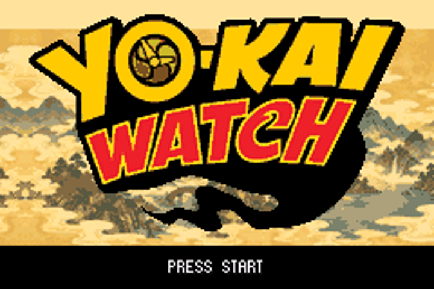
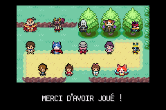

# Écran titre et crédits — intégration à valider

Le nouveau titre et les **32 souvenirs** sont intégrés sur `feature/ecran-titre-credits-20261024`. Les deux versions compilent et passent les tests mGBA. **Aucune fusion sur master.**

## Écran titre

Au lancement : carton noir silencieux `by Juste Yoann`, environ deux secondes, puis le logo original fourni apparaît progressivement sur cinq secondes. Le fond est un **paysage sans personnages ni Yo-kai**, conformément à la dernière demande. Le décor défile vers la droite à environ 2,57 pixels/seconde ; logo et texte restent fixes.

`PRESS START` est blanc, centré dans une **banderole noire fixe** en bas. Le texte clignote légèrement après l'apparition du logo. START arrête immédiatement la musique et ouvre le menu standard de sauvegarde, qui reste silencieux. Sans sauvegarde, la ligne « Nouvelle partie » est affichée ; le tutoriel Chen est conservé.

Musique proposée : **Nates House**, depuis le début, parmi les pistes déjà intégrées. L'extrait natif présente une entrée plus douce puis une montée sur les premières secondes. Comparaison préparée avec Take Care, Blossom Heights et The Very Curious Yo-kai Watch : [mesures et provenance](COMPARAISON_MUSIQUES.json). Mystic Grove n'est pas utilisée. **Le choix artistique reste à valider à l'écoute**, sans prétendre qu'une mesure de signal remplace l'audition.

[GIF du titre — plus de 20 secondes](prive/titre-20s.gif) · [signature](prive/signature.png) · [menu sans sauvegarde](prive/menu-sans-sauvegarde.png)

## Crédits

Les souvenirs sont des captures réelles du moteur dans mGBA : petites photos sur fond noir, placements et dimensions alternés, textes séparés, fondus indépendants. Le tampon de palette reste noir pendant le chargement pour éviter les flashs ; les transitions sont contrôlées sur les images réellement affichées. Le cadrage conserve les proportions des sprites. Les textes de crédits constituent une proposition à revoir avec les images.

Chaque souvenir classique dure environ 7,25–7,27 secondes, fondus compris. Le final dure environ **30 secondes**. La durée totale est de **15 239 images GBA**, soit environ **4 min 15 s**. Le compteur VBlank pilote la séquence afin que les chargements d'images n'allongent pas le montage.

La photo finale réunit **14 personnages**, avec variantes garçon/fille et Nathaniel/Michael : protagoniste, Matt, Ariane, Usapion, autre protagoniste, grand-père, Hovernyan, Domniscian, Don Morléone, Zazel, Enma l'Ancien, Orqanos, Maître Nyada et Jibanyan. Matt est le rival et apparaît une seule fois. Whisper, Komasan, Don Spiraton, Léo et Chen sont exclus selon les décisions de Yoann.

La prise de vue utilise les vrais sprites overworld et leurs palettes, rendus dans mGBA sur un décor de la Route 1 figé pour la photo. Les 14 acteurs sont posés via le moteur de sprites natif ; la capture n'est pas un collage d'illustrations. Aucun personnage de cette photo n'a été redessiné.

Le final affiche exactement `MERCI D'AVOIR JOUÉ !`, sous l'image. Il se termine sur du noir silencieux, puis le redémarrage standard permet de continuer la sauvegarde.

- [Planche des 32 écrans — garçon](prive/credits/garcon/planche-32.png)
- [Planche des 32 écrans — fille](prive/credits/fille/planche-32.png)
- [Extrait des crédits](prive/credits/garcon/extrait.gif)
- [Final de 30 secondes](prive/credits/garcon/final-30s.gif)
- [Final — variante fille](prive/credits/fille/32.png)

Les vidéos sonores et les quatre extraits de comparaison du titre sont remis dans le paquet de prévisualisation du chat. L'audio privé reste hors du dépôt Git.

## OST et budget

Le MP3 est bien **celui fourni précédemment**, confirmé par SHA-256. La version privée utilise le morceau complet : **255,138 secondes**, mono à 12 kHz, DPCM natif, sans boucle forcée. Le réglage de lecture conserve sa vitesse :600 images consomment 120 547 échantillons dans le moteur, conformément à 12 kHz. Le flux se termine naturellement. Les31 autres pistes sont identiques octet pour octet, et Take Care conserve ses autres usages.

Le profil public utilise le repli musical natif habituel et reste compilable sans les données audio privées.

| Version | ROM occupée avant | ROM occupée après | Libre sur 32 Mio |
| --- | ---: | ---: | ---: |
| Publique | 15 948 716 octets | 16 108 172 octets | 17 446 260 octets |
| Privée | 31 710 079 octets | 33 448 311 octets | **106 121 octets** |

Le flux des crédits occupe 1 578 703 octets. Les 64 photos des deux variantes occupent 132 536 octets de tuiles compressées, 32 768 octets de palettes et **2844 octets pour cinq cartes de tuiles partagées**. Le paysage et le logo utilisent des tuiles natives ; aucun décodeur vidéo n'est ajouté au jeu. L'EWRAM statique augmente de 16 octets ; le chargement d'une photo utilise la VRAM, et la fenêtre de texte utilise le tas existant.

[Budget détaillé](BUDGET.json) · [Contrôles audio](TEST_AUDIO.json) · [Configuration audio reproductible](../../data/yokai/credits_audio.json)

## Vérifications

| Contrôle | Publique | Privée |
| --- | --- | --- |
| Boot, signature silencieuse, titre audible, START immédiat, menu silencieux | Réussi | Réussi |
| Nouvelle partie réelle, choix garçon/fille et nom | Réussi | Réussi |
| Sauvegarde native, retour B au titre, START vers le menu, Continuer | Réussi, deux variantes | Réussi, deux variantes |
| Retour depuis les Options vers le menu silencieux | Réussi | Réussi |
| Crédits complets, 32 images, textures et palettes natives, durée et fin silencieuse | Réussi, deux variantes | Réussi, deux variantes |
| Fin de Ligue réelle : quatrième membre, finale Don, Panthéon, crédits, sauvegarde et Continuer | Réussi, garçon | Réussi, fille |

Le menu de sauvegarde FRLG ne possède pas d'entrée Options. Le contrôle Options ouvre l'écran existant par une fixture et vérifie son retour au menu ; aucun raccourci de debug ou nouveau bouton n'est ajouté au jeu.

Les états de capture sont préparés par des fixtures de position, visibilité et progression. Les tests de finale commencent avec une équipe QA renforcée, puis jouent les victoires et transitions natives, sans injecter de résultat de combat ni de drapeau de victoire. Il s'agit de contrôles ciblés et de captures du moteur, pas d'un parcours continu de toute l'aventure ni d'une validation de l'équilibrage ou du matériel GBA.

La comparaison binaire confirme également **5 642 ressources conservées identiques**, dont les ressources des 151 Yo-kai, ainsi que 2 613 entrées de tables et les 168 alias du nettoyage précédent. La régénération des nouveaux graphismes et de leurs objets compilés reproduit les deux ROM octet pour octet.

[Synthèse des tests](TESTS_SYNTHESE.json) · [Tests publics](public/TEST_CREDITS.json) · [Tests privés](prive/TEST_CREDITS.json) · [Finale publique](public/finale-complete/FINALE_NORMALE_MGBA.json) · [Finale privée](prive/finale-complete/FINALE_NORMALE_MGBA.json) · [Préservation des ressources](preservation/TESTS_BINAIRES.json) · [Reconstruction](TEST_RECONSTRUCTION.json)

L'ordre du montage suit les adaptations approuvées : discours d'Argenta avant le premier Badge, Wyatt à la place de Pierre, Katie/Nathan à Azuria, Ariane seule pour l'enquête et finale Don après Maître Nyada. Les documents originaux sont conservés dans `sources/`, le storyboard appliqué dans [credits_storyboard.json](../../data/yokai/credits_storyboard.json).

La revue visuelle et sonore de Yoann reste attendue avant toute fusion.
