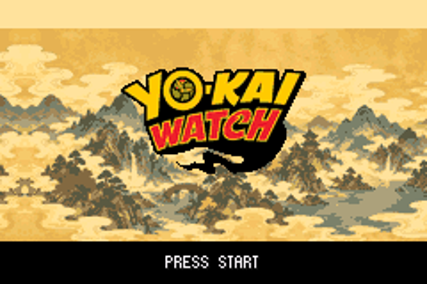

# Logo réduit de moitié

Le logo visible passe de 208×120 à **104×60 pixels**. Il conserve son centre à l'écran, soit une position visible x68–171, y38–97. Le fichier original fourni sert à nouveau à la conversion native pour conserver la meilleure lisibilité à cette taille.

[Animation](prive/titre-20s.gif) · [Capture publique](public/titre-x3.png)

Les deux versions compilent. Le parcours natif de boot, la signature, le titre audible, START et le menu silencieux passent dans mGBA : [public](public/TEST_TITRE.json), [privé](prive/TEST_TITRE.json). La zone peinte du logo est également vérifiée à 104×60 pixels.

ROM occupée : 16 105 316 octets en public, 33 445 455 octets en privé. La réduction libère 2 856 octets dans chaque version. Aucun changement audio n'est appliqué pour cet ajustement.

Branche `feature/ecran-titre-credits-20261024`, sans fusion sur master.
