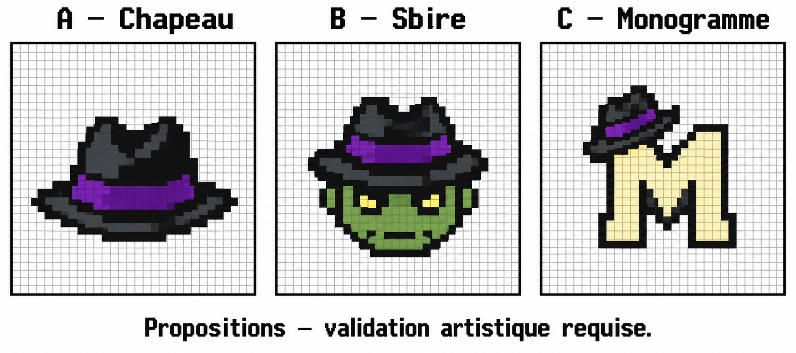

# Symbole du Casino — historique des concepts

**Archive :** le concept A a été retenu, redessiné sur une grille native puis
validé et intégré. Les indications d’attente ci-dessous décrivent le jalon
antérieur. L’entrepôt est finalement restauré **sans emblème**.
[État final et preuves mGBA](../../../QA_RECETTE_FINALE/MAFIAMILLE_KANTO/finalisation/README.md).

A : chapeau. B : tête du sbire. C : monogramme M et chapeau.

Ces aperçus conceptuels ont été produits avec l’outil de génération d’images,
puis conservés sans transformation. Ce ne sont pas des exports natifs 32×32
à importer dans le jeu : la grille dessinée ne certifie pas leur conformité
technique, leur palette ni leur rendu au format réel. Aucune variante de
personnage n’est créée ou intégrée.

Après choix du créateur, le symbole retenu devra être réalisé sur la grille
native des rouleaux et du tableau des gains, avec palette vérifiée sans
modifier le 7 ou les autres symboles qui partagent sa banque.

**Aucun aperçu n’est lié à la ROM. Le R d’origine reste actif jusqu’au choix.**
Le code des probabilités et des gains est intact.

## Deux autres R repérés

Le décodage des tilemaps a identifié un R dans chacune des illustrations
d’entrée : `graphics/map_preview/rocket_hideout/tiles.png` et
`graphics/map_preview/rocket_warehouse/tiles.png`. Ces deux dessins sont
conservés en attente de validation, comme les rouleaux et le tableau des gains.
Leur remplacement doit reprendre le symbole choisi, avec un aperçu de mise
en situation avant intégration. Il reste donc quatre ressources graphiques
contenant un R, pas seulement les deux ressources des machines à sous.

La porte `graphics/door_anims/rocket_warehouse.png`, examinée visuellement,
ne présente pas de R. Les décors visibles dans les captures de cartes sont
conservés ; cette vérification ne certifie pas chaque pixel de tous les
tilesets partagés du jeu.
