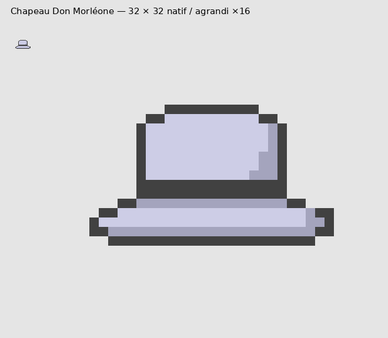
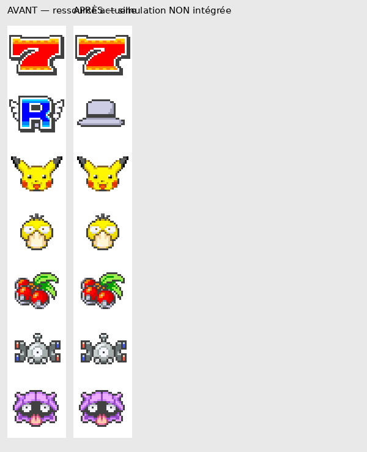
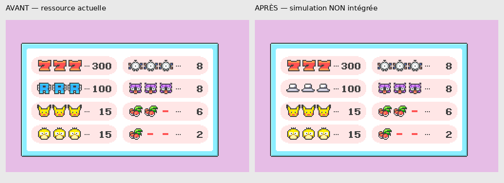
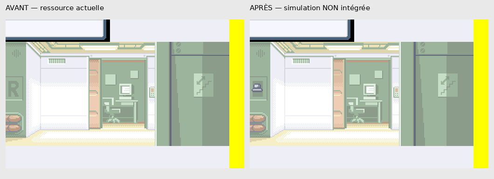
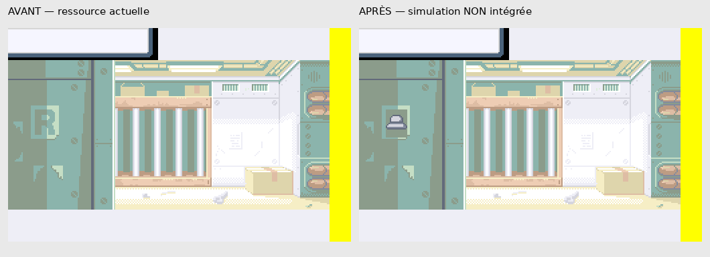
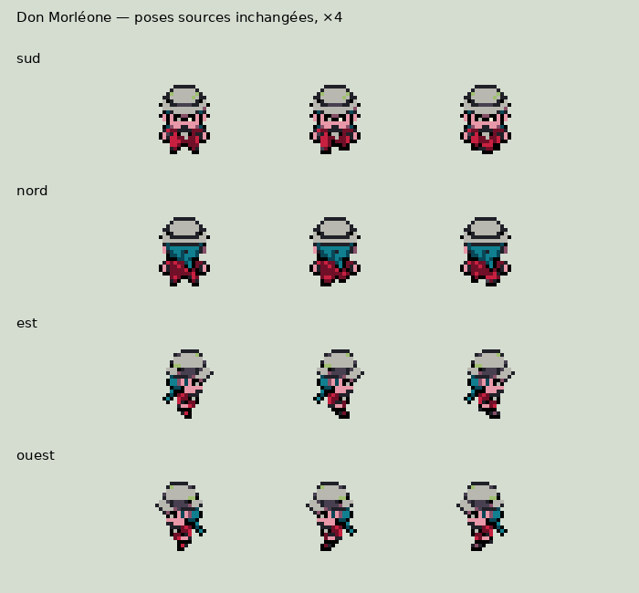
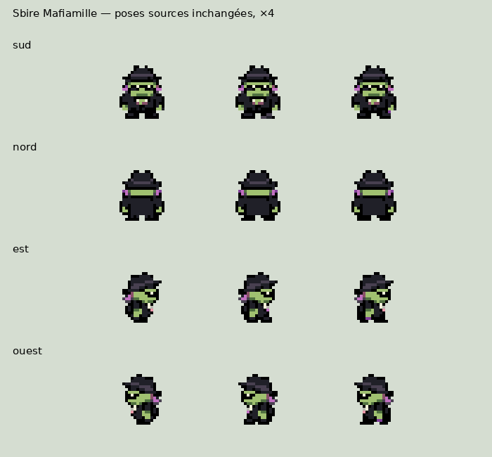
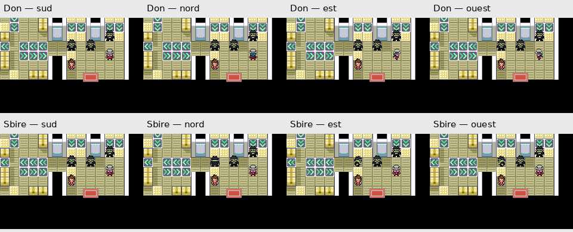

# Validation artistique — emblème et marche Mafiamille

Branche : `feature/mafiamille-kanto`. Référence conservée : `ddcb53b10e8cca51283b291078a1d91d20e3643c`.

**Aperçus uniquement, en attente d’autorisation explicite. Aucun remplacement dans la ROM.** Le choix du concept A est acquis ; son dessin natif ci-dessous reste à valider. Aucune compilation ni nouvelle session mGBA n’a été nécessaire pour cette présentation.

## Emblème : chapeau clair de Don Morléone

Dessin réalisé directement à la résolution native : chaque caractère des quatre masques dans [preparer.py](preparer.py) représente un pixel, sans illustration réduite, anticrénelage ni ressource externe importée. Référence d’identité : les portraits et sprites de Don déjà présents dans `graphics/yokai_characters/don_morleone/`. Le chapeau seul remplace le symbole d’organisation ; aucune tête ni lettre M.

[PNG transparent natif 32 × 32](embleme-natif-32x32.png) · [agrandissement ×16](embleme-x16.png).

| Utilisation | Enveloppe du dessin natif | Ressource de simulation | Palette |
|---|---:|---:|---|
| Rouleaux | 27 × 15 px, dans une icône 32 × 32 | 32 × 224 px | Banque existante 2, quatre indices utilisés |
| Gains | 14 × 9 px | 112 × 40 px | Banque existante 1, trois indices utilisés |
| Repaire | 12 × 9 px | Feuille 120 × 104 px ; illustration 256 × 160 px | Palette existante, trois indices utilisés |
| Entrepôt | 16 × 11 px | Feuille 120 × 128 px ; illustration 256 × 160 px | Palette existante, trois indices utilisés |

Les gris des rouleaux ont une légère dominante bleutée imposée par la palette partagée avec le 7 et les cerises : clair `(205,205,230)`, ombre `(164,164,189)`, contour/bande `(65,65,65)`. Aucun changement de palette partagé. Dans les illustrations d’entrée, le ton le plus sombre disponible est `(98,106,123)` : la bande est donc gris ardoise plutôt que noire, pour respecter la palette et les éléments voisins. L’emblème reste le même aux quatre tailles.

## Simulations des quatre remplacements

**Ce sont des rendus des ressources et tables graphiques, pas des captures d’une nouvelle ROM dans mGBA.** Agrandissements en nearest-neighbor. Les teintes sont celles des PNG indexés ; la quantification RGB555 et les éventuels filtres d’affichage de l’émulateur peuvent modifier légèrement les couleurs affichées.

### 1. Rouleaux

Seule l’icône R, lignes 32 à 63, est remplacée dans la copie. Les six autres symboles et tous les indices de palette sont inchangés. Le chapeau conserve une marge transparente dans sa case de 32 × 32.

### 2. Tableau des gains

Rendu de la table de placement originale : une seule case source modifiée produit les trois chapeaux attendus. Montants, chiffres et autres symboles identiques. [Feuille graphique avant/après](gains-feuille-comparaison.png).

### 3. Entrée du repaire de Céladopole

[Simulation native 256 × 160](repaire-apres-natif.png).

### 4. Entrée de l’entrepôt des îles Sevii

[Simulation native 256 × 160](entrepot-apres-natif.png).

Les illustrations sont conservées dans leur intégralité, y compris la marge technique jaune à droite : elle appartient aux données source, pas au nouvel emblème. Les R sont effacés uniquement sur leur plaque, puis remplacés. Les pixels extérieurs à ces petites zones restent identiques. Les versions d’entrée nécessitent des tables de placement adaptées pour éviter de modifier d’autres occurrences de carreaux partagés : les copies sont fournies, avec leurs feuilles indexées de dimensions inchangées. Elles occupent 193/195 et 234/240 carreaux disponibles ; aucun agrandissement nécessaire.

## Marche : ressources déjà présentes, sans retouche

Les planches suivantes extraient les poses de repos et les deux poses de pas des feuilles déjà intégrées. L’est utilise le miroir horizontal natif du profil ouest. **Ces planches sont des vues des ressources, pas des captures du moteur.**

### Don Morléone

Captures mGBA existantes, copiées à l’identique : [sud](don_morleone-sud-marche.gif) · [nord](don_morleone-nord-marche.gif) · [est](don_morleone-est-marche.gif) · [ouest](don_morleone-ouest-marche.gif).

### Sbire Mafiamille classique

Captures mGBA existantes, copiées à l’identique : [sud](mafiamille_1-sud-marche.gif) · [nord](mafiamille_1-nord-marche.gif) · [est](mafiamille_1-est-marche.gif) · [ouest](mafiamille_1-ouest-marche.gif).

### Huit vues animées réunies

Montage des huit GIF existants, conservant leur cadence. Il s’agit de marches sur place commandées au moteur lors des tests précédents, pas de nouvelles scènes scénaristiques. [Rapport technique d’origine](../../../QA_RECETTE_FINALE/MAFIAMILLE_KANTO/marche/TEST_MGBA.json).

### Observation artistique, à valider

- Don conserve son costume rouge, son chapeau clair, ses lunettes et son écharpe turquoise. Le sbire conserve ses vêtements noirs, son visage vert et son bandeau violet. Les volumes restent compacts et les pieds restent dans les cellules de 16 × 32.
- Les profils sont symétriques via le miroir prévu par le moteur. Les deux poses de pas alternent les pieds et les bras ; la différence reste volontairement petite à cette résolution.
- Le bandeau sombre de Don est discret sur les poses arrière. Certains pixels du visage et du chapeau changent pendant le pas ; les planches permettent de juger si cette variation te convient. Aucune correction artistique n’a été appliquée.
- La transparence et les palettes ont été vérifiées dans les tests mGBA antérieurs. Les GIF sont repris sans prétendre à une nouvelle validation technique ni à une approbation artistique de ta part.

## Contrôles et portée

[CONTROLES.json](CONTROLES.json) consigne les dimensions, palettes et comparaisons. Le script vérifie que les autres icônes du Casino sont identiques et que les feuilles/tablemaps d’entrée simulées reconstruisent exactement les aperçus, sans effet de bord dû aux carreaux partagés.

Les 16 956 fichiers suivis à la référence sont inchangés dans Git. Seul ce nouveau dossier de présentation est ajouté. Aucune modification du moteur, des dialogues, des événements, des équipes, du gameplay ou des musiques ; aucun changement dans `master` ou `audio/integration-31-ost`, aucune fusion. Les ROM existantes ne sont pas recompilées et leurs empreintes restent identiques.

**Suite uniquement après autorisation :** intégrer les quatre ressources et leurs tables nécessaires, compiler puis effectuer les vérifications mGBA de leurs usages réels. Les symboles R restent donc actuellement présents dans la ROM.
