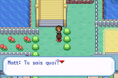

# Matt à Azuria — perte de couleurs après combat

Défaut reproduit sur `Pokemon_Yokai_Watch_Beta_0.1_FR.gba`
(SHA-256 `5e350381135282f916616c221ef59db974fec501b73579a406c533e5104469e5`).

Matt et le membre de la Mafiamille d’Azuria utilisent tous deux la banque de
palette spéciale 10. Lorsque Matt occupe un emplacement d’objet antérieur à
celui du membre de la Mafiamille, la reconstruction des sprites au retour du
combat recharge la palette de la Mafiamille en dernier : Matt apparaît alors
avec ses cheveux clairs et ses vêtements noirs/rouges. Le défaut dépend de
l’ordre des objets actifs, ce qui explique les premiers essais sans anomalie.

## Correction

À Azuria uniquement, Matt utilise désormais la banque 6, déjà employée pour
l’isoler dans les scènes d’Argenta et de la finale. La même sélection s’applique
à son apparition, à la reconstruction du sprite après combat/menu et aux
changements graphiques. La Mafiamille conserve sa banque 10. Aucun pixel,
dialogue, combat, musique, drapeau ni format de sauvegarde n’est modifié.
Branche : `fix/matt-palette-retour-combat-20261024`. Aucune fusion sur master.

## Vérifications

- Deux compilations réussies : publique et privée avec les OST existantes.
- Six combats ciblés terminés dans mGBA : garçon/fille × entrées x=22, 23, 24.
- Comparaison des 16 couleurs chargées pour Matt avant et après apparition de
  l’autre acteur, après combat, pendant le dialogue et après entrée/sortie de
  l’aide : toutes correspondent à sa palette d’origine après correction.
- Palette de la Mafiamille également contrôlée après combat ; banques distinctes.
- Dix sauvegardes natives existantes rechargées avec Continuer : carte,
  position, nombre de membres, niveaux et PV identiques. Les fichiers `.sav`
  restent inchangés. La sauvegarde personnelle du signalement n’a pas été fournie.

Les tests utilisent des fixtures explicites : nouvelle partie, équipe préparée
niveau 100, placement devant le pont, apparition native de la Mafiamille après
Matt pour imposer l’ordre d’allocation problématique. Les combats sont réellement
joués aux boutons, sans forcer leur résultat. Ces tests isolés ne reprennent
pas la campagne de parcours complet, qui reste arrêtée à Argenta.

ROM corrigée : `Pokemon_Yokai_Watch_Beta_0.1_FR.gba`,
SHA-256 `c80f2d7dc14248b8b4ae2e40f34e5c9e145774ee7b88084b74d5be383eb45386`, 33,449,979 octets (taille inchangée).

Conserver le fichier `.sav` et le même nom de base pour la ROM. Quitter mGBA,
remplacer le `.gba`, puis démarrer normalement et choisir Continuer. Un ancien
état rapide mGBA contient la RAM et les palettes antérieures à la correction ;
le rechargement depuis `.sav` permet d’utiliser le nouveau moteur.
