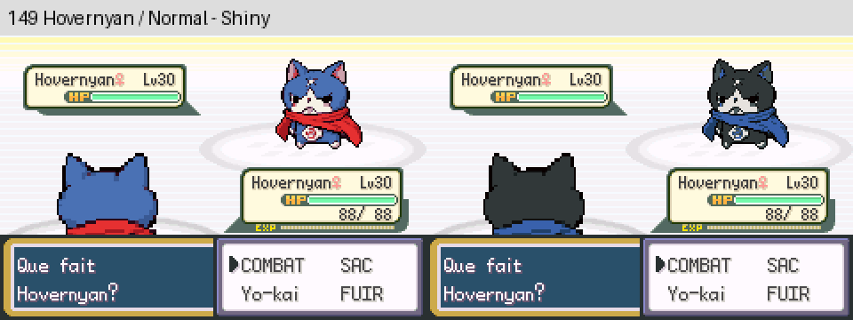
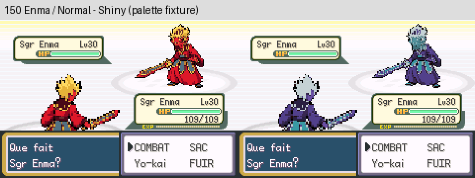

# Nettoyage des ressources Pokémon inutilisées

168 ressources graphiques de 28 anciens Pokémon ne sont plus embarquées dans la ROM. Gain réel après compilation : **76 984 octets dans chacune des deux versions** (environ 75 Kio).

| Version | ROM occupée avant | ROM occupée après | Libre sur 32 Mio |
| --- | ---: | ---: | ---: |
| Publique | 16 025 700 octets | 15 948 716 octets | 17 605 716 octets |
| Privée avec musique | 31 787 063 octets | 31 710 079 octets | **1 844 353 octets** |

La version publique reste distribuée dans un fichier rempli jusqu'à 16 Mio : le gain concerne les données réellement utilisées, mesurées par l'éditeur de liens. La RAM utilisée reste identique.

## Périmètre

L'audit conserve toute espèce mentionnée dans les scripts, rencontres, équipes, évolutions ou code du moteur. Il conserve également toute ressource graphique utilisée directement hors des tables de graphismes. Les tables descriptives générales (noms, Pokédex, coordonnées, listes de mots) ne constituent pas à elles seules une apparition dans le jeu.

Les espèces retenues pour ce nettoyage sont : Aipom, Barboach, Bayleef, Beldum, Chimecho, Combusken, Corphish, Croconaw, Delibird, Feebas, Grovyle, Lairon, Ledyba, Lileep, Makuhita, Pupitar, Quilava, Scizor, Sentret, Shelgon, Slakoth, Spheal, Stantler, Swablu, Taillow, Typhlosion, Vibrava et Wingull (noms internes).

Les sources originales restent disponibles dans Git. Seules leurs inclusions binaires sont remplacées par des références partagées aux graphismes de secours déjà présents. Les identifiants d'espèces, tailles de tables et métadonnées restent inchangés ; aucun pointeur nul n'est introduit. Un exemplaire de ces anciennes espèces importé depuis une sauvegarde externe affichera désormais un point d'interrogation. Cet affichage de secours est volontaire et ne concerne aucune espèce du catalogue des 151 Yo-kai.

Les 151 Yo-kai, leurs shiny, œufs, fantômes, boss, portraits, overworlds, scripts, musique et règles du jeu sont préservés. D'autres ressources Pokémon restent référencées par des événements, équipes ou fonctions héritées : elles ont été conservées. Leur suppression demanderait un audit de ces usages distinct du présent nettoyage.

## Vérifications

- Compilation publique et privée réussie : [journaux](logs/build-public.log), [version privée](logs/build-prive.log).
- Comparaison des ROM avant/après : **5 645 ressources binaires conservées identiques**, **168 alias contrôlés**, **2 613 entrées de tables vérifiées**, pour chaque version. Les données des 151 Yo-kai et des œufs sont incluses. [Résultats binaires](TESTS_BINAIRES.json).
- mGBA : **11 combats par version**, espèces 001, 018, 051, 066, 067, 120, 133, 145, 149, 150 et 151 ; contrôle des textures de face/dos et des palettes. Les 302 pointeurs de palettes normales/shiny sont vérifiés sur chaque ROM. Les espèces interdites de shiny sont montrées à l'aide de fixtures explicites, sans modifier les règles. [Résultats publics](mgba/public/combats/TEST_MGBA.json), [privés](mgba/prive/combats/TEST_MGBA.json).
- Vérifications ciblées de rendu et d'intégrité, sans prétendre à une validation de toute l'aventure ni de toutes les attaques.

## Reproductibilité

L'[inventaire](INVENTAIRE.json) contient les fichiers retirés de la compilation, leurs alias et les références justifiant la conservation des autres ressources. Générateur : `python tools/yokai/nettoyer_ressources_pokemon.py`. Comparaison binaire : `python tools/yokai/tester_nettoyage_pokemon.py`, avec les anciennes ROM/ELF dans `/tmp/yokai-nettoyage-avant` et le toolchain ARM dans le PATH. Les ROM, les ELF et les musiques privées ne sont pas publiés.

Base : `296055aab`. Branche : `feature/nettoyage-ressources-pokemon`. Aucune fusion sur master.

Pour la musique de crédits étudiée précédemment, les données audio estimées à 1 760 104 octets laisseraient **84 249 octets avant les en-têtes et autres données d'intégration**. Cette musique n'est pas intégrée par ce nettoyage.
