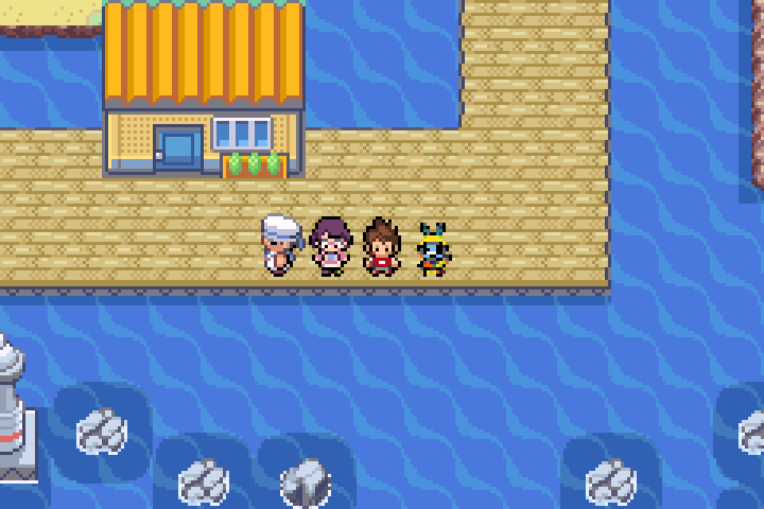

# Usapion plus petit sur la carte

Usapion mesure maintenant **17 pixels visibles de haut**, contre **19 pixels** pour Ariane et Nathan. Les pieds restent alignés au sol. Le profil de présentation existant passe de 218 à 154 en Q8 ; le dessin source, la palette et le sprite de combat sont conservés.

Les deux ROM ont été recompilées. Les dimensions ont été lues dans la VRAM de mGBA pour chacune : [publique](public/VERIFICATION.json), [privée](prive/VERIFICATION.json).

Les trois personnages ont été alignés uniquement pour cette comparaison ; les positions des cartes du jeu restent inchangées. Les rapports de validation complets du chapitre restent attachés à leur version antérieure, avant cet ajustement visuel.
