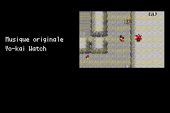

# Quêtes postgame — ROM de test du 25 octobre 2026

Branche dédiée : `feature/postgame-quetes-20261025`, issue de `18bb3b182`. Aucune fusion sur `master`.

- [Télécharger la ROM](Pokemon_Yokai_Watch_Beta_0.1_Postgame_Quetes.gba)
- [Combat d’arène contre Domniscian, avec son](domniscian-arene-avec-son-mgba.mp4) — **5 min 05 s**.
- [Fin complète : combats, Panthéon, crédits et redémarrage](combat-final-credits-redemarrage-mgba.mp4) — **15 min 37 s**.

Les deux films sont des captures continues de mGBA avec son natif, sans coupe ni accélération. Le point de départ et l’équipe sont préparés avant la capture : six Yo-kai de niveau 60 pour Domniscian, de niveau 100 pour la finale, statistiques naturelles, IV 31 et EV 0. Pendant l’enregistrement, seules les touches sont envoyées : aucun K.O., résultat, changement de carte ou passage aux crédits n’est injecté.

La finale montre Don Morléone, les soins de Matt, la fusion et les huit formes de Don Spiraton, la conclusion scénaristique, le Panthéon, les 32 souvenirs des crédits puis le retour automatique à l’écran titre. Ce n’est pas un parcours complet de l’aventure avec cette équipe. Le détail des horodatages et des conditions figure dans [la provenance](finale-provenance.json).

## Modifications intégrées

1. **Seigneur Enma** : introduction unique à la première sortie de la maison après la Ligue, avec son véritable sprite. Rencontre statique dans la Grotte Azurée au sous-sol ; accessible après la Ligue, K.O. temporaire, capture définitive.
2. **Professeur Chen** : Jibanyan supplémentaire offert une fois après la Ligue, envoyé au PC si l’équipe est complète. Le Jibanyan de Céladopole et ses évolutions restent disponibles.
3. **Maître Nyada I** : maison de l’Île 7, Kyubi aux Îles Écume et Octorgone à la Centrale après acceptation. Captures reconnues même au PC ; Œuf Chance à la remise de quête.
4. **Alizon Bie et Gorgouille** : progression conservée. Les trois victoires contre les Oni, puis le retour auprès d’Alizon, débloquent Gorgouille niveau 80 au Mont Braise. Une sortie par la porte ne compte pas comme victoire. K.O. de Gorgouille : réapparition au retour dans la zone.
5. **Maître Nyada II** : exige la première quête terminée, Gorgouille réellement capturé et une nouvelle visite à la maison. Scène du sommeil dans la Grotte Azurée, portrait propre à Démophage et équipe demandée : Scatcheur 61, Coléroptere 62, Coach Antonic 63, Turboss 64, Démophage 65. La Terr’heure y est bloquée pendant cette quête. Démophage offert puis Ticket de la Tour.
6. **Tour Dresseurs** : accès avec le ticket, huit étages et quatre modes conservés. Un seul mode terminé suffit à rencontrer Maître Nyada au sommet. Niveaux adaptatifs un peu inférieurs au maximum de l’équipe au début, puis progressifs ; le chronomètre sert aux records, sans délai éliminatoire ajouté. Rematch disponible, cadeau Maître Nyada unique.
7. **Hovernyan** : rematch postgame de Nathaniel/Michael à Cramois’Île conservé, cadeau unique avec envoi au PC.
8. **Scientifique** : Lavanville → Carmin-sur-Mer près du port → Safrania près de Yopple. Robonyan 60, Robonyan F 65, Robonyan 28 shiny 70. Dernier adversaire réellement shiny, puis cadeau Robonyan 28 shiny unique. Dialogue final de reconversion conservé dans la scène.
9. **Médallium et Juste Yoann** : condition des 151 captures, invitation de Chen, combat et Charme Chroma conservés. Message de conclusion demandé : `THANK FOR PLAY`.

Toutes les espèces expressément demandées existent dans les 151 : aucune substitution à ces espèces n’a été nécessaire. Maître Nyada porte son nom complet dans les dialogues et l’affichage du dresseur en combat, y compris à la Ligue.

## Musiques et Terr’heure

- Démophage et Maître Nyada au sommet : OST **Boss Yo-kai**.
- Les trois combats du scientifique : **Messenger from the Future / Robonyan Arrives**, l’OST « Futur » existante.
- Le film de Domniscian montre son véritable combat d’arène à Safrania, avec sa musique actuelle. Il ne montre pas l’autre rencontre de Domniscian chez Yopple. Sa musique n’a pas été remplacée pour la démonstration.
- Aucune conversion, suppression ou modification des données musicales.
- Une défaite contre un Oni termine la Terr’heure et applique le retour classique au dernier Centre Pokémon. En Nuzlocke, les Yo-kai morts restent morts ; récupération d’un survivant du PC ou game over si aucun ne reste.
- Les réglages précédents de Terr’heure, dont les cinq minutes, sont conservés.

## Photo des crédits

Le souvenir générique **« Surf sur l’océan »** est remplacé par une capture native de Terr’heure, pour Nathan et pour Katie. Les 32 scènes, les autres photos, les textes de crédit et leur durée restent conservés. Les sources et le cadrage préparé dans mGBA sont documentés dans [la provenance des captures](credits/PROVENANCE.json).

Le remplacement est également déclaré dans `data/yokai/credits_replacements.json` pour survivre à une future régénération des crédits.

## Audit des 151 et adaptations

L’audit des rencontres, scripts, cadeaux, échanges, évolutions et équipes a retrouvé des reliquats d’espèces au-delà des 151 dans d’anciennes équipes et installations. **687 occurrences** ont été converties vers des Yo-kai existants, avec correspondance documentée selon les types et la somme des statistiques : [liste complète](CONVERSIONS_ESPECES.json). Les identifiants internes des 151 ne changent pas. Les surnoms des équipes de la Tour suivent les espèces et ses attaques à K.O. immédiat ont été remplacées par Météores.

L’[audit des acquisitions](AUDIT_151.json) ne trouve plus d’espèce hors des 151 dans les tables examinées et recense une voie d’obtention pour chacun des 151 sur Rouge Feu. Il tient compte des cadeaux, échanges et évolutions, pas uniquement des rencontres sauvages. Il s’agit d’un audit statique complété par les essais ciblés ci-dessous, pas de 151 captures réellement jouées dans l’ordre.

Pour respecter leurs sources uniques, Gorgouille et Maître Nyada ne sont pas reproductibles à la Pension. L’ancien statique de Maître Nyada au Canyon Sesor a été retiré. Son rôle de dernier adversaire de la Ligue reste conservé.

L’équipe finale du sommet reprend la composition valide de Maître Nyada à la Ligue, avec +15 niveaux : **73, 74, 75, 76, 78 et 80**, Démophage puis Maître Nyada en derniers. Le cadeau Maître Nyada est de niveau 80. Démophage conserve exactement les niveaux 61–65 demandés, même si les combats Oni préalables sont plus élevés ; aucun rééquilibrage silencieux de cette équipe.

## Vérifications dans mGBA

Les tests utilisent des nouvelles parties et des batteries temporaires. Aucun fichier de sauvegarde utilisateur n’a été ouvert ou remplacé. Les cartes, prérequis et équipes de départ sont préparés ; ces tests ne constituent pas un parcours normal intégral de l’aventure.

| Contrôle | Résultat / preuve |
| --- | --- |
| Cadeaux avant/après Ligue, PC, doublons, équipe et PC pleins, véritable shiny | 11 contrôles — [JSON](TESTS_CADEAUX.json) |
| Introduction Enma, Nyada I et II, conditions, scène et victoire Démophage | 9 contrôles — [JSON](TESTS_SCENES.json) |
| Trois victoires réelles du scientifique, ordre et shiny | 5 contrôles — [JSON](TESTS_SCIENTIFIQUE.json) |
| Accès Tour, quatre modes, équipes/niveaux, victoire réelle Maître Nyada, cadeau | 9 contrôles — [JSON](TESTS_TOUR.json) |
| Kyubi, Octorgone, Enma et Gorgouille : K.O. réels, retour, captures réelles à la Master Ball, disparition définitive | 8 contrôles — [JSON](TESTS_STATIQUES.json) |
| Régressions Alizon, rematch Hovernyan, Médallium/Charme ; 323 lignes mesurées dans la police native | 4 contrôles — [JSON](TESTS_REGRESSIONS.json) |
| Défaite Oni normale, Nuzlocke avec survivant PC, Nuzlocke sans survivant | 3 contrôles — [JSON](TESTS_DEFAITE_ONI.json) |
| Photo Terr’heure réellement chargée dans les crédits des deux personnages, 32 scènes | 2 contrôles — [JSON](TESTS_CREDITS.json) |

Les états de Nyada I/II, les trois étapes du scientifique, les cadeaux et le ticket ont été vérifiés après sauvegarde native, redémarrage et « Continuer ». Pour la Tour, les quatre modes et les huit étages sont vérifiés par construction native des équipes et préparation des étages terminés : ce ne sont pas 32 étages intégralement combattus. Le combat final, lui, est gagné réellement par les touches. Sa persistance est testée séparément avec le script natif de remise du cadeau dans une session neuve : restaurer un état rapide via le cœur libretro masque les écritures de batterie et faussait cet essai.

Le test de défaite Oni prépare le résultat et les P.V. pour exercer le callback natif de défaite ; il ne prétend pas montrer trois combats perdus joués intégralement. Le contrôle de la conclusion Juste Yoann prépare sa victoire pour tester la scène et le cadeau ; son combat n’a pas été rejoué dans cette campagne.

Les deux films ont une piste AAC stéréo 48 kHz issue du son natif, une vidéo 720×480 et des durées audio/vidéo concordantes : [contrôle des fichiers](VERIFICATION_VIDEOS.json). La présence de son est vérifiée ; ce travail ne prétend pas résoudre ou réévaluer le grésillement musical signalé auparavant.

## ROM, mémoire et sauvegardes

- Fichier : `Pokemon_Yokai_Watch_Beta_0.1_Postgame_Quetes.gba`.
- Taille : **33 522 071 octets — environ 31,97 Mio**.
- SHA-256 : `64de51a65db083fbe5bba74285c857508383cc01db223837d6f07d12221a942b`.
- Compilation avec les OST intégrées : ROM occupée **33 522 071 octets**, marge **32 361 octets** avant la limite de 32 Mio.
- EWRAM : **261 624 / 262 144 octets** ; IWRAM : **30 912 / 32 768 octets**. Pas d’ajout de variable globale en RAM pour ces quêtes.
- Aucun agrandissement des structures de sauvegarde ni renumérotation des espèces. Progression nouvelle stockée dans les drapeaux libres `0x340` à `0x35B` ; [registre](IDENTIFIANTS.json).
- Les anciennes sauvegardes n’ont pas besoin d’être effacées. Leur format est conservé ; aucune sauvegarde personnelle n’a toutefois été fournie pour une vérification individuelle.

Aucun nouveau blocage connu dans les parcours ciblés après les corrections. Il reste à tester l’équilibrage en partie normale et la campagne complète jusqu’aux 151 captures. Aucun contenu Limbes Éternelles, Temple Céleste ou Sanctuaire divin n’a été réintroduit.

## Sources principales

`src/postgame_quests.c`, `data/scripts/postgame_quests.inc`, leurs cartes et hooks de transition ; nouvelles équipes/dresseurs/portrait ; ticket et icône ; tables d’espèces et de la Tour ; choix de BGM ; callback de défaite Terr’heure ; photo de crédits et générateur. Les scripts reproductibles de cette campagne sont dans `tools/yokai/tester_postgame_*_mgba.py`, `tester_terreur_defaite_centre_mgba.py` et `enregistrer_postgame_combats_mgba.py`. La liste exacte des fichiers de cette livraison figure dans [FICHIERS_MODIFIES.txt](FICHIERS_MODIFIES.txt).
