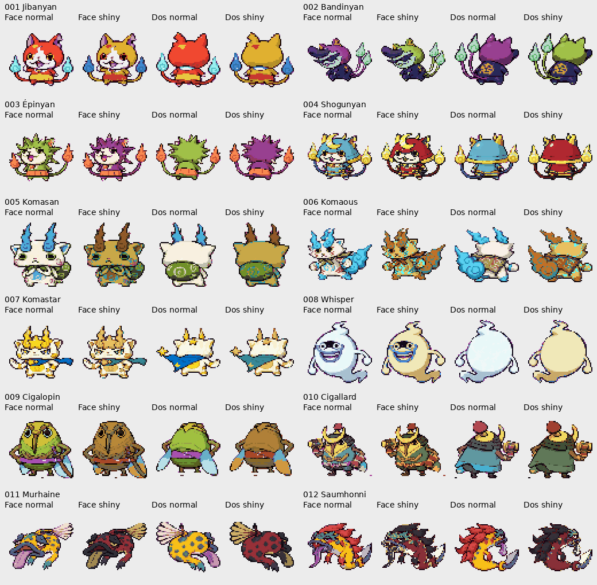

> **Révision2 disponible : [les151 shiny seuls](revision-2/PLANCHES.md) et [le nouveau rapport](revision-2/RAPPORT.md).** Cette page décrit la première passe.

# Refonte des 151 shiny — proposition à valider

Branche : `feature/shiny-151-refonte-20261024`. Base : `903281f49`. Aucun merge sur master.

**151 palettes proposées**, avec les vues normales et shiny de face et de dos. Les silhouettes, cadrages et animations sont conservés. Les taux de rencontre, le Charme Chroma, le Safari et le scénario restent inchangés.

[Galerie des 151 résultats individuels](GALERIE.md) · [Audit par espèce](AUDIT_151.md) · [Audit technique](AUDIT_TECHNIQUE.md) · [Visionneuse HTML à ouvrir localement](index.html)

## Planches de comparaison

| Espèces | Planche |
|---|---|
| 001–012 | [Planche 01](planche-01.png) |
| 013–024 | [Planche 02](planche-02.png) |
| 025–036 | [Planche 03](planche-03.png) |
| 037–048 | [Planche 04](planche-04.png) |
| 049–060 | [Planche 05](planche-05.png) |
| 061–072 | [Planche 06](planche-06.png) |
| 073–084 | [Planche 07](planche-07.png) |
| 085–096 | [Planche 08](planche-08.png) |
| 097–108 | [Planche 09](planche-09.png) |
| 109–120 | [Planche 10](planche-10.png) |
| 121–132 | [Planche 11](planche-11.png) |
| 133–144 | [Planche 12](planche-12.png) |
| 145–151 | [Planche 13](planche-13.png) |

## Tests exécutés

- Compilations publique et privée réussies, dans les limites de mémoire GBA. ROM publique : 15 990 228 octets utilisés ; privée : 31 751 591 octets, sur 32 Mio.
- Intégrité des 151 palettes, concordance CSV/SPECIES, RGB555 compilés, index transparents et 302 dessins normaux vérifiés : [résultats](TEST_INTEGRITE.json).
- Première passe mGBA : **151 combats par version**, avec face/dos et sélection automatique de palette contrôlés. Les 84 espèces autorisées utilisent naturellement leur palette shiny ; pour les 67 exclusions, la palette est chargée explicitement par une fixture après contrôle du comportement normal existant.
- Retouche finale du chapeau d’Appak : nouveau build puis combat nº088 revérifié dans les deux versions. Les **302 pointeurs et palettes compilées (normales + shiny)** sont également vérifiés dans chaque ROM finale. Les 150 autres palettes restent identiques à la première passe.
- Pas de parcours complet de l’aventure ni de test exhaustif de toutes les attaques. Les preuves techniques ne valent pas validation artistique.

| Version / phase | Combats | SHA-256 de la ROM testée | Résultats |
|---|---:|---|---|
| public — 151 espèces | 151 | `209fc2795e7d0f57d3b1222c01c9231be9ae0dcf11cac1af6815cd78bd5b6baf` | [JSON](mgba/public/TEST_MGBA.json) |
| public — retouche Appak + 302 pointeurs de palettes | 1 | `8cba7d8ea95312c24eaeeffe49dc6ced058a0fe29069260472424a6818f14860` | [JSON](mgba/public/retouche-appak/TEST_MGBA.json) |
| prive — 151 espèces | 151 | `916fe57916987086db2486d12038bc69ddeb241cadae82da91b8a54eaffea2d2` | [JSON](mgba/prive/TEST_MGBA.json) |
| prive — retouche Appak + 302 pointeurs de palettes | 1 | `7154e4e1e18401b87aa925c5ac5738e09393e0e6e71ab5f289fb160998321732` | [JSON](mgba/prive/retouche-appak/TEST_MGBA.json) |

[Logs de compilation et d’émulateur](logs/)

## Arbitrages visuels nécessaires

Les palettes restent des propositions. Les index réunissent parfois des matières qui devraient avoir des couleurs différentes : les aperçus et les fiches détaillent ces approximations. Les cas les plus visibles sont :

- **008 Whisper** : la robe de Whisperocrates n’existe pas sur le dessin actuel ; les tons crème/doré sont adaptés au corps.
- **018 Robonyan F** : le bicolore rouge/bleu de l’artwork demanderait des masques locaux.
- **051, 066/067, 121, 133, 145 et 151** : certaines zones partagent des index avec les contours, le ventre, les pièces mécaniques ou les ornements. Leur séparation nécessitera des masques plus précis et un arbitrage sur les nuances disponibles.
- **053/054** : rouge/blanc appliqués aux zones existantes, sans inventer de nouvelles rayures.
- **150 Enma** : les couleurs de la référence sont adaptées au sprite humain à épée conservé ; aucune autre forme n’est substituée.

**67 formes restent exclues des rencontres shiny par la règle historique.** Les palettes sont préparées et inspectables ; leur activation globale n’est pas incluse, afin de respecter l’interdiction de modifier la logique de rencontre.

Conformément à l’étape 7 du [dossier utilisateur](dossier/PROMPT_CODEX.md), arrêt ici pour validation visuelle de Yoann avant intégration définitive. Les éventuelles corrections et l’activation des espèces historiquement exclues restent à décider.
