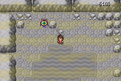

# Terr’heure — chrono fixe entre les étages

Le bandeau du nom de grotte modifie le défilement vertical du plan BG0, également utilisé par le chrono. Il est désormais désactivé pendant toute la Terr’heure. Un bandeau déjà présent au déclenchement est fermé pendant la transition, avant l’apparition du chrono. En dehors de la Terr’heure, les noms de lieux continuent de s’afficher normalement.

Huit [contrôles ciblés dans mGBA](TESTS.json) passent, dont quatre changements d’étage dans la Grotte Sombre. Sur 720 frames contrôlées, le décalage matériel BG0 reste à zéro et la fenêtre du chrono reste à sa position supérieure. L’affichage des noms de lieux est également vérifié avant et après l’événement. Ces essais utilisent des transitions natives préparées et ne constituent pas un parcours complet. Aucune nouvelle vidéo enregistrée.

[Télécharger la ROM](Pokemon_Yokai_Watch_Beta_0.1_Chrono_Fixe.gba)

Durée conservée : cinq minutes. Correctifs précédents des patrouilles conservés. Taille : 33517663 octets. SHA-256 : `3963629a60b3ced5355c7824ebc910a3c6387b77d066cae79849ac26b551c271`. Format de sauvegarde conservé.

Branche dédiée : `fix/terre-heure-regard-oni-20261025`. Aucune fusion sur `master`.
