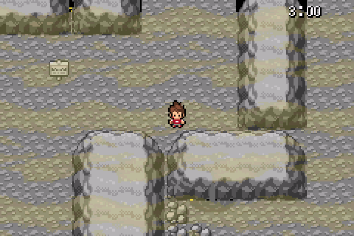

# Terr’heure : décor gris, nuages jaunes et combat à zéro

Branche `fix/terre-heure-gris-brume-chrono-20261025`, sans fusion sur `master`.

[**ROM de test corrigée avec les OST**](Pokemon_Yokai_Watch_Beta_0.1_Terre_Heure_Gris_Brume.gba) · [Taille et SHA-256](LIVRAISON.json)

## Rendu en jeu

[**Voir le GIF du décor gris et des nuages mobiles**](gris-brume-mobile-mgba-x3.gif)

L’ancienne formule ajoutait directement du jaune aux couleurs du décor. Elle est remplacée par une conversion neutre : les 208 couleurs de terrain ont maintenant des composantes rouge, verte et bleue identiques.

La brume est une couche distincte de nappes jaunes animées. Elle réutilise la texture de nuages du jeu, avec des espaces transparents entre les nappes et une opacité de 3/16. Elle passe derrière Nathan et les personnages. Les palettes du terrain restent grises sous les nuages ; les personnages et l’interface gardent leurs couleurs.

La texture n’est préparée qu’au chargement. Son déplacement utilise quinze sprites matériels partageant les mêmes 2 Kio de tuiles, sans traitement graphique pixel par pixel à chaque image.

## Chronomètre à zéro

[**Voir le GIF du chrono qui déclenche le combat**](chrono-zero-combat-mgba-x3.gif)

À zéro, la Terr’heure ne se termine plus directement par un échec. Le combat contre l’Oni du palier courant commence automatiquement, sans confirmation ni dialogue d’introduction à fermer. Cela fonctionne aussi dans un passage où aucun Oni n’est présent sur la carte.

Si un menu est ouvert lorsque le temps expire, le combat est imposé au retour au terrain. Le menu ne permet pas de reprendre l’exploration ou d’atteindre la porte sans affronter l’Oni.

- **Victoire :** le palier est validé, les poursuivants disparaissent et l’exploration continue sans limite de temps, avec le décor gris et les nuages jaunes.
- **Défaite :** l’événement se termine et le joueur retrouve la grotte normale. Les règles du Nuzlocke restent inchangées.

La brume est libérée avant la transition de combat, puis restaurée au retour. Elle est également nettoyée lors des chargements et de la sortie par la porte.

## Vérifications mGBA

**74 contrôles ciblés réussis**, tous avec le SHA-256 de la ROM téléchargeable :

| Groupe | Contrôles | Résultats |
| --- | ---: | --- |
| Gris réel, nuages, couleurs de Nathan et combats automatiques des trois paliers | 10 | [JSON](TESTS_CORRECTIONS.json) |
| Cartes, palettes, porte blanche, menus, délai et Flash | 41 | [JSON](TESTS_CARTES_PORTE.json) |
| IA, poursuite, objets et quête | 12 | [JSON](TESTS_PROGRESSION.json) |
| Combats réels, défaite, capture de Gorgouille et sauvegarde/Continuer | 11 | [JSON](TESTS_COMBATS_REELS.json) |

Les tests vérifient notamment :

- les 208 couleurs de terrain réellement grises dans la palette matérielle ;
- le mouvement des nuages pendant que Nathan reste immobile ;
- les pixels opaques de Nathan identiques avec et sans la couche de brume ;
- le démarrage automatique des combats Gargaros, Ogralos et Orqanos à zéro, sans saisie de bouton ;
- une vraie victoire après chaque expiration, suivie du retour à l’exploration libre et à la brume ;
- le combat imposé sur un petit étage sans Oni visible ;
- le blanc complet de la porte et la restauration de l’obscurité ;
- 120 mises à jour du terrain sur les 120 images mesurées pendant la poursuite avec les OST.

Les positions, équipes de test et durées courtes sont préparées en mémoire. Les animations, transitions, dégâts, résultats et captures sont exécutés par le moteur mGBA. Ce n’est pas un parcours complet de l’aventure.

La correction ajoute 820 octets de ROM et 8 octets fixes d’EWRAM par rapport à la version précédente. Il reste 63 621 octets de ROM et 524 octets d’EWRAM fixe disponibles. Aucun fichier musical ni format de sauvegarde n’est modifié.

Pour reprendre une partie, utilise une copie de ta `.sav` portant le même nom que cette nouvelle ROM, puis **Continuer**.
