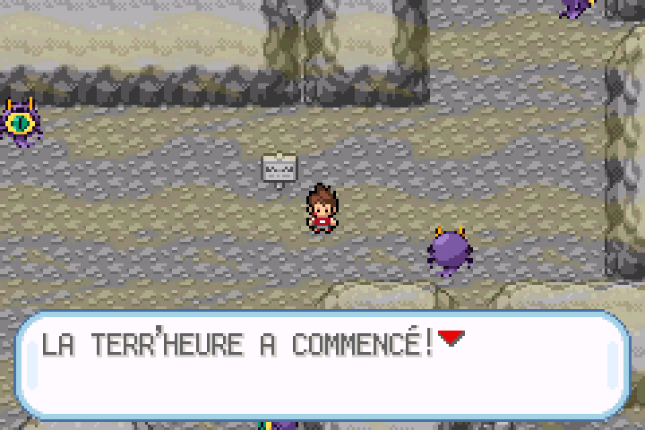

# Terr’heure — Nathan, patrouilles et porte éloignée

Branche dédiée : `fix/terre-heure-nathan-patrouilles-20261025`. Aucune fusion sur `master`.

[Télécharger la ROM](Pokemon_Yokai_Watch_Beta_0.1_Terre_Heure_Patrouilles.gba) · [Voir la vidéo continue dans mGBA](declenchement-porte-sortie-mgba.mp4)

## Comportement livré

La porte se trouve sur un autre étage, au point accessible le plus éloigné parmi les emplacements sûrs. La limite obligatoire de 150 pas est retirée : si le meilleur emplacement est plus proche, il est accepté. La recherche examine toutes les cases viables, avec un chemin à pied vérifié, plutôt qu’une petite liste de positions prédéfinies. Les raccourcis possibles sont pris en compte dans le classement des distances. Les six réseaux de grottes possèdent maintenant des positions éligibles ; une composante isolée sans accès à un autre étage reporte toujours le déclenchement.

Nathan reste visible pendant la transformation et le texte. La disparition provenait d’un objet en cours de création dont l’identifiant de sprite temporaire pointait sur le joueur : le fondu effaçait alors ses pixels. Les écritures sont désormais protégées et la création des objets séparée de cette phase.

Les habitants disparaissent avec les cinq secondes de désaturation et de brume. Les patrouilles se matérialisent ensuite progressivement avant le texte. Elles commencent avec des orientations variées, privilégient les intersections et les approches, marchent réellement à vitesse normale et ont les collisions natives des Dresseurs. Leur nombre s’adapte à la place disponible, jusqu’à huit. Elles ne peuvent apparaître ni entrer dans le carré de deux cases autour de la porte, coins compris.

Un regard détecté déclenche le même cri que l’introduction, un point d’exclamation et une immobilisation d’environ deux secondes. Le compteur reste de six minutes. À zéro, le combat contre l’Oni est imposé. Tunnel et Corde Sortie sont refusés pendant l’événement et redeviennent disponibles après la sortie.

Le retour maintient l’écran blanc pendant le rechargement et ne révèle que la carte normale. Les habitants et les objets originaux sont restaurés ; la disparition temporaire des Poké Balls au sol ne les marque plus comme ramassées.

Le rattrapage à trois pas de la sortie s’applique seulement quand le seuil prévu a déjà été atteint et qu’une tentative a été bloquée. Il n’anticipe pas les 30 à 150 pas programmés. Le tirage reste unique par visite, avec les taux 5/15 % pendant l’aventure et 10/30 % après la Ligue, sans cumul de Shorts Oni. La première rencontre garantie est réservée à la Grotte Sombre pendant l’aventure.

## Vérifications

96 contrôles ciblés passent sur la même ROM dans mGBA :

- [17 contrôles de déclenchement](TESTS_DECLENCHEMENT.json), dont sauvegarde/Continuer et priorité sur une rencontre de Dresseur.
- [18 contrôles de distance](TESTS_DISTANCES.json), comparant le choix natif à une recherche Python indépendante, et rattrapage près d’une sortie.
- [13 contrôles Nathan/patrouilles](TESTS_NATHAN_PATROUILLES.json), dont pixels du joueur, collisions, immobilisation, périmètre de porte, écran blanc et objets conservés.
- [7 contrôles de progression](TESTS.json), dont cinq secondes de transition, chrono intact pendant le déplacement et six minutes réellement écoulées avant le combat.
- [41 contrôles des cartes et de la sortie](cartes/TESTS_CARTES_PORTE.json), dont menus, porte, palettes et restauration de l’obscurité.

Il s’agit de vérifications ciblées avec des situations préparées, pas d’un parcours à 100 % de l’aventure.

## Vidéo

La vidéo dure 2 min 42 s, sans coupe ni accélération, avec le son direct de mGBA. Elle montre le déclenchement, Nathan pendant le texte, les patrouilles, un véritable combat et une victoire contre l’Oni, le changement d’étage, la porte, puis dix secondes après le retour normal.

La position initiale, le tirage favorable juste avant son dernier pas et une équipe de démonstration (Seigneur Enma niveau 85, statistiques et capacités naturelles) sont préparés avant la capture. Pendant l’enregistrement, seules les commandes de la manette sont utilisées : aucun déplacement forcé, résultat de combat ou changement de minuterie n’est injecté. [Métadonnées et repères temporels](ENREGISTREMENT_SORTIE.json).

## ROM

- Nom : `Pokemon_Yokai_Watch_Beta_0.1_Terre_Heure_Patrouilles.gba`
- Taille : **33 516 647 octets**.
- SHA-256 : `d8edc8263d1802a15122f0b04dcca6f9ee7edfdd563a98411c998d847a266700`.
- Compilation avec les ressources audio privées déjà intégrées, sans modification des OST.
- Format de sauvegarde conservé ; les ajouts sont dans l’état temporaire en RAM.

