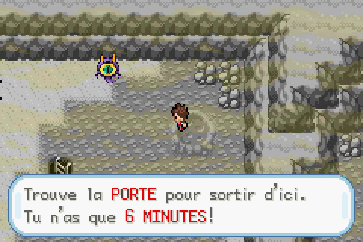
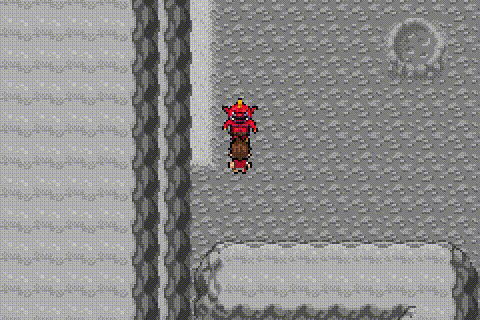

# Terr’heure — regards, difficulté progressive et fondu de victoire

Branche dédiée : `fix/terre-heure-regard-oni-20261025`. Aucune fusion sur `master`.

[Vidéo : trois Oni dans trois grottes](trois-oni-trois-grottes-mgba.mp4) · [ROM corrigée](Pokemon_Yokai_Watch_Beta_0.1_Terre_Heure_Equilibree.gba)

## Résultat des parcours de fuite

Les trois situations finales sont réussies dans mGBA **sans combattre l’Oni**, en courant vers la porte et en évitant les poursuivants. La capture de chaque parcours est continue, à vitesse normale, depuis le déclenchement jusqu’à dix secondes après le retour normal.

| Oni | Grotte | Distance minimale de la porte, autre étage | Commandes rendues → interaction avec la porte |
| --- | --- | ---: | ---: |
| Gargaros | Mont Sélénite | 170 pas | 55,8 s |
| Ogralos | Grotte Sombre | 174 pas | 49,7 s |
| Orqanos | Îles Écume | 72 pas | 30,9 s |

La porte des Îles Écume illustre l’exception demandée : moins de 150 pas, mais l’emplacement viable le plus éloigné sur un autre étage. La durée de six minutes n’est jamais modifiée pendant les captures. Ces temps réels incluent les alertes et transitions jusqu’à la porte ; le chrono du jeu laisse donc au moins autant de marge.

**Ce que cela confirme :** il est possible de sortir dans le délai sans affronter l’Oni dans chacun de ces trois scénarios. La marge sur ces trajets est importante.

**Limite :** les trajets sont pilotés par un algorithme qui lit les positions, connaît les cartes et la destination de la porte, puis agit exclusivement par la manette. Ce n’est pas une étude de difficulté auprès de joueurs découvrant les grottes, ni une garantie de réussite sur tous les tirages. L’exploration sans connaître la porte prendra davantage de temps. Les premiers essais, avant les réglages finaux, comportaient des captures ; ils ont motivé les ajustements ci-dessous. Aucune victoire de combat n’est utilisée pour faire passer un essai de fuite pour une réussite.

Les situations initiales, le stade Oni, la visite favorable et l’équipe sont préparés avant chaque enregistrement. Pendant les prises, aucun warp, changement RAM, changement de minuterie ou résultat de combat n’est injecté. Les trois prises finales utilisent la graine native 1, sans sélection d’une réussite parmi plusieurs graines finales. Métadonnées : [Gargaros](GARGAROS.json), [Ogralos](OGRALOS.json), [Orqanos](ORQANOS.json), [montage et chapitres](VIDEO.json).

## Réglages effectués

| Stade | Maximum de patrouilles sur l’étage | Déplacement | Reprise minimale entre deux immobilisations |
| --- | ---: | --- | ---: |
| Gargaros | 1 | Marche lente, pauses plus longues | environ 8 s de contrôle |
| Ogralos | 2 | Marche lente, pauses plus courtes | environ 6 s de contrôle |
| Orqanos | 3 | Marche normale | environ 4 s de contrôle |

La place réellement disponible réduit encore ces plafonds. Les cases de couloir à deux issues ne comptent plus pour augmenter la densité. Les nouveaux emplacements demandent un espace dégagé autour d’eux et davantage de séparation. Les patrouilles ne peuvent pas entrer dans les couloirs à deux issues pendant leurs rondes. Le périmètre protégé de deux cases autour de la porte est conservé.

Le regard de l’Oni déclenche le même cri et la même immobilisation d’environ deux secondes que les patrouilles, avec un point d’exclamation. Pendant cette immobilisation, lui seul peut continuer d’approcher : au plus deux nouveaux pas pour Gargaros/Ogralos, trois pour Orqanos, et il s’arrête à deux cases du joueur. Ce dernier point empêche une capture imposée pendant que les commandes sont bloquées. La poursuite reprend après restitution du contrôle. Le délai entre alertes empêche les immobilisations en chaîne.

Le déclenchement automatique du combat demande maintenant la case immédiatement devant l’Oni ; un simple contact de côté ou dans son dos ne lance plus immédiatement le combat. Un Oni en poursuite peut toutefois se retourner pour attraper un joueur qui reste près de lui. Interagir volontairement avec lui permet toujours de le combattre.

L’introduction annonce désormais **6 MINUTES**, conformément au compteur réel.

## Fondu après une victoire

Après un combat gagné, l’Oni et les patrouilles se dissolvent progressivement pendant 64 VBlanks, soit environ une seconde. Leurs objets sont retirés à la fin, puis le message de victoire apparaît. Nathan, les trésors et le décor ne sont pas effacés. La brume et l’exploration libre restent présentes, avec le chrono arrêté comme auparavant.

Le bonus à la fin de la vidéo montre ce fondu **après un véritable combat gagné**, et pas uniquement après une simulation du résultat. [Provenance du combat](VICTOIRE.json).

## Vérifications et livraison

44 contrôles ciblés passent sur la même ROM : [20 contrôles de regard, densité et fondu](TESTS_REGARD_ONI.json), [17 contrôles de déclenchement](TESTS_DECLENCHEMENT.json), [7 contrôles de progression](TESTS.json). Ils couvrent notamment le verrouillage de deux secondes, l’approche de l’Oni, les contacts latéraux, la protection à deux cases aux trois stades, le texte compilé, le fondu avec les pixels du joueur inchangés, les six minutes réellement écoulées et le combat imposé à zéro.

Ces vérifications s’ajoutent aux trois parcours de fuite et au véritable combat enregistré. Elles ne constituent pas un test complet de toute l’aventure.

- ROM : `Pokemon_Yokai_Watch_Beta_0.1_Terre_Heure_Equilibree.gba`.
- Taille : **33 517 599 octets**.
- SHA-256 : `53c62090c8838a2eff68d6abc019ec9b3f13f44daa1ba679fdb6079faefb101b`.
- Format des sauvegardes conservé, sans ajout de données persistantes.
- Aucune OST ni ressource musicale modifiée.
