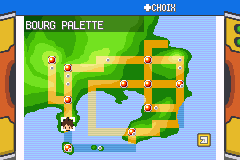
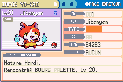
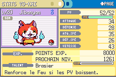
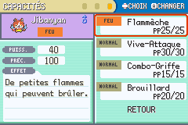
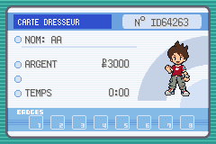
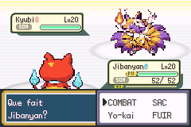

# ROM française — 24 octobre 2026

Branche : `feature/traduction-fr-complete-20261024`. Base : `716712b08`.
`master` reste à `037335f4c725d7c9aecdac87066f2002b4bd7e14`, sans fusion.

ROM avec toutes les OST : `Pokemon_Yokai_Watch_Beta_0.1_FR.gba`.
Taille : **33,449,979 octets**. SHA-256 : `5e350381135282f916616c221ef59db974fec501b73579a406c533e5104469e5`.
Le fichier téléchargeable est une copie exacte de `pokefirered_audio.gba`.

## Traduction

Les dialogues de l’aventure, messages communs des Centres de soins, panneaux,
interfaces, aide, objets, Médallium, événements et vocabulaire ont été repris en
français. La dernière passe couvre aussi les textes hérités courts et japonais,
les descriptions d’anciennes ressources et les surnoms par défaut de la Tour.
Les 1 006 mots du vocabulaire sont traduits et triés pour leur affichage français,
sans changer les identifiants sauvegardés ni les conditions de déblocage.

**Les 78 libellés de lieux sont français**, y compris les villes, les destinations
et les lieux des Îles Sevii. Exemples : Bourg Palette, Jadielle, Argenta, Azuria,
Lavanville, Carmin sur Mer, Céladopole, Parmanie, Safrania et Cramois’Île.
Les références dans les dialogues, panneaux et descriptions d’objets ont également
été reprises. Les identifiants internes, coordonnées et alias restent inchangés.
Les libellés sont enregistrés dans `display_name` du JSON source ; ils restent
français lors de la régénération des en-têtes.

Les libellés graphiques de la Carte Dresseur, de la fiche, des types/capacités et
des états de santé sont rendus en français. PV remplace HP dans les barres concernées.
Ces petits libellés utilisent un dessin de caractères compact dans les tuiles
chargées ; les PNG sources d’origine sont conservés. Aucun ajout de RAM persistante.
Les noms pluriels des Baies conservent leur variété : « Baie Ceriz » / « Baies Ceriz ».

Les noms de personnes, marques, contributeurs et institutions des crédits sont
conservés. Les 26 chaînes japonaises restantes sont des identités/comparaisons
pour les imports et des données de débogage, pas des dialogues normaux du joueur.
Voir [le classement résiduel](AUDIT_RESIDUEL.json). Le détecteur linguistique est
une aide de tri, pas une preuve suffisante à lui seul.

## Préservation

Aucun changement de scénario, statistiques, équipes, rencontres, sauvegardes ou
musique dans cette passe. Les 151 noms actifs et les identifiants du vocabulaire
sont préservés. Les variantes garçon/fille sont conservées.
La correction du retour Argenta–Route 2 est reprise à l’identique de la branche
`fix/argenta-retour-route2-20261024` ; Wyatt reste dans l’audience du discours.

[Contrôles structurels](PRESERVATION.json) : 228 fichiers de scripts ne changent
que par leurs chaînes ; exception explicitement vérifiée pour la correction Argenta.
Les modifications de code supplémentaires concernent uniquement les libellés,
leur affichage et le pluriel français. Les sources audio et graphiques sont inchangées.

## Vérifications mGBA

- Compilations publique et avec OST réussies ; démarrage et nouvelle partie
  vérifiés dans les deux. La ROM livrée contient les OST.
- Nouvelles parties garçon/fille par les commandes, 78 noms de lieux liés et
  largeur native, 1 006 mots du vocabulaire (colonnes de 72 pixels), pluriels de
  toutes les Baies, Carte Dresseur recto/verso, carte de Kanto et fiche avec ses pages.
- 298 noms/descriptions d’objets contrôlés ; 151 profils du Médallium et 369 textes
  d’aide contrôlés en largeur native, avec captures d’échantillons.
- Menus START/équipe/Sac/Médallium ouverts ; 26 messages de combat rendus et limites
  du tampon vérifiées. SOM/GEL/BRU/PSN/PAR contrôlés sur les deux côtés du combat.
- Discours, soins, musée, sortie vers la Route 2, START et retour à Argenta testés
  sur les quatre colonnes d’entrée. Les visites de 16 états de cinématiques
  terminées laissent les déplacements et START disponibles.
- Deux sauvegardes existantes de fin de jeu chargées via Continuer ; déplacement
  possible et données des 151 Yo-kai en Boîtes conservées. Fichiers originaux non écrits.

Les essais utilisent mGBA/libretro et des états de test explicités dans les scripts
et JSON : positions, drapeaux ou équipes préparés pour isoler chaque contrôle.
Ils ne constituent pas une traversée intégrale de l’aventure ni un essai réel du
multijoueur ou de toutes les combinaisons de dialogues. Certains contrôles de texte
précèdent les derniers ajouts graphiques ; leur empreinte de ROM est conservée.
Le test global et les contrôles d’états graphiques portent sur la ROM finale.

## Captures








## Reproduction et sources

Compilation avec le pack OST existant :

```sh
source /workspace/.setup/env.sh
make -j6 YOKAI_AUDIO_DIR=/workspace/private-audio/title-credits-integration
```

Sans le pack privé, `make -j6` compile la version publique.
Tests : `tools/yokai/tester_fr_complet_mgba.py`, `tester_etats_fr_mgba.py`,
`tester_localisation_interfaces_mgba.py`, `tester_localisation_objets_mgba.py`,
`tester_argenta_retour_route2_mgba.py`, `tester_retours_cinematiques_mgba.py`,
et `verifier_preservation_fr_complete.py`. Définir `YOKAI_QA_ROM` et `YOKAI_QA_ELF`.

Les tableaux relus se trouvent dans `data/localisation/fr/24_*.tsv` à `62_*.tsv`.
Les JSON de cette documentation gardent les textes avant/après des lots.
Les noms et descriptions françaises de ressources Pokémon héritées ont été
comparés aux données publiques PokeAPI (`pokemon_species_names.csv` et
`pokemon_species_flavor_text.csv`, langue 5) :
https://github.com/PokeAPI/pokeapi/tree/master/data/v2/csv
Les descriptions ont été sélectionnées sur correspondance exacte de l’ancien
texte anglais ou traduites manuellement. Les identifiants et valeurs de jeu
n’ont pas été repris d’une autre génération.
