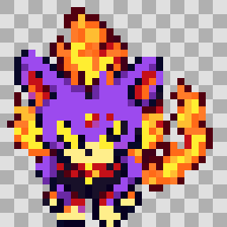

# Personnages originaux du hack

Les PNG ci-dessous sont opaques sur damier. Les sources natives conservent leur transparence d’index0. Les grandes planches source et les rectangles de découpe sont suivis avec leurs convertisseurs dans tools/yokai/. Aucun ancien sprite de Red/Leaf/Blue n’a été simplement recoloré.

## Actifs et testés dans mGBA

| Personnage | Séries natives et aperçu | Preuves |
|---|---|---|
| Nathan | [Planche complète](../../graphics/yokai_characters/nathan/complete-preview.png) | [Introduction](../../QA_RECETTE_FINALE/RECONSTRUCTION/preuves/nathan-introduction.png), [Surf](../../QA_RECETTE_FINALE/RECONSTRUCTION/preuves/nathan-surf-quatre-directions.png) |
| Katie | [Planche complète](../../graphics/yokai_characters/katie/complete-preview.png) | [Introduction](../../QA_RECETTE_FINALE/RECONSTRUCTION/preuves/katie-introduction.png), [Combat](../../QA_RECETTE_FINALE/RECONSTRUCTION/preuves/katie-combat-dos.png) |
| Matt | [Combat et marche](../../graphics/yokai_characters/matt/preview-checkerboard.png), [crédits](../../graphics/yokai_characters/matt/complete-preview.png) | [Introduction](../../QA_RECETTE_FINALE/RECONSTRUCTION/preuves/nathan-introduction-matt.png) |
| Ariane | [Planche](../../graphics/yokai_characters/ariane/preview-checkerboard.png) | [Route25](../../QA_RECETTE_FINALE/RECONSTRUCTION/preuves/ariane-usapion-route25.png) |
| Enma et Kyubi | [Planche](../../graphics/yokai_characters/enma/preview-checkerboard.png) | [Rapport natif](../../QA_RECETTE_FINALE/RECONSTRUCTION/TEST_ENMA_MGBA.json) |
| Nathaniel | [Planche](../../graphics/yokai_characters/nathaniel/preview-checkerboard.png) | [Combat](../../QA_RECETTE_FINALE/RECONSTRUCTION/preuves/cameo-nathaniel-portrait-combat.png) |
| Michael | [Planche](../../graphics/yokai_characters/michael/preview-checkerboard.png) | [Combat](../../QA_RECETTE_FINALE/RECONSTRUCTION/preuves/cameo-michael-portrait-combat.png) |
| Wyatt | [Planche](../../graphics/yokai_characters/wyatt/preview-checkerboard.png) | [Combat](../../QA_RECETTE_FINALE/RECONSTRUCTION/preuves/cameo-wyatt-portrait-combat.png) |

Nathan/Katie disposent des séries de déplacement/action et des écrans secondaires complets. Les caméos fixes utilisent trois orientations, l’est par miroir, sans prétendre à un cycle de marche absent. Le caméo de Céladopole réutilise les nouvelles ressources de Nathan/Katie avec ses propres identifiants de PNJ.

## Groupes postgame actifs et testés

- [Domniscian](../../graphics/yokai_characters/domniscian/preview-checkerboard.png), [employé rouge](../../graphics/yokai_characters/employe_rouge/preview-checkerboard.png), [employé bleu](../../graphics/yokai_characters/employe_bleu/preview-checkerboard.png).
- [Don Morleone](../../graphics/yokai_characters/don_morleone/preview-checkerboard.png), [Mafiamille1](../../graphics/yokai_characters/mafiamille_1/preview-checkerboard.png), [Mafiamille2](../../graphics/yokai_characters/mafiamille_2/preview-checkerboard.png), [Mafiamille3](../../graphics/yokai_characters/mafiamille_3/preview-checkerboard.png).

Ces sept portraits et leurs overworld sont actifs. Chaque groupe utilise une palette commune vérifiée dans la mémoire de mGBA. [Domniscian et employés, quatre orientations](../../QA_RECETTE_FINALE/RECONSTRUCTION/preuves/cameo-domniscian-groupe-directions.png) ; [Don Morleone et Mafiamille, quatre orientations](../../QA_RECETTE_FINALE/RECONSTRUCTION/preuves/cameo-morleone-groupe-directions.png). Les combats, prérequis et récompenses sont contrôlés dans TEST_CAMEOS_BOSS_MGBA.json ; les musiques personnelles restent en attente.

## Enma : personnage et créature distincts

Le Seigneur Enma du Mont Braise conserve son portrait de dresseur et ses trois poses de PNJ. Le Yo-kai Enma capturable de la Caverne Azurée possède désormais un overworld félin violet à flammes, adapté de son sprite de combat validé n°150. Les données de l’espèce et les conditions de capture ne changent pas.

Ressources : `graphics/yokai_characters/enma_creature/` ; dessin source conservé, conversion technique reproductible avec `tools/yokai/convertir_enma_creature.py`. Une pose statique32×32, palette4bpp15couleurs opaques +index0 transparent ; animation inanimée native, aucune marche requise pour cette rencontre.
