# Refonte artistique des 151 Yo-kai — phase 1

**Propositions de travail, sans intégration au jeu et sans validation implicite.** Les comparaisons ci-dessous montrent des PNG natifs 64 × 64, canevas complet, agrandis uniformément **×3** sur damier opaque. Les versions après sont des redessins proposés, pas des sprites approuvés.

**151 espèces / 302 vues originales examinées.** Classement : **95 A**, **16 B**, **35 C**, **5 D**. **51 espèces** des listes prioritaires ont un essai : **23 propositions à examiner** et **28 essais incomplets ou non retenus**. Les 33 demandes de proportions et les 20 défauts précis concernent 51 espèces distinctes : 131 et 135 figurent dans les deux listes.

**Le résultat artistique est partiel.** Les cases « Après » signalées **ESSAI INCOMPLET** ne signifient pas que le défaut est corrigé. En particulier : les neuf queues de 016 ne sont pas dénombrables avec certitude ; 098 conserve sa face donc le point signalé reste à corriger ; 124 conserve une lecture trop frontale de ses yeux arrière. Les essais 031 et 099 changent trop l’expression ou les proportions pour une correction légère ; 036 ne garantit pas toutes les armes ; 093 n’apporte pas de bénéfice évident. Ne pas intégrer ces essais en l’état.

[Analyse complète des 151 espèces](ANALYSE-151.md) · [Tableau CSV](assessment.csv) · [Données JSON et chemins sources](assessment.json) · [Vérifications techniques](technical-validation.json)

## Comparaisons normales

Chaque carte contient **Face : Avant / Après**, puis **Dos : Avant / Après**. Numéro, nom, classe et état de la proposition figurent au-dessus. Les familles Castelius 102–105 sont côte à côte sur le lot 5 ; 087–088, 129–130 et 143–144 sont également rapprochés. Aucun original n’est agrandi individuellement ni recadré pour la comparaison.

### Lot 1 — 8 espèces
017 Robonyan, 022 Granpapéti, 041 Brumette, 098 Sergent Rampant, 100 Usapion, 124 Chaipo, 135 Sabrille, 149 Hovernyan

[Ouvrir à pleine résolution](comparisons/normal/lot-01.png)

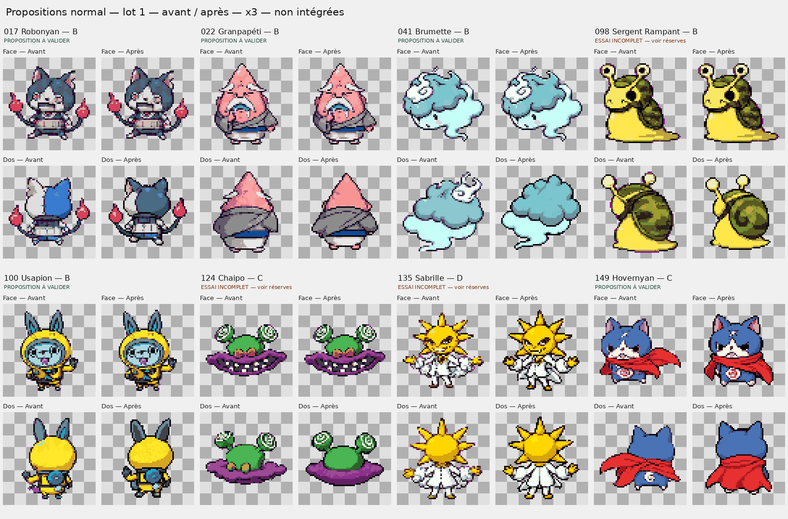

### Lot 2 — 8 espèces
084 Trytik, 086 Turboss, 111 Duc DeLaFeuille, 112 FeuildeChou, 114 XXL de bain, 117 Raton Glandeur, 128 Chauv'coucou, 131 Loubarbare

[Ouvrir à pleine résolution](comparisons/normal/lot-02.png)

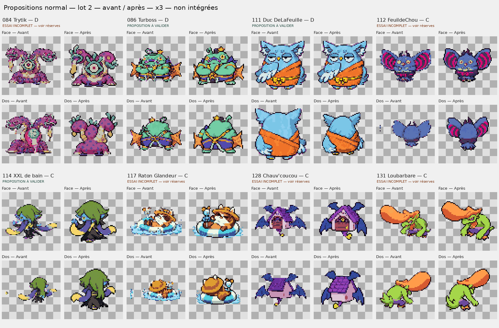

### Lot 3 — 8 espèces
015 Octorgone, 016 Kyubi, 025 Passpa, 027 Blizzaria, 028 Feulion, 047 Humainequin, 048 Slurpent, 071 Insomnel

[Ouvrir à pleine résolution](comparisons/normal/lot-03.png)

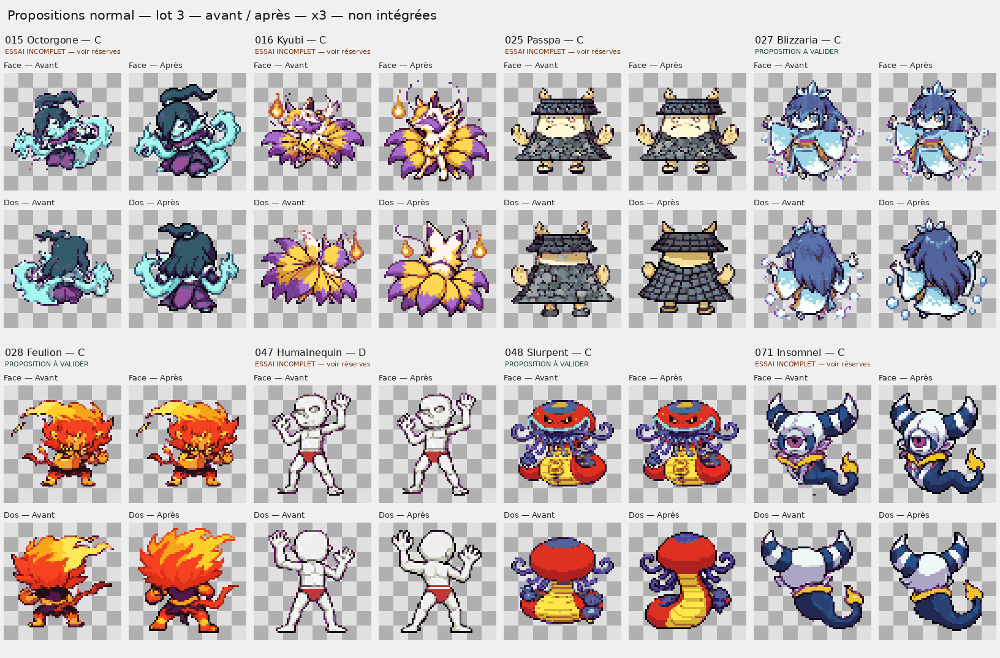

### Lot 4 — 8 espèces
061 Égare-dare, 062 Charivari, 090 Glapie, 093 Tête de lard, 031 Crocho, 036 Poulpatouch, 040 Démophage, 049 Baku

[Ouvrir à pleine résolution](comparisons/normal/lot-04.png)

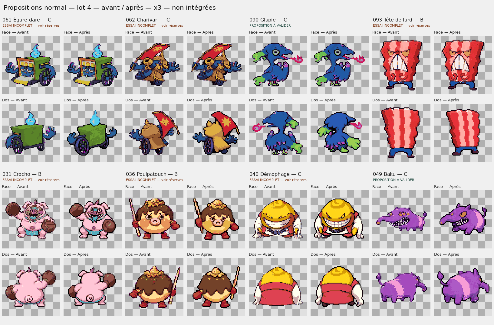

### Lot 5 — 8 espèces
087 Kappacap, 088 Appak, 099 Coach Antonic, 102 Castelius III, 103 Castelius II, 104 Castelius I, 105 Castelius Max, 119 Samoussrai

[Ouvrir à pleine résolution](comparisons/normal/lot-05.png)

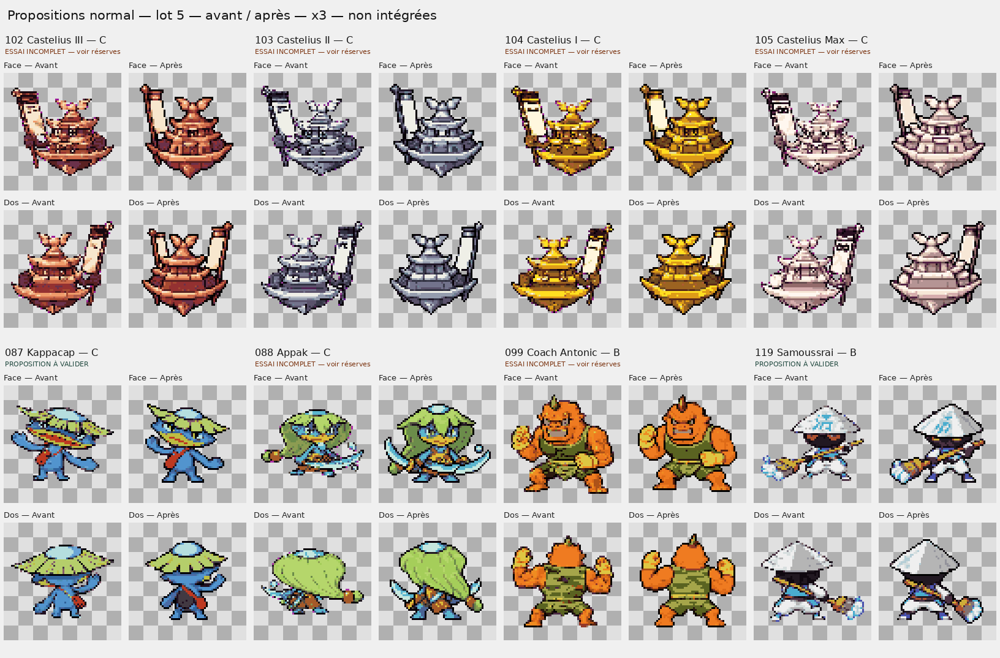

### Lot 6 — 8 espèces
129 Pachycool, 130 Pachypipi, 132 Racaïd, 133 Terminyanator, 139 Doyaris, 142 Lulugubre, 143 Toumou, 144 Lamlam'mou

[Ouvrir à pleine résolution](comparisons/normal/lot-06.png)

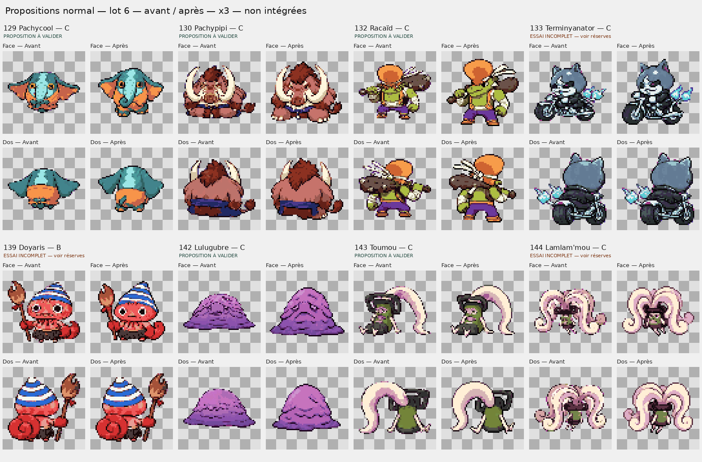

### Lot 7 — 3 espèces
070 Sorcophage, 145 Savantard, 147 Mademoaiselle

[Ouvrir à pleine résolution](comparisons/normal/lot-07.png)

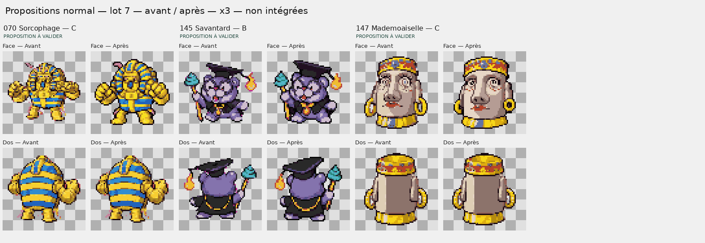

## Comparaisons shiny

Les mêmes indices de pixels sont affichés avec les **palettes shiny existantes, inchangées**. Aucune nouvelle couleur shiny n’est inventée. Les réserves artistiques des versions normales s’appliquent aussi ici.

### Shiny — lot 1
[Ouvrir à pleine résolution](comparisons/shiny/lot-01.png)

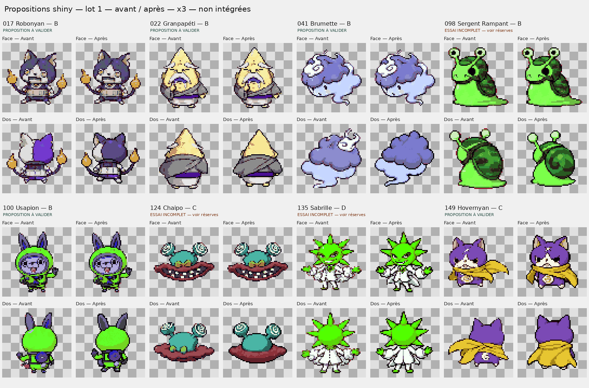

### Shiny — lot 2
[Ouvrir à pleine résolution](comparisons/shiny/lot-02.png)

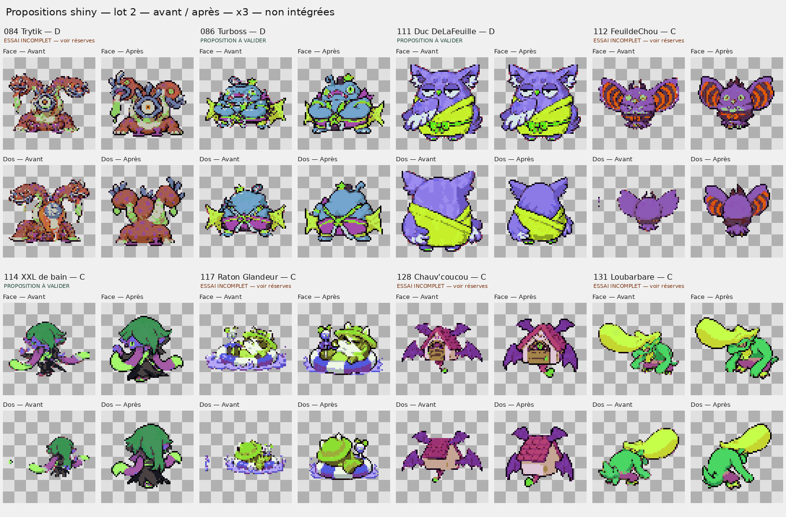

### Shiny — lot 3
[Ouvrir à pleine résolution](comparisons/shiny/lot-03.png)

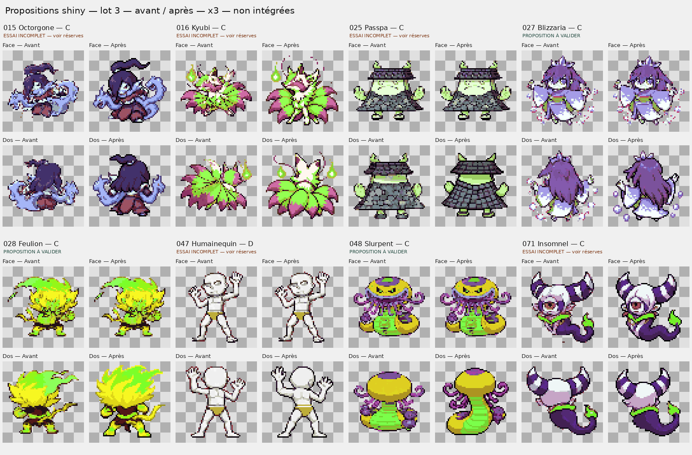

### Shiny — lot 4
[Ouvrir à pleine résolution](comparisons/shiny/lot-04.png)

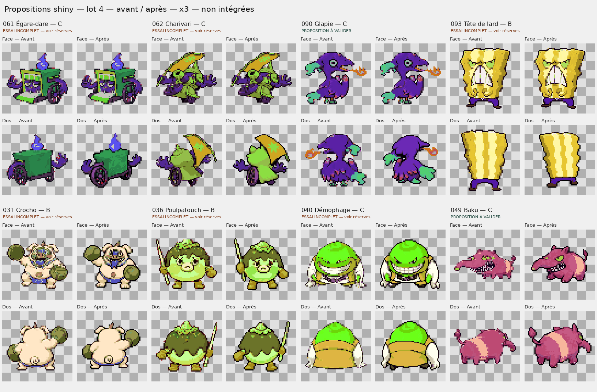

### Shiny — lot 5
[Ouvrir à pleine résolution](comparisons/shiny/lot-05.png)

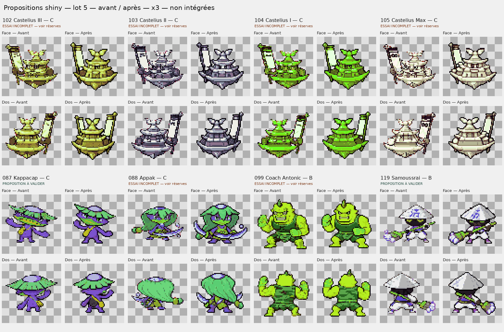

### Shiny — lot 6
[Ouvrir à pleine résolution](comparisons/shiny/lot-06.png)

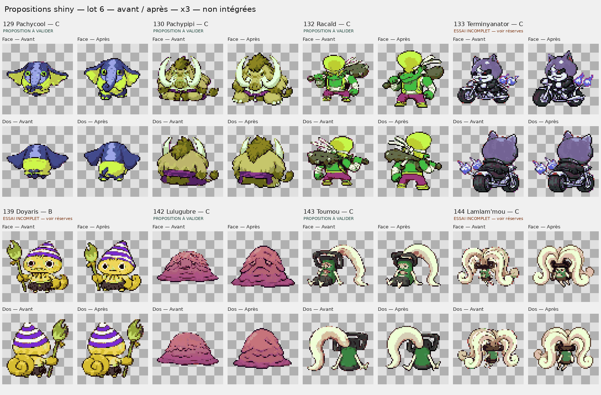

### Shiny — lot 7
[Ouvrir à pleine résolution](comparisons/shiny/lot-07.png)

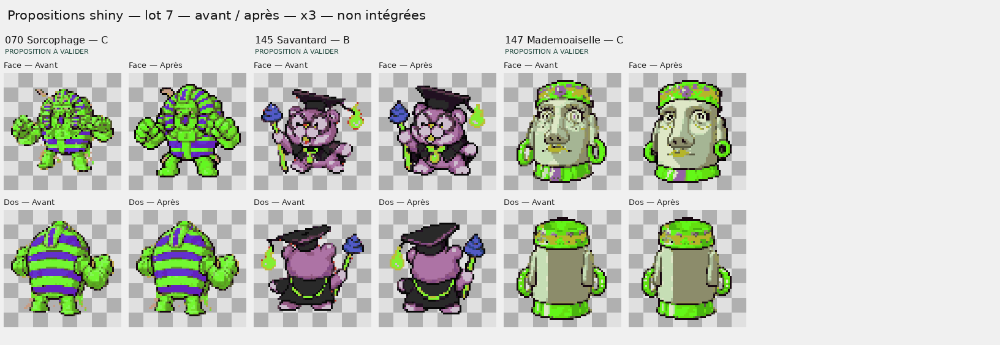

## Suivi des 51 espèces prioritaires

Toutes les propositions attendent une décision explicite de l’utilisateur. « À examiner » indique une proposition suffisamment cohérente pour la revue, pas une validation artistique définitive. Les essais incomplets sont conservés pour montrer les limites réellement observées.

| Espèce | Classe | Observation / demande | Travail réalisé | Réserves / reste à faire | Statut |
|---|---|---|---|---|---|
| [015 — Octorgone](comparisons/normal/lot-03.png) | C | Dragons cyan dominants, torse et bras centraux comprimés ; dos à reconstruire au-delà de la tête. | Corps central plus haut et dragons rapprochés ; arrière du vêtement redessiné. | Le dos reste très symétrique ; préciser les épaules et le raccord des dragons. | **Incomplet / réserves** |
| [016 — Kyubi](comparisons/normal/lot-03.png) | C | Éventail de queues plus visible que le renard ; neuf queues à conserver et rendre dénombrables. | Tête et torse agrandis, éventail réorganisé. | Neuf queues non dénombrables avec certitude ; essai non retenu en l'état, séparation à redessiner. | **Incomplet / réserves** |
| [017 — Robonyan](comparisons/normal/lot-01.png) | B | Grande surface bleue du dos différente du métal sombre de face ; face à préserver. | Dos gris métallique, oreilles et mains dans la gamme rouge existante ; face copiée sans changement. | — | À examiner |
| [022 — Granpapéti](comparisons/normal/lot-01.png) | B | Petites marques claires au sommet arrière rappellent des sourcils ; reconstruire la capuche, garder la face. | Marques de sourcils retirées du dos, capuche rose reconstruite ; face intacte. | — | À examiner |
| [025 — Passpa](comparisons/normal/lot-03.png) | C | Dos sans visage mais pose très frontale ; demander une rotation construite du costume et des pieds. | Arrière du costume simplifié et pieds redessinés ; face intacte. | Rotation vers l'adversaire encore insuffisante ; reprendre la pose, pas un miroir. | **Incomplet / réserves** |
| [027 — Blizzaria](comparisons/normal/lot-03.png) | C | Face convaincante ; arrière des cheveux et épaules à orienter vers l'adversaire sans simple miroir. | Arrière des cheveux et manches redessiné en léger trois-quarts ; face intacte. | — | À examiner |
| [028 — Feulion](comparisons/normal/lot-03.png) | C | Face agressive réussie ; torse et jambes arrière à accorder à l'orientation de la crinière. | Crinière, épaules et jambes arrière recomposées ensemble ; face intacte. | — | À examiner |
| [031 — Crocho](comparisons/normal/lot-04.png) | B | Gants très présents ; tête et buste peuvent gagner légèrement en carrure, sans refonte du boxeur. | Essai de boxeur plus compact avec torse redessiné. | Bouche et expression trop changées pour une correction légère ; essai non retenu, garder l'expression d'origine. | **Incomplet / réserves** |
| [036 — Poulpatouch](comparisons/normal/lot-04.png) | B | Tête déjà expressive ; légère présence supplémentaire possible en préservant intégralement les deux armes. | Corps plus présent sous la chevelure, tête et arrière redessinés. | Conservation de toutes les armes non établie ; vérifier les extrémités et ne pas intégrer cet essai. | **Incomplet / réserves** |
| [040 — Démophage](comparisons/normal/lot-04.png) | C | Tête jaune expressive mais masse centrale à renforcer ; mains et griffes doivent rester complètes. | Tête jaune et corps rouge aux contours plus compacts ; mains blanches gardées. | Gain de carrure encore modéré ; renforcer le tronc sans réduire les griffes. | **Incomplet / réserves** |
| [041 — Brumette](comparisons/normal/lot-01.png) | B | Grande spirale blanche supérieure indue au dos ; préserver les volutes pâles légitimes du bas et la face. | Spirale blanche supérieure retirée du dos ; nuage bleu continu et vapeur pâle conservés ; face intacte. | — | À examiner |
| [047 — Humainequin](comparisons/normal/lot-03.png) | D | Tête tournée mais cage thoracique et bassin conservent des lectures de face ; anatomie arrière à redessiner. | Dos du mannequin redessiné avec omoplates et plans arrière ; face d'origine conservée. | Bassin et mains encore schématiques ; retouche anatomique à 64 pixels souhaitable. | **Incomplet / réserves** |
| [048 — Slurpent](comparisons/normal/lot-03.png) | C | Masse inférieure arrière évoque une jupe ; expliciter la continuité du corps et d'une queue de serpent. | Queue serpentine unique enroulée sous la masse rouge arrière ; face intacte. | — | À examiner |
| [049 — Baku](comparisons/normal/lot-04.png) | C | Corps du tapir trop mince derrière le long museau ; arrondir le tronc sans en faire un bipède. | Tapir violet plus arrondi, museau rapproché et arrière plus volumineux. | — | À examiner |
| [061 — Égare-dare](comparisons/normal/lot-04.png) | C | Objet sur roues : perspective du plan arrière à confirmer avec les roues et les mains ; orientation ambiguë, aucun miroir automatique. | Roue et plan vert arrière reconstruits ; face intacte. | Direction de la caisse encore ambiguë ; essai de perspective, non correction validée. | **Incomplet / réserves** |
| [062 — Charivari](comparisons/normal/lot-04.png) | C | Capuche et épaules arrière à accorder à la direction de combat ; vérifier la pose plutôt que retourner le dessin. | Arrière de capuche et de corps redessiné sans miroir de la face. | Orientation encore proche du dos initial ; contrôle artistique de la pose nécessaire. | **Incomplet / réserves** |
| [070 — Sorcophage](comparisons/normal/lot-07.png) | C | Poings dominants sur la face ; tête et torse à renforcer, dos actuel explicitement satisfaisant à conserver. | Face de guerrier au torse et à la tête plus présents ; dos d'origine conservé octet pour octet. | — | À examiner |
| [071 — Insomnel](comparisons/normal/lot-03.png) | C | Grand œil, cornes et corps mal hiérarchisés ; dos, cornes et queue à construire vers l'adversaire. | Grand œil recentré, corps et queue plus lisibles, cornes arrière redessinées. | Direction arrière encore assez frontale au plan de symétrie ; préciser le trois-quarts. | **Incomplet / réserves** |
| [084 — Trytik](comparisons/normal/lot-02.png) | D | Corps larvaire sous-représenté face aux trois têtes ; vrai dos et deux pieds communs à reconstruire. | Corps larvaire commun plus massif, trois têtes compactées, deux pieds et vrai dos sans œil frontal. | Nuque de la tête centrale à mieux distinguer au dos ; détails et raccords à finir au pixel. | **Incomplet / réserves** |
| [086 — Turboss](comparisons/normal/lot-02.png) | D | Fins et équipements écrasent la carrure ; agrandir franchement visage, buste et bras du capitaine. | Bras et poitrine du capitaine pirate redessinés plus massifs ; fins et équipements rapprochés. | — | À examiner |
| [087 — Kappacap](comparisons/normal/lot-05.png) | C | Chapeau trop large par rapport au visage et aux jambes ; recomposer le petit kappa sans perdre son identité. | Chapeau plus compact, visage et jambes plus présents, dos du petit kappa reconstruit. | — | À examiner |
| [088 — Appak](comparisons/normal/lot-05.png) | C | Évolution guerrière limitée par cheveux et armes ; tête, torse et arrière à rendre plus présents. | Tête, torse et armes rapprochées pour une silhouette plus développée que 087. | Vérifier la fidélité des armes et des mains sur une prochaine retouche fine. | **Incomplet / réserves** |
| [090 — Glapie](comparisons/normal/lot-04.png) | C | Bec du dos pointe à gauche ; reconstruire tête, ailes et pattes vers la droite, ne pas retourner la face. | Bec arrière maintenant dirigé à droite ; tête, aile et pattes recomposées ; face intacte. | — | À examiner |
| [093 — Tête de lard](comparisons/normal/lot-04.png) | B | Dos déjà dépourvu de visage ; la tranche plate autorise une silhouette proche de face, rotation à évaluer sans l'imposer. | Essai de tranche arrière simplifiée, sans visage ; face intacte. | Pas de gain évident de perspective ; original déjà défendable, essai non recommandé. | **Incomplet / réserves** |
| [098 — Sergent Rampant](comparisons/normal/lot-01.png) | B | Point sombre frontal signalé à isoler précisément ; dos de la tête et des antennes à réorienter, ne pas supprimer une tache anatomique légitime. | Dos de coquille et appendices redessiné ; face maintenue strictement identique. | Point frontal NON corrigé : sa position exacte parmi les taches légitimes n'est pas établie ; tête arrière encore trop latérale. | **Incomplet / réserves** |
| [099 — Coach Antonic](comparisons/normal/lot-05.png) | B | Bras musclés déjà lisibles ; léger gain de torse et de hauteur, garder la petite tête. | Essai de buste et d'épaules musclés redessinés. | La tête prend trop de place et le bénéfice reste faible ; essai non retenu, reprendre une correction réellement légère. | **Incomplet / réserves** |
| [100 — Usapion](comparisons/normal/lot-01.png) | B | Oreille arrière implantée de façon ambiguë ; remettre les deux oreilles en perspective sur le casque, garder la face. | Oreilles arrière réimplantées avec faces sombres cohérentes sur le casque ; face intacte. | — | À examiner |
| [102 — Castelius III](comparisons/normal/lot-05.png) | C | Mât et bannière réduisent la citadelle bronze ; corps et visage à agrandir en famille avec 103–105. | Citadelle bronze redessinée en famille, bannière rapprochée, visage et étages clarifiés. | Mât encore dominant ; raccourcissement à accentuer sans changer l'échelle commune de la famille. | **Incomplet / réserves** |
| [103 — Castelius II](comparisons/normal/lot-05.png) | C | Même problème de hiérarchie mât/citadelle que 102 ; conserver les matériaux argentés et la progression de famille. | Même composition familiale que 102, métal argenté conservé. | Mât encore dominant ; même reprise que 102. | **Incomplet / réserves** |
| [104 — Castelius I](comparisons/normal/lot-05.png) | C | Même recomposition familiale nécessaire ; conserver l'or et rendre le visage moins noyé dans les étages. | Même composition familiale que 102, gamme or conservée. | Mât encore dominant ; même reprise que 102. | **Incomplet / réserves** |
| [105 — Castelius Max](comparisons/normal/lot-05.png) | C | Bannière dominante ; corps nacré à agrandir et rendre plus majestueux, logique commune avec 102–104. | Citadelle nacrée redessinée avec la famille, drapeau rapproché et étages clarifiés. | Majesté relative encore peu marquée et mât trop présent ; poursuivre avec les quatre formes ensemble. | **Incomplet / réserves** |
| [111 — Duc DeLaFeuille](comparisons/normal/lot-02.png) | D | Face à conserver strictement ; dos encore trop frontal/trois-quarts, reconstruire tête, plumes et tenue arrière. | Véritable arrière bleu et robe orange sans visage frontal ; face originale copiée sans changement. | — | À examiner |
| [112 — FeuildeChou](comparisons/normal/lot-02.png) | C | Très grandes oreilles, corps minuscule et dos peu volumineux ; replier les oreilles sans perdre leurs motifs colorés. | Tête plus lisible, oreilles compactées et corps dorsal redessiné. | Oreilles encore trop étalées ; présence centrale inférieure à 111 et pliage à accentuer. | **Incomplet / réserves** |
| [114 — XXL de bain](comparisons/normal/lot-02.png) | C | Langue étalée impose un petit corps ; la courber et agrandir tête/torse, comparer à 113 sans modifier celui-ci. | Langue courbée près du corps, tête et vêtement plus lisibles, dos recomposé. | — | À examiner |
| [117 — Raton Glandeur](comparisons/normal/lot-02.png) | C | Bouée et éclaboussures dominent le raton ; donner la priorité à sa tête, son torse et sa position assise. | Raton et arrière de tête plus visibles dans la bouée, éclaboussures simplifiées. | Bouée encore large ; réduire davantage son emprise et mettre plus de torse à découvert. | **Incomplet / réserves** |
| [119 — Samoussrai](comparisons/normal/lot-05.png) | B | Chapeau large mais légitime ; léger gain de corps sous le chapeau en gardant la petite forme d'apprenti. | Corps, bras et jambes plus visibles sous le chapeau ; accessoires conservés dans le canevas. | — | À examiner |
| [124 — Chaipo](comparisons/normal/lot-01.png) | C | Nez orangé et yeux trop frontaux au dos ; supprimer le nez arrière et reconstruire les extrémités des appendices. | Nez orangé supprimé du dos et masse verte arrière reconstruite ; face intacte. | Spirales des deux yeux encore trop frontales ; reconstruire les extrémités vues de derrière. | **Incomplet / réserves** |
| [128 — Chauv'coucou](comparisons/normal/lot-02.png) | C | Envergure domine la maison ; maison à agrandir et ailes à rabattre, préserver toit et entrée. | Maison et porte plus présentes, toit arrière identifiable, ailes redessinées. | Ailes pas assez rabattues ; maison encore à renforcer, essai partiel. | **Incomplet / réserves** |
| [129 — Pachycool](comparisons/normal/lot-06.png) | C | Oreilles très larges pour un petit corps ; plus de hauteur, tête et trompe plus lisibles. | Tête et corps plus hauts, oreilles rapprochées et trompe compacte ; dos plus rond. | — | À examiner |
| [130 — Pachypipi](comparisons/normal/lot-06.png) | C | Défenses et largeur limitent la masse ; augmenter tête, ventre et jambes, silhouette plus massive que 129. | Mammouth au corps plus plein et jambes mieux délimitées, défenses conservées. | — | À examiner |
| [131 — Loubarbare](comparisons/normal/lot-02.png) | C | Pompadour et éléments latéraux dominent ; recomposer le lézard et rendre sa queue arrière unique, sans ambiguïté. | Lézard plus présent sous la coiffure, dos redessiné avec un seul tracé de queue voulu. | Queue encore peu séparée des pattes ; sa lecture unique doit être rendue évidente. | **Incomplet / réserves** |
| [132 — Racaïd](comparisons/normal/lot-06.png) | C | Batte et coiffure limitent la carrure ; torse et épaules à renforcer tout en gardant l'arme. | Torse et bras de bagarreur redessinés, batte gardée proche des épaules. | — | À examiner |
| [133 — Terminyanator](comparisons/normal/lot-06.png) | C | Moto domine la face ; tête et épaules à agrandir, dos actuel plus imposant à conserver. | Tête métallique et épaules plus lisibles au-dessus de la moto ; dos d'origine conservé. | Moto encore dominante ; proposition partielle de composition, pas de gain définitif affirmé. | **Incomplet / réserves** |
| [135 — Sabrille](comparisons/normal/lot-01.png) | D | Rayons satisfaisants mais torse arrière encore frontal ; supprimer chemise/revers de face et redessiner les vêtements de dos. | Dos de veste redessiné sans chemise frontale évidente ; face légèrement recomposée. | Plis du veston et bras encore ambigus ; contrôle et retouches au pixel requis. | **Incomplet / réserves** |
| [139 — Doyaris](comparisons/normal/lot-06.png) | B | Face un peu moins présente que le dos ; gain léger sans modifier le couvre-chef ni le dos réussi. | Essai de visage et manteau de face plus lisibles ; dos d'origine conservé. | Gain de présence faible par rapport à l'original ; version optionnelle, ne pas considérer l'agrandissement demandé comme acquis. | **Incomplet / réserves** |
| [142 — Lulugubre](comparisons/normal/lot-06.png) | C | Masse centrale trop plate ; augmenter volume et tristesse lisible en conservant l'affaissement. | Masse centrale plus haute et bombée, plis affaissés et expression triste conservés. | — | À examiner |
| [143 — Toumou](comparisons/normal/lot-06.png) | C | Lame énorme réduit le petit personnage ; rapprocher sa courbe et donner plus de place à la tête et aux pieds. | Courbe de la grande lame rapprochée du petit corps, pieds et face rendus plus lisibles. | — | À examiner |
| [144 — Lamlam'mou](comparisons/normal/lot-06.png) | C | Plusieurs lames saturent la silhouette ; recomposer autour d'un corps plus lisible et plus menaçant que 143. | Lames courbées autour d'un corps central redessiné, arrière sans visage. | Corps encore petit sous les lames ; menace et progression depuis 143 à renforcer. | **Incomplet / réserves** |
| [145 — Savantard](comparisons/normal/lot-07.png) | B | Bâton et coiffe limitent un peu le visage ; gain mesuré de tête et de corps, rester un savant. | Savant redessiné avec tête plus lisible et bâton proche du corps, sans carrure guerrière. | — | À examiner |
| [147 — Mademoaiselle](comparisons/normal/lot-07.png) | C | Bijoux concurrencent le visage de pierre ; accentuer le nez et la masse Moaï, réduire légèrement les anneaux. | Visage de pierre redessiné, grand nez accentué, anneaux plus petits ; dos d'origine conservé. | — | À examiner |
| [149 — Hovernyan](comparisons/normal/lot-01.png) | C | Cape horizontale écrase le chat ; la rabattre vers le bas et supprimer le disque blanc erroné du dos. | Cape rouge retombant derrière le chat sur les deux vues ; disque blanc arrière supprimé, tête mieux dégagée. | — | À examiner |

## Constats supplémentaires et originaux préservés

Les **95 espèces classées A** restent entièrement conservées ; les raisons individuelles sont dans [l’analyse complète](ANALYSE-151.md). Les cinq constats autonomes suivants restent **sans proposition dessinée**, et ne sont pas comptés parmi les 51 essais :

- 023 Puissanfon — Petits points sombres isolés en haut et sur le côté du canevas ; possibles résidus, à distinguer des effets voulus.
- 063 Chihuaglagla — Petits segments bleus isolés à droite, surtout au dos ; possibles résidus du détourage à examiner, chien à préserver.
- 116 Rocky Badboya — Petit segment rose isolé près du bord latéral ; possible résidu de voisin d'atlas, conserver la crête et le poing.
- 137 Felipaix — Petites particules orange/sombres à droite de la silhouette, sur les deux vues ; possibles résidus à nettoyer après identification.
- 150 Enma — Flammes et accessoires encadrent une petite tête ; piste autonome de simplification secondaire, sans toucher à la correspondance Mewtwo.

Les petits fragments sur 023, 063, 116 et 137 sont des **résidus possibles**, pas des suppressions autorisées arbitrairement : distinguer un effet volontaire d’un fragment d’atlas. Pour 150, une recomposition des flammes est une piste artistique, pas une erreur technique ni un changement d’identité. **Enma reste 150 / SPECIES_MEWTWO.**

## Sources, orientation et pipeline

Les 151 correspondances et chemins exacts sont dans [source-map.json](source-map.json). Les sources actives sont `graphics/yokai/NNN_nom/front.png`, `back.png`, `normal.pal` et `shiny.pal` ; les chemins complets sont consignés par espèce. La compilation produit les tuiles 4bpp/LZ77 et palettes RGB555 référencées par les symboles Pokémon existants dans `src/data/graphics/pokemon.h`. Cette branche de revue ne publie pas l’intégration du jeu restée locale.

Le chemin joueur [BattleLoadPlayerMonSpriteGfx](../../src/battle_gfx_sfx_util.c#L369) charge `gMonBackPicTable`. Le [contrôleur joueur](../../src/battle_controller_player.c#L2105) crée le sprite et lance `gAnims_MonPic`, sans inversion horizontale dans ce chemin normal. Dans [src/data.c](../../src/data.c#L112), le joueur emploie `sAffineAnim_Battler_Normal` avec matrice identité ; les adversaires ont une table distincte avec matrice inversée. Les images de dos sont donc dessinées vers l’adversaire à droite : ne pas leur appliquer le retournement des adversaires. Les effets d’attaque temporaires ne constituent pas la convention du repos.

Les dos réussis 001, 005, 008 et 070 servent de repères pour la lisibilité arrière ; cela n’implique pas qu’un personnage symétrique doive être artificiellement retourné. Les coordonnées et élévations actuelles restent celles du manifeste de [la galerie initiale](../yokai-gallery/source-manifest.json). **Aucune simulation fidèle du terrain ni session d’émulateur n’a été effectuée.** Ces images servent au contrôle des dessins, pas à certifier leur placement en combat.

Les deux archives fournies ont été lues : 84 références puis 67 références. Leur [inventaire avec empreintes](sources/reference-archive-inventory.json) est conservé sans republier les archives. La référence anatomique de Trytik utilisée pour le redessin correspond exactement à celle de l’archive fournie. Les atlas de travail utilisent les sprites réellement intégrés, pas une conversion automatique des illustrations de référence.

## Méthode, fichiers de travail et restauration

- `proposals/NNN/front.png` et `back.png` : essais indexés 4 bits, 16 entrées de palette maximum dont l’index 0 transparent.
- `proposals/NNN/normal.pal` et `shiny.pal` : copies exactes des palettes existantes. Les redessins sont quantifiés vers ces indices, sans nouvelle palette.
- [sources/originals.zip](sources/originals.zip) : 51 paires avant + palettes, copies originales octet pour octet. Les données originales des 151 espèces restent disponibles dans [l’instantané initial](../yokai-gallery/sources/gba-graphics.zip).
- `sources/reference-*.png`, `proposal-*.png`, `direction-*.txt` : atlas d’entrée, sorties de l’outil de dessin et consignes ; provenance conservée pour éviter de présenter un simple agrandissement comme une refonte.
- [conversion.json](conversion.json) : extraction des nouveaux dessins, limites des cases et coefficient d’échantillonnage **unique par lot**. Seules les marges transparentes des nouveaux atlas sont retirées avant conversion ; aucun ajustement individuel à une taille cible, aucun étirement, aucun original recadré. Les propositions finales possèdent toutes un nouveau canevas 64 × 64.

Les vues à préserver sont recopiées intégralement : faces 017, 022, 025, 027, 028, 041, 047, 048, 061, 062, 090, 093, 098, 100, 111, 124 ; dos 070, 133, 139 et 147. **Sal de bain 113 reste entièrement inchangé.** Aucun fichier de sprite/palette/icône/empreinte/position du jeu n’est remplacé. Une sauvegarde locale complète des ressources intégrées et des cinq fichiers de liaison a aussi été créée avant le travail.

Régénération technique (Python, Pillow et ImageMagick ; aucune nouvelle génération artistique) :

```sh
python3 docs/yokai-sprite-rework/scripts/prepare.py
python3 docs/yokai-sprite-rework/scripts/gallery.py
python3 docs/yokai-sprite-rework/scripts/report.py
python3 docs/yokai-sprite-rework/scripts/validate.py
```

Les outils GBA du dépôt sont nécessaires pour le dernier contrôle. La validation convertit les PNG de proposition vers les tuiles 4bpp et LZ77 dans un dossier temporaire et vérifie le retour exact des indices ; elle ne lie pas ces ressources à la ROM. Aucun test de compilation complète après intégration n’est revendiqué : la phase 2 reste bloquée jusqu’à une validation explicite.

## Limites et prochaine décision

Les redessins proviennent d’un outil d’édition d’image, puis d’une conversion technique à la palette du jeu. La compatibilité du fichier ne prouve ni l’exactitude anatomique ni la qualité artistique. Les réserves détaillées doivent guider une nouvelle passe de dessin, notamment 016, 031, 036, 061–062, 093, 098–099, 102–105, 112, 124, 128, 131 et 135. Les palettes sont conservées, mais l’affectation sémantique des indices aux nouvelles formes mérite encore la revue visuelle normale/shiny avant intégration.

Valider ou rejeter séparément les propositions par numéro et par vue. Aucune absence de réponse ne déclenche l’intégration. Aucune ROM n’est publiée.
